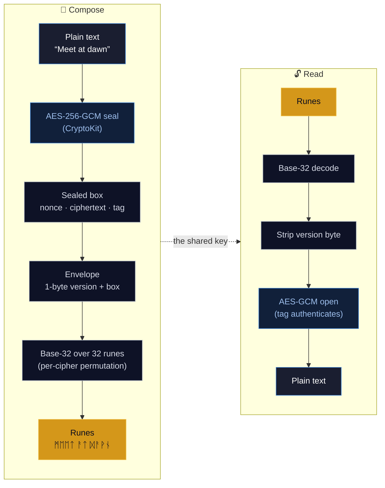
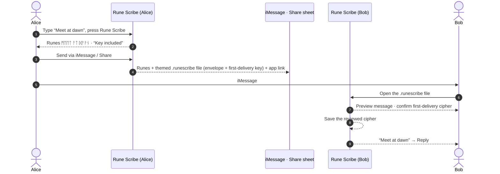
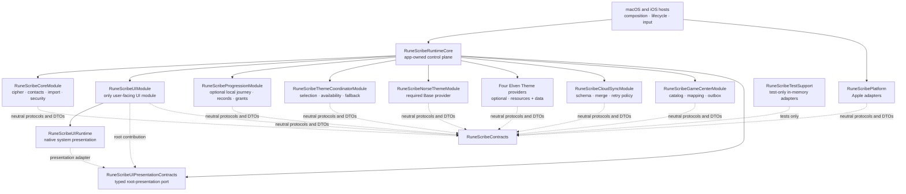

<div align="center">

# ᚱᚢᚾᛖ ᛋᚲᚱᛁᛒᛖ &nbsp;·&nbsp; Rune Scribe

**Encrypt a message, wear it as Norse runes, and share it anywhere.**

A private, on-device encrypted-messaging app for **macOS** and **iOS**. Type a
message and Rune Scribe seals it with **AES-256-GCM** and renders the ciphertext
as a string of Unicode runes. Send a friend your cipher — by QR, iMessage, link,
or file — and they can read it; without it, the runes are just runes.


A product of **Raven Forge Software**.

</div>

---

## ✨ Features

- **🔐 Real encryption, runic skin** — every message is sealed with **AES-256-GCM**
  (authenticated encryption) under a shared key, then rendered as Norse runes for
  the journey. The runes are a reversible, cosmetic costume; the security is the
  key. A wrong key doesn't garble the text — it simply refuses to open.
- **📚 Cipher library** — keep **multiple labelled ciphers**, each its own 256-bit
  key. Pick the active one, switch any time, and create, rename, export, import,
  link to a contact, or delete them.
- **👥 Contacts & per-contact ciphers** — organise ciphers by person. Import from
  Apple Contacts (or add by hand); each imported contact is auto-assigned its own
  fresh cipher, so every conversation has its own key.
- **💬 Send over iMessage & Share** — encode a message and send it straight through
  **iMessage** (iOS) or the **system Share sheet** (both platforms). The runes ride
  in the bubble; a themed `.runescribe` file carries the sealed message and bounded
  appearance metadata. On the **first** eligible message to a contact it also carries
  the cipher key. Later themed messages keep the file and never resend the key; Copy
  Runes remains the compact compatibility action.
- **🤝 Share a cipher safely** — the primary **Share** action sends a validated themed
  **`.runescribe` Artifact**; **Customize Share** chooses its Codex appearance. Explicit
  Export, offline `runescribe://import` link, and QR actions remain available as
  fallbacks. Each invitation carries the same validated key. No server or Universal Link
  is involved.
- **🔒 App lock** — an optional **4-digit PIN** gates the app on launch and when it
  returns from the background. The PIN is never stored: a salted
  **PBKDF2-HMAC-SHA256** hash lives in the Keychain, and repeated wrong guesses
  trigger an escalating lockout that survives relaunch.
- **🪄 Living transformation** — pressing **Rune Scribe** inscribes the text in
  place, rune by rune, each glyph flaring as it lands. No popups, no spinners —
  the text frame itself transforms.
- **🎨 Five distinct Codices, one shared interface** — a provider-neutral SwiftUI
  composition system renders the required Norse Base Codex and optional Moonleaf,
  Sunspire, Wildwood, and Gloamthorn resource-and-data providers. Each provider supplies
  its own background, Script, Relics, Seals, Frame/Crest, panel chrome, Vault states,
  and accessibility/static-share treatments; runtime-owned progression controls
  availability and selection.
- **🏆 Local Journey** — optional Achievements, Codex gates, and the Vault/Progress
  view stay on-device. Unlock reveals are queued accessibly, and encode/decode
  still work if Progression is unavailable.
- **☁️ Optional progression services** — private iCloud mirroring is local-first and
  carries progression records only. Game Center is an optional trophy-case mirror;
  it never grants or revokes Rune Scribe ownership, and decline/offline states leave
  the local app fully usable. Saved opt-in permits one bounded authentication attempt
  on a later launch, while failed reports remain in the durable outbox.
- **🎬 Cold-launch intro** — a short, skippable Raven Forge splash video plays on
  first open and at most once every **30 days** thereafter (tap anywhere or **Skip**),
  bypassed automatically if the video asset isn't bundled.

---

## 🔮 How a message becomes runes

Rune Scribe is **encrypt-then-encode**. The security lives entirely in the
AES-256-GCM layer; the runes are a reversible base-32 rendering on top, carrying no
secrecy of their own.



**The pipeline, exactly:**

1. **Seal** — `plaintext → AES.GCM.seal` produces a combined sealed box:
   **12-byte nonce ‖ ciphertext ‖ 16-byte authentication tag**. A fresh random
   nonce is used every time.
2. **Frame** — `MessageEnvelope.wrap` prepends a single **version byte** (`0x01`).
   No key identifier is stored.
3. **Encode** — `RuneCodec` turns those bytes into runes with **base-32**
   (5 bits per rune, RFC 4648 bit order, no padding) over a fixed **32-rune
   alphabet** (`U+16A0–U+16BF`, core Elder Futhark — chosen for broad system-font
   coverage). Each cipher applies its own private **decorative permutation** of the
   32 glyphs, so the *same* message under two ciphers looks different — purely
   cosmetically.

Reading reverses each step. Because the AEAD tag authenticates the key, a wrong or
tampered message **fails to open** rather than returning garbage — the receiver
simply tries each cipher it holds until exactly one succeeds.

> **The runes are not the secret.** They're a faithful, reversible rendering of an
> encrypted envelope — anyone can decode the runes back to bytes, but those bytes
> stay sealed without the 256-bit key. Guard the key, not the runes.

---

## 🤝 Sharing a cipher

A cipher is the shared secret: whoever holds it can read — and write — your runes.
Rune Scribe provides one primary typed-Artifact path plus explicit compatibility
fallbacks. Every path funnels through the **same validated import rail** and works
without a Rune Scribe server.

- **Primary Share / Customize Share.** **Cipher Library → Share** prepares a themed,
  typed `.runescribe` Artifact and opens the system share sheet. **Customize Share**
  opens the provider-neutral Share Builder first, with a fixed warning that the
  invitation contains the shared cipher. The Artifact carries validated presentation,
  safe-preview, provenance, and optional legacy-font sections without exposing key bytes
  to UI state.
- **Link / QR fallbacks.** A cipher is packed into a compact **129-byte record**
  (version, an 8-byte public ID, the 32-byte key, the 32-glyph permutation, the font
  reference, and a SHA-256 checksum) carried as base64url inside an offline
  `runescribe://import` deep link. **More → Share Link** sends that link, while **More →
  Show QR** renders it as a QR code. The recipient taps or scans it to open Rune Scribe's
  confirmation flow.
- **Explicit Export.** **More → Export File** saves a portable typed `.runescribe`
  invitation through the platform file exporter. Import from **Cipher Library →
  Import**, or open the file with Rune Scribe. Exact legacy decoder files remain
  readable.

Every channel — primary Artifact, Share Builder Artifact, exported file, link, QR, or a
pasted `runescribe://` link — is validated on
arrival. Legacy records must retain their exact version, length, true 0–31 permutation,
and checksum. Typed packages additionally enforce canonical sections, byte/count/image
bounds, hashes, and required versions before allocation or rendering. The in-app **QR
scanner is iOS-only**; on macOS you import via the file or a pasted link.

Themed presentation is resolved against the installed provider's artifact and resource
inventory before rendering. Unknown selections or resource metadata/digest drift use
the Base Norse fallback without changing admission or decryption of a valid Core payload.

> **Import note.** Cipher material is never saved merely because a message opens.
> A first-delivery attachment presents the normal cipher confirmation sheet on both
> platforms. On macOS, use **Cipher Library → Import**, open the `.runescribe` file,
> or paste a `runescribe://` import link.

> **Guard the cipher.** A shared QR image or `.runescribe` file carries the actual
> **256-bit key** — anyone who has it can read your runes, so hand it over privately
> and don't post it publicly.

---

## 💬 Sending a message

Encode a message and Rune Scribe makes sending the obvious next step — **Send via
iMessage** (iOS) or **Share** (both platforms). On the **first** message to a contact,
what goes out is:

1. **The runes, as plain text** — what a human sees in the bubble. Meaningless without
   the key, so they leak nothing.
2. **A themed `.runescribe` file attachment** carrying the **sealed envelope**, sender
   display name, chosen Codex/Relic/Seal/Frame IDs, bounded static preview, and
   provenance state — and, on this first message (when the cipher is linked to the
   contact and hasn't been delivered yet), the **cipher key** itself. The compose screen
   says which: **“Key included”** vs **“Uses your shared key.”**
3. **A plain “get the app” link** to the Rune Scribe page, for a recipient who doesn't
   have the app yet.

Every **later themed** message keeps the `.runescribe` attachment but carries **no
key** and no product link. The recipient already holds the cipher. **Copy Runes** is
the deliberate runes-only compatibility action. No Universal Links or Rune Scribe
message server is involved.



**Recipient with the app** opens the `.runescribe` attachment. Rune Scribe can preview
the plaintext with an embedded first-delivery key, but labels the claimed sender as
unverified and keeps the key transient. The recipient must review and confirm the
cipher before it is saved or **Reply** becomes available. A later message authenticates
with that locally stored cipher and displays the local cipher name; its mutable wire
sender label cannot create a contact or rebind a relationship. **Recipient without the
app** taps the plain "get the app" link to the Rune Scribe page. Rotating a key is
manual: make a new cipher for that contact, and its next message re-embeds the new key
for explicit confirmation.

Both platforms use the same confirmation boundary. See [Platform notes](docs/platform-notes.md)
for the supported intake paths.

> The wire formats are pinned by tests: `CipherSharePayloadTests` and
> `MessageSharePayloadTests` (encode, decode, round-trip, embedded-key,
> version/checksum rejection), `FileRouterTests` (typed-container magic and legacy
> version-byte classification), and `MessageServiceTests` / `MessageCoordinatorTests`
> (bounded try-all decryption + explicit first-delivery confirmation).

---

## 🏛 Architecture

Rune Scribe is a SwiftUI + Metal application split across compile-time package
boundaries. Cryptography, keys, messages, contacts, and the authoritative local Vault
remain on-device. Optional private CloudKit and Game Center traffic is isolated behind
runtime-owned adapters and never carries message or key material.



The macOS and iOS hosts are composition roots. Product behavior lives in
`RuneScribeCoreModule`; exactly one UI Module owns the SwiftUI view tree.
`RuneScribeRuntimeCore` is the continuing app-owned composition and lifecycle control
plane, while `RuneScribePlatform` and `RuneScribeUIRuntime` contain the Apple-system
adapters. Compile-time boundaries, typed contracts, and the executable 17-ratchet
architecture guard prohibit implementation import edges, external Forsetti code, and
TestSupport in shipping products.

The stricter P11 Forsetti scanner remains report-only and is not represented as a
compliance pass. It tracks further per-call mediation and ownership hardening as
architecture backlog; the product-release bar remains the concrete regression, source,
mutation, Release-build, asset, privacy, and built-product gates.

The current application targets link Contracts, Runtime Core, UI Runtime, Platform,
Core, Progression, Theme Coordinator, Norse Base, four Elven providers, Cloud policy,
Game Center policy, and the sole UI Module. Norse remains the required fallback;
optional provider, Progression, cloud, and Game Center failures cannot block cipher
workflows. An external Forsetti package, binary, source copy, fetch, or local checkout
is permanently prohibited.

See [Module Graph](docs/architecture/ModuleGraph.md),
[Contracts and Capabilities](docs/architecture/ContractsAndCapabilities.md), and
[Roadmap Alignment](docs/architecture/RoadmapAlignment.md) for current status and
retained historical evidence. The
[controlling Forsetti policy](docs/architecture/FORSETTI_CONTROLLING_POLICY.md) defines
the current boundary and dependency rules.

---

## 🗺 Implementation roadmap

The previously authorized version 1.0.39 build 39 roadmap-completion baseline remains a
historical source-complete snapshot that was not shipped. Version 1.0.41 build 41 is the
current UI/Xcode remediation candidate. Its source-bound qualification, device matrix,
visual evidence, and known limits are recorded in the
[UI/Xcode remediation qualification](docs/verification/ui-xcode-remediation/QualificationSummary.md).
Version 1.0.40 build 40 remains a retained historical repository-qualification record:
that source passed 1,238/1,238 Swift tests, 255/255 Python tests, 60 Norse semantic rules,
25/25 Norse mutations, 18/18 legacy mutations, 28/28 shipping negative mutations,
27/27 evidence-hardening tests, and 101/101 local built-product checks. Those historical
results are not relabeled as source-bound evidence for 1.0.41. The current candidate is
**not shipped**. The earlier signed 1.0.41 archives predate the subsequently merged
theme, Universal Link, tutorial, and workspace changes. Fresh iOS and macOS archive and
export qualification is required for the current source before upload; validation,
upload, submission, release, and rollout remain owner-operated publication work.

| Wave | Scope | Source status |
|---|---|---|
| 0A–1B | Baseline, app-owned runtime, domain compatibility, typed package | Complete |
| 2 | Semantic Theme system and required Norse Base | Complete |
| 3 | Local Progression, Vault, grants, migration, recovery | Complete |
| 4 | Themed Artifact sharing, receiving, Encounters, provenance | Complete |
| 5A | Local-first private iCloud progression synchronization | Complete; live provisioning is a separate external-service action |
| 5B | Optional Game Center catalog, mapping, outbox, status | Complete; live records and sandbox access are separate external-service actions |
| 6 | Production Elven providers, hardening, evidence, no-ship handoff | Merged source candidate; fresh Store qualification required; not shipped |
| 7 | Limited/singular collectible program | Deferred separate program |

The corrected Elven v3.1 corpus (56 logical resources and 184 shipping outputs) remains
the accepted historical Phase C baseline. The v4.3 continuation updates production
resources and evidence without rewriting that record. The superseded v4.3 package audit
is retained under [`docs/verification`](docs/verification/theme-fidelity-v4-3/) as
noncontrolling history. Its manual-evidence and self-binding mechanics do not determine
product release readiness.

The controlling automated release bar is narrower and product-focused: core user flows,
clean tests, iPhone/iPad/macOS Release builds, deterministic UI smoke coverage,
accessibility/privacy/security checks, signing and entitlements, and no known
release-blocking defects. Manual hardware observations and package self-binding
bookkeeping are superseded and nonblocking. The repository-controlled final-source gates
and supported UI runs pass with no known release-blocking defects. The repository's
`scripts/qualify-app-store-archives.sh` gate also creates and inspects fresh iOS and
Mac App Store exports without uploading them. App Store Connect validation, upload,
submission, and rollout remain owner-operated publication work.

All nine Elven Series recovery findings pass simultaneously. Recovery is PASS / CLOSED,
the corrected v3.1 package is ACCEPTED, and Phase C is PASS / MERGED TO MAIN via PR #45 at
`e9e0e0c8814aaa107d7480e070f14a6fe9b09975`. Phase D provider targets, live entitlement
binding, themed transport, Cloud/Game Center policy, and Wave 6 source hardening are
implemented after that baseline without rewriting it.

The machine-readable [roadmap ledger](docs/verification/roadmap-alignment.json) covers
124 tasks. `BAS-006`, `SHR-001`, and `SHR-015` are the only
`simulator-replacement-complete` rows; `REL-011` is `non-gating-external` and cannot
denote rollout or shipment. `BAS-005` is not applicable because no approved scrubbed
real-user fixture was supplied. External-device and live-service work from the historical
baseline is recorded in the
[no-ship owner handoff](docs/verification/roadmap-completion/OwnerTestAndNoShipHandoff.md).
Current signed archive/export evidence and the remaining upload boundary are recorded in
the [UI/Xcode remediation qualification](docs/verification/ui-xcode-remediation/QualificationSummary.md).

Current architecture and dependency authority lives in the
[controlling Forsetti policy](docs/architecture/FORSETTI_CONTROLLING_POLICY.md),
[supersession index](docs/architecture/ForsettiSupersessionIndex.md),
[roadmap status ledger](docs/verification/roadmap-alignment.json), and nonconflicting
[architecture decisions](docs/architecture/decisions/README.md). The hash-locked
[Codex System Specification](docs/product-roadmap/Rune-Scribe-Codex-System-Spec-v1.0.md)
and [implementation roadmap](docs/product-roadmap/Rune-Scribe-Codex-Current-App-Delta-and-Implementation-Roadmap-v1.0.md)
remain authority for nonconflicting product requirements, compatibility anchors, and
historical sequencing. The separate
[Roadmap Remediation Amendment v1.1](docs/product-roadmap/Rune-Scribe-Codex-Roadmap-Remediation-Amendment-v1.1.md)
records the controlling app-owned, Simulator, external-account, release-candidate, and
nonshipment variances; the former external-framework direction is superseded.

---

## 🔐 Security & privacy

- **Real authenticated encryption.** Messages are sealed with **AES-256-GCM**
  (CryptoKit) under a per-cipher 256-bit key. A fresh random nonce is used per
  message, and the GCM tag authenticates both key and contents — a wrong key or any
  tampering makes decryption **fail**, never silently mis-decode.
- **Local security authority.** Encrypting, decrypting, key storage, contacts, full
  messages, package bytes, and unlock grants remain local. Rune Scribe has no message
  server or proprietary account. Optional private CloudKit sync carries only bounded
  progression facts, and optional Game Center receives monotonic trophy progress.
- **Keys at rest.** Each cipher's key lives inside the cipher library, which is
  itself **AES-256-GCM encrypted** with a symmetric key held in the **Data Protection Keychain**
  (`WhenUnlockedThisDeviceOnly`, no iCloud sync). Contacts are encrypted with the
  same key and written to an on-disk file (with complete file protection on iOS).
  Existing Keychain items are updated in place, so a failed replacement cannot erase
  the previous cipher library, PIN, or persisted lockout state. On macOS, an older
  file-based item may be copied only from the current classic default keychain after the
  Data Protection replacement and accessibility class are verified. The source item is
  never deleted, including when an imported or restored keychain has become the default.
  Explicit deletion records a this-device-only blocker so retained legacy data cannot
  silently reappear later.
- **Local sharing surfaces.** Sending a cipher or message hands a link, QR, or file
  to the OS share sheet; Rune Scribe does not operate a message relay. Inbound links and
  scanned QR codes are validated entirely on-device (correct version, length,
  permutation, checksum) and a cipher never imports without your **one-tap
  confirmation** — and your PIN first, if App Lock is on. iOS QR scanning uses the
  camera only to read the code; frames are processed on-device and never saved or
  sent.
- **Cloud field allowlist.** Private sync rejects plaintext, cipher/key material,
  messages, package bytes, contact identity, raw relationship identifiers, QR content,
  and private logs. Invalid remote records are quarantined without deleting valid
  local Progression. Cloud and Game Center can never grant or revoke ownership.
- **The PIN is never stored.** Only a random 16-byte salt and a
  **PBKDF2-HMAC-SHA256** derivation (120,000 iterations) are kept in the Keychain,
  compared in constant time. A persistent, escalating lockout (15s → 30s → 60s →
  120s → 300s after five wrong guesses) blunts brute-force attempts even across
  relaunches.
- **Declared platform access.** Both app bundles include the same privacy manifest:
  tracking is disabled, no developer-collected data is declared, and file-timestamp
  access is limited to protected app-container files and files the user chooses to
  import.
- **Honest scope.** Rune Scribe is a personal-privacy tool: strong, standard
  encryption with a **manual, peer-to-peer key hand-off** and a fun Norse aesthetic.
  It is *not* a vetted secure messenger — there's no forward secrecy, no server-side
  verification, and no protection once a key is shared. A cipher — `.runescribe` file,
  QR image, or link — **is** the key; guard it accordingly and don't post it publicly.

See the source-controlled [Privacy Policy](docs/PRIVACY.md) and
[Support guide](docs/SUPPORT.md) for the optional Apple-service fields, user controls,
fallback behavior, and current compatibility boundary.

---

## 🧱 Project structure

```
RuneScrib/
├── AppHost/      SwiftUI entry, delegates, composition, lifecycle and input forwarding
├── Metal/        Shipping Metal shader
└── Resources/    Assets, privacy manifest, Noto Sans Runic font, splash video and licenses
Packages/RuneScribeArchitecture/
├── Sources/
│   ├── RuneScribeContracts/      Neutral IDs, DTOs and service protocols
│   ├── RuneScribeRuntimeCore/    App-owned runtime and mediation control plane
│   ├── RuneScribeUIPresentationContracts/ Typed root-presentation contracts
│   ├── RuneScribeUIRuntime/      Native system-presentation boundary
│   ├── RuneScribePlatform/       Keychain, files, Contacts, fonts and system adapters
│   ├── RuneScribeCoreModule/     Domain, crypto, persistence, import and app lock
│   ├── RuneScribeProgressionModule/ Local achievements, grants, migration and recovery
│   ├── RuneScribeThemeCoordinatorModule/ Runtime Theme selection, fallback and diagnostics
│   ├── RuneScribeNorseThemeModule/ Required Norse Base provider and verified resources
│   ├── RuneScribeTheme*Module/    Four optional production Elven providers
│   ├── RuneScribeCloudSyncModule/ Private progression schema and merge policy
│   ├── RuneScribeGameCenterModule/ Frozen catalog, mapping and outbox policy
│   ├── RuneScribeUIModule/       SwiftUI product views, state projection and navigation
│   └── RuneScribeTestSupport/    In-memory adapters; never linked into shipping apps
└── Tests/                        1242 Swift package tests
RuneScribTests/                   Hosted macOS composition and compatibility tests
RuneScribIOSTests/                Hosted iOS routing, migration and presentation tests
RuneScribIOSUITests/              iPhone/iPad product parity tests
RuneScribMacParityTests/          Isolated macOS product parity tests
RuneScribArchitectureTests/       Repository architecture guard
docs/                             Architecture, verification and locked product roadmap
scripts/                          Architecture and built-product qualification guards
```

The Xcode project is generated from `project.yml` with
[XcodeGen](https://github.com/yonsm/XcodeGen) — `project.yml` is the source of
truth; regenerate with `xcodegen generate`.

---

## 🛠 Building

Open `RuneScrib.xcodeproj` in Xcode 26 or later, then select the
`RuneScrib-macOS` application scheme for Mac or `RuneScrib-iOS` for an iPhone/iPad
Simulator. `project.yml` remains the generation source of truth.

```bash
# Regenerate the Xcode project from project.yml
xcodegen generate

# Fast, password-free package and architecture checks
scripts/check-architecture.sh
swift test --package-path Packages/RuneScribeArchitecture

# Build & test macOS with ad-hoc signing
xcodebuild -project RuneScrib.xcodeproj -scheme RuneScrib-macOS \
  -configuration Debug -destination 'platform=macOS,arch=arm64' \
  CODE_SIGN_STYLE=Manual CODE_SIGN_IDENTITY=- DEVELOPMENT_TEAM= test

# Build (iOS simulator)
xcodebuild -project RuneScrib.xcodeproj -scheme RuneScrib-iOS \
  -configuration Debug -destination 'generic/platform=iOS Simulator' \
  CODE_SIGN_STYLE=Manual CODE_SIGN_IDENTITY=- DEVELOPMENT_TEAM= build

# Reproduce both local Release builds and the 101-check product inspection
scripts/qualify-release-products.sh

# Create and inspect fresh iOS and Mac App Store exports without uploading
scripts/qualify-app-store-archives.sh
```

Two app targets — **RuneScrib-macOS** (macOS 15) and **RuneScrib-iOS** (iOS 17) —
share the thin host sources and link the same local package products, built in **Swift
6** language mode. The macOS target ships with App Sandbox + Hardened Runtime enabled
for Mac App Store distribution. Debug and Simulator qualification use ad-hoc signing so
automated checks do not require a login-Keychain password.
The Release-product qualifier retains its logs and local app bundles under a unique
temporary evidence directory. The separate App Store qualifier retains signed archives,
exports, entitlements, profiles, signature reports, and hashes; it does not validate or
upload through App Store Connect.

Both targets register the **`runescribe://`** URL scheme and a single exported
**`com.runescribe.runescribe`** document type — the `.runescribe` cipher/message file,
disambiguated by typed-container magic or its legacy leading version byte — and declare
Contacts and (iOS) camera usage strings. The iOS target also declares
**`applinks:ravenforgesoftware.com`** so cipher invitations can open the app through a
Universal Link after the website publishes the matching association document.
Those Info.plist keys and entitlements — and the bundled splash video — are configured
in `project.yml` and `Config/`, the source of truth.

---

## ✅ Testing

The local Swift package passes **1242 package tests** (1105 XCTest cases and
137 Swift Testing cases), supplemented by repository architecture guards, hosted
macOS/iOS tests, iPhone/iPad UI parity, and an
isolated macOS parity host. The package suite uses deterministic in-memory adapters and
does not access the operator's login Keychain.

| Suite | What it covers |
|---|---|
| Runtime and architecture | Manifest validation, capability denial, optional isolation, durable outbox/migration handoff, factory lifecycle, exactly one UI Module, dependency and shipping-product guards |
| Core domain | AES-GCM, rune codec, ciphers, encrypted repositories, contacts, imports, fonts, PIN lock, privacy-safe progression evidence and share lifetime |
| Compatibility | Exact cipher v3/message v1 fixtures, encrypted existing-install fixtures, links, routes and no-rewrite migration |
| Progression | Exact catalog/rule boundaries, atomic grants, deduplication, scalable migration, quarantine, rebuild, catalog upgrade and fault injection |
| Theme | Versioned contracts, coordinator selection/fallback, all five production providers, resource identity/budgets/provenance, canonical wrappers, responsive probes, static-share parity, and fallback/failure isolation |
| UI Module | Session projection, sensitive-state cleanup, routing, attachment policy, sharing, Vault snapshots and durable accessible reveals |
| Platform adapters | Keychain contract, protected files and SQLite state, scoped inbound reads, Contacts, fonts, resources, feedback, clipboard and share artifacts |
| Hosted and parity tests | Composition, isolated Simulator Keychain migration, native share outcomes, accessibility, iPhone/iPad and macOS product flows |

Direct-device observations are superseded by repository-controlled Simulator, hosted,
and deterministic equivalents and are not pending release gates. The
legacy package's larger visual-evidence and self-binding matrix remains noncontrolling.
Named final-source, mutation, and built-product guards pass. Retained prior iPhone 17 Pro
headless UI run passes 7 tests with 1 iPad-only skip and 0 failures. The iPad Pro 13-inch (M5)
headless UI run on iOS 26.5 passes 5 tests with 3 phone-specific skips by design and 0
failures. Those UI runs are not represented as current-candidate source-bound evidence.
Earlier signed Store archive/export qualification passed for the source measured at
that time. Those artifacts predate later merged changes and do not qualify the current
source; fresh archive/export qualification is required before upload. App Store Connect
validation, upload, submission, and publication remain external. Every result stays
labeled by the environment in which it was observed.

---

## 📜 License

Rune Scribe is **proprietary** software, licensed (not sold) under the
[End-User License Agreement](EULA.md). The bundled *Noto Sans Runic* font is used
under the SIL Open Font License. © Raven Forge Software. All rights reserved.

---

## 📖 Documentation

Detailed guides, architecture deep-dives, and diagrams live in the
**[project wiki](https://github.com/flynn33/rune-scribe/wiki)** and the tracked
[`docs`](docs) directory. Start with [Roadmap Alignment](docs/architecture/RoadmapAlignment.md)
for the current implementation boundary and dependencies. Elven Series status is in
the [resolution ledger](docs/verification/ElvenSeriesBlockingResolutionLedger.md),
[recovery state](docs/verification/elven-recovery-v3/RecoveryState.json), and
[recovery final audit](docs/verification/elven-recovery-v3/RecoveryFinalAudit.md), and
[Phase C final audit](docs/verification/elven-phase-c/PhaseCFinalAudit.md).
Run `scripts/check-documentation-alignment.py` to verify release versions, roadmap
status, recovery authority, and publication policy together.

<div align="center">

**ᚱᚨᚹᛖᚾ ᚠᛟᚱᚷᛖ ᛋᛟᚠᛏᚹᚨᚱᛖ** · [ravenforgesoftware.com](https://ravenforgesoftware.com)

</div>
