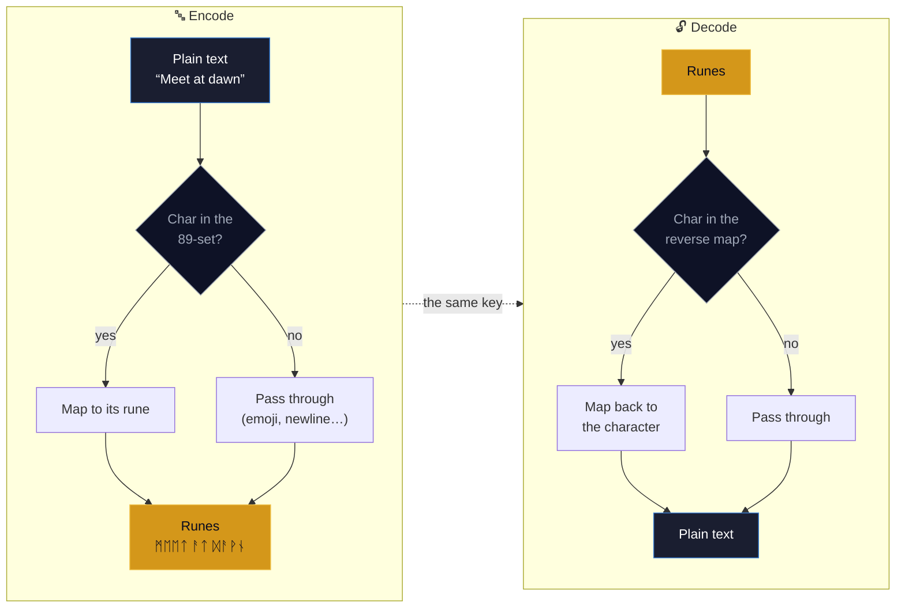
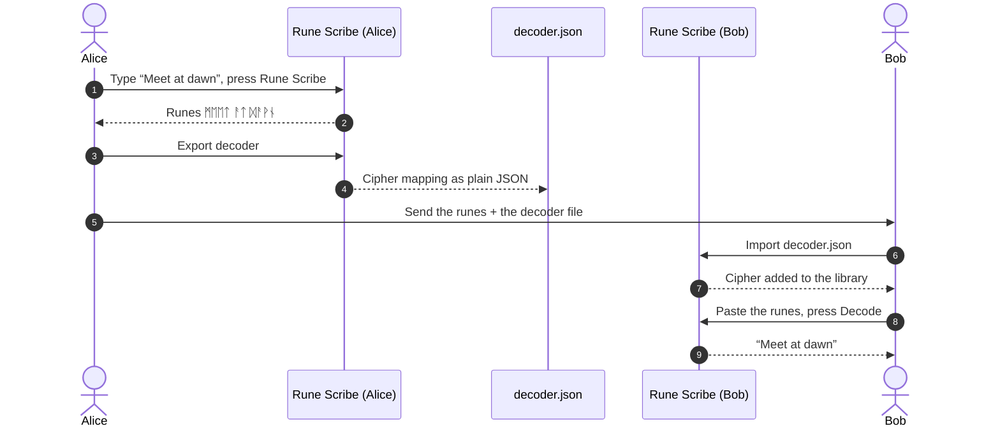
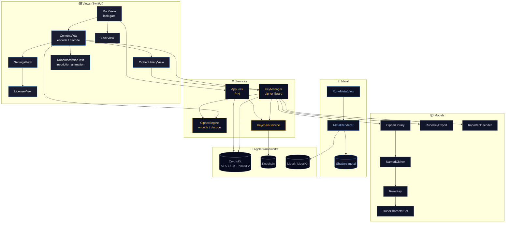

<div align="center">

# ᚱᚢᚾᛖ ᛋᚲᚱᛁᛒᛖ &nbsp;·&nbsp; Rune Scribe

**Turn your words into Norse runes — and back again.**

A private, on-device substitution-cipher app for **macOS** and **iOS**. Type a
message, watch each character inscribe itself into a unique Unicode rune, and
share the result anywhere. Hand a friend your decoder file and they can read it;
without it, the runes are just runes.


A product of **Raven Forge Software**.

</div>

---

## ✨ Features

- **🔤 Encode & decode** — map an 89-character set (A–Z, a–z, 0–9, space, common
  punctuation) onto the Unicode Runic block (U+16A0–U+16F8). Anything else
  (newlines, emoji, accents, other scripts) passes through untouched.
- **📚 Cipher library** — keep **multiple labelled cipher/decipher pairs**. Each
  one both encodes and decodes; pick the active pair and switch any time. Create,
  rename, export, import, and delete them.
- **🤝 Share to decode** — export a cipher as a single `.json` decoder file. A
  friend imports it and can read your runes. The decoder is plain JSON of the
  mapping — it isn't tied to your device — so it works across installs.
- **🔒 App lock** — an optional **4-digit PIN** gates the app on launch and when
  it returns from the background. The PIN is never stored: a salted
  **PBKDF2-HMAC-SHA256** hash lives in the Keychain, and repeated wrong guesses
  trigger an escalating lockout.
- **🪄 Living transformation** — pressing **Rune Scribe** inscribes the text in
  place, rune by rune, each glyph flaring as it lands. No popups, no spinners —
  the text frame itself transforms.
- **🎨 Crafted interface** — a Metal-rendered Norse background, a bundled
  **Noto Sans Runic** font so every rune renders sharply, and one cohesive design
  system across both platforms.

---

## 🔮 How the cipher works

The cipher is a **random bijection** (a one-to-one pairing) from the 89 input
characters onto 89 runes. The pairing — the *key* — is generated on first launch
with a cryptographically secure shuffle, encrypted with **AES-256-GCM**, and
stored in the system **Keychain**. Encoding looks up each character; decoding uses
the exact inverse.



Because the cipher's *output* alphabet is the runic block, the only text that
won't survive a round trip is a message that *itself* contains literal rune
characters — which no real message does. Everything people actually type (Latin
text, numbers, punctuation, emoji, accents, other scripts) round-trips exactly.

---

## 🤝 Sharing & decoding — the friend-to-friend flow

The exported decoder is plain JSON of the mapping, **not** anything tied to your
device's keychain or encryption key. That's what lets a friend on a completely
separate install read your message.



> This exact path is locked down by `FriendDecodeRoundTripTests` — 700+ random
> key/message round trips, plus emoji, accents, other scripts, multi-line text,
> and the full character set.

---

## 🏛 Architecture

Rune Scribe is SwiftUI + Metal, organised into clear layers. All cryptography and
storage happen on-device; nothing is sent anywhere.



---

## 🔐 Security & privacy

- **On-device only.** Encoding, decoding, and key storage all happen locally.
  Rune Scribe has no servers, no accounts, and no network calls.
- **Keys at rest.** Each cipher mapping is **AES-256-GCM** encrypted with a
  symmetric key that lives in the Keychain and never leaves the device.
- **The PIN is never stored.** Only a random salt and a **PBKDF2-HMAC-SHA256**
  derivation are kept (in the Keychain), compared in constant time. A persistent,
  escalating lockout blunts brute-force attempts.
- **Honest scope.** Rune Scribe is a personal-privacy and obfuscation tool with a
  fun Norse aesthetic — not a guaranteed-secure messenger. The decoder file is
  plaintext by design (so friends can read it); guard it like a key.

---

## 🧱 Project structure

```
RuneScrib/
├── App/          RuneScribApp (entry), AppDelegate (font registration)
├── Models/       RuneKey, NamedCipher, CipherLibrary, RuneCharacterSet,
│                 RuneKeyExport, ImportedDecoder, AppLicense
├── Services/     KeyManager, AppLock, KeychainService, CipherEngine,
│                 Clipboard, FontRegistration
├── Views/        RootView, ContentView, CipherLibraryView, SettingsView,
│                 LockView, PINFlowView, LicenseView
│   └── Components/  RuneTheme, RuneInscriptionText, PINPadView,
│                    RuneScribButtonStyle, DecoderDocument
├── Metal/        RuneMetalView, MetalRenderer, Shaders.metal
└── Resources/    Assets, Noto Sans Runic font
RuneScribTests/   58 unit tests (cipher, library, PIN, friend round-trip)
```

The Xcode project is generated from `project.yml` with
[XcodeGen](https://github.com/yonsm/XcodeGen) — `project.yml` is the source of
truth; regenerate with `xcodegen generate`.

---

## 🛠 Building

Requires Xcode 26+ on macOS.

```bash
# Regenerate the Xcode project from project.yml
xcodegen generate

# Build & test (macOS)
xcodebuild -project RuneScrib.xcodeproj -scheme RuneScrib-macOS \
  -destination 'platform=macOS' test

# Build (iOS simulator)
xcodebuild -project RuneScrib.xcodeproj -scheme RuneScrib-iOS \
  -destination 'generic/platform=iOS Simulator' build
```

Two app targets — **RuneScrib-macOS** and **RuneScrib-iOS** — share one source
tree behind `#if os(macOS)` / `#if os(iOS)` splits. The macOS target ships with
App Sandbox + Hardened Runtime enabled for Mac App Store distribution.

---

## ✅ Testing

**58 unit tests**, including a dedicated cross-person suite that proves the most
important promise — that a friend can decode your message on a different device:

| Suite | What it covers |
|---|---|
| `RuneScribTests` | character set, key generation, the cipher engine, exports |
| `CipherLibraryTests` | the cipher library model, mutations, legacy migration |
| `AppLockTests` | PIN format validation |
| `DecoderImportTests` | export → import → decode round trips |
| `FriendDecodeRoundTripTests` | full Alice → file → Bob flow, 700+ combinations |

---

## 📜 License

Rune Scribe is **proprietary** software, licensed (not sold) under the
[End-User License Agreement](EULA.md). The bundled *Noto Sans Runic* font is used
under the SIL Open Font License. © Raven Forge Software. All rights reserved.

---

## 📖 Documentation

Detailed guides, architecture deep-dives, and diagrams live in the
**[project wiki](https://github.com/flynn33/rune-scribe/wiki)**.

<div align="center">

**ᚱᚨᚹᛖᚾ ᚠᛟᚱᚷᛖ ᛋᛟᚠᛏᚹᚨᚱᛖ** · [ravenforgesoftware.com](https://ravenforgesoftware.com)

</div>
