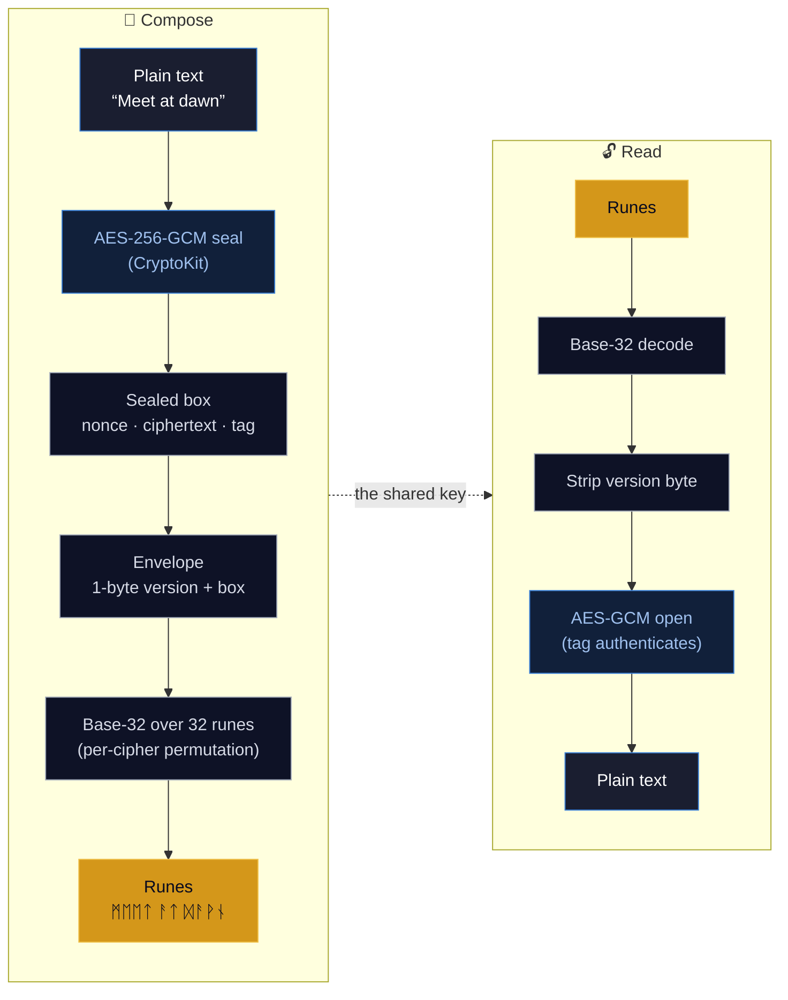
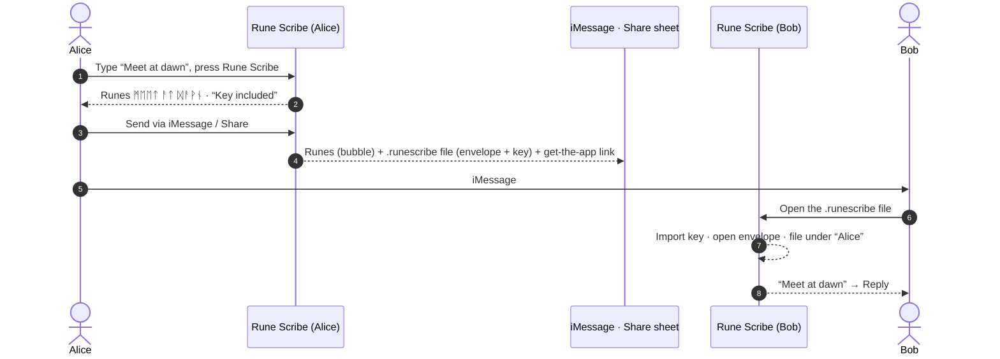
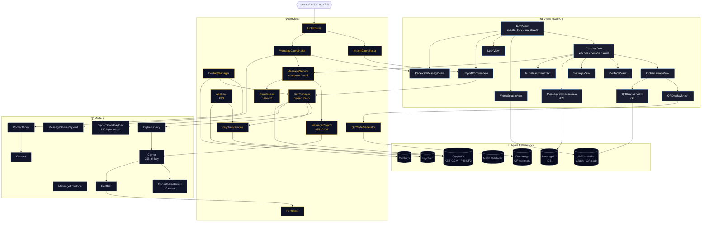

<div align="center">

# ᚱᚢᚾᛖ ᛋᚲᚱᛁᛒᛖ &nbsp;·&nbsp; Rune Scribe

**Encrypt a message, wear it as Norse runes, and share it anywhere.**

A private, on-device encrypted-messaging app for **macOS** and **iOS**. Type a
message and Rune Scribe seals it with **AES-256-GCM** and renders the ciphertext
as a string of Unicode runes. Send a friend your cipher — by QR, iMessage, link,
or file — and they can read it; without it, the runes are just runes.


A product of **Raven Forge Software**.

</div>

---

## ✨ Features

- **🔐 Real encryption, runic skin** — every message is sealed with **AES-256-GCM**
  (authenticated encryption) under a shared key, then rendered as Norse runes for
  the journey. The runes are a reversible, cosmetic costume; the security is the
  key. A wrong key doesn't garble the text — it simply refuses to open.
- **📚 Cipher library** — keep **multiple labelled ciphers**, each its own 256-bit
  key. Pick the active one, switch any time, and create, rename, export, import,
  link to a contact, or delete them.
- **👥 Contacts & per-contact ciphers** — organise ciphers by person. Import from
  Apple Contacts (or add by hand); each imported contact is auto-assigned its own
  fresh cipher, so every conversation has its own key.
- **💬 Send over iMessage & Share** — encode a message and send it straight through
  **iMessage** (iOS) or the **system Share sheet** (both platforms). The runes ride
  in the bubble; on the **first** message to a contact a `.runescribe` file carries the
  sealed message and the cipher key, so the recipient reads it with one tap and never
  sees a key-exchange step. Every later message is runes only — they already hold the key.
- **🤝 Share a cipher, two ways** — hand someone a cipher by **QR code** (an offline
  `runescribe://` payload, scanned by the Camera or the in-app scanner) or as a portable
  **`.runescribe` decoder file**. Both carry the same validated key and font reference,
  aren't tied to your device, and work across installs — no server, no Universal Link.
- **🔒 App lock** — an optional **4-digit PIN** gates the app on launch and when it
  returns from the background. The PIN is never stored: a salted
  **PBKDF2-HMAC-SHA256** hash lives in the Keychain, and repeated wrong guesses
  trigger an escalating lockout that survives relaunch.
- **🪄 Living transformation** — pressing **Rune Scribe** inscribes the text in
  place, rune by rune, each glyph flaring as it lands. No popups, no spinners —
  the text frame itself transforms.
- **🎨 Crafted interface** — a Metal-rendered Norse background, a bundled
  **Noto Sans Runic** font so every rune renders sharply, and one cohesive design
  system across both platforms.
- **🎬 Cold-launch intro** — a short, skippable Raven Forge splash video plays on
  first open (tap anywhere or **Skip**), bypassed automatically if the video asset
  isn't bundled.

---

## 🔮 How a message becomes runes

Rune Scribe is **encrypt-then-encode**. The security lives entirely in the
AES-256-GCM layer; the runes are a reversible base-32 rendering on top, carrying no
secrecy of their own.



**The pipeline, exactly:**

1. **Seal** — `plaintext → AES.GCM.seal` produces a combined sealed box:
   **12-byte nonce ‖ ciphertext ‖ 16-byte authentication tag**. A fresh random
   nonce is used every time.
2. **Frame** — `MessageEnvelope.wrap` prepends a single **version byte** (`0x01`).
   No key identifier is stored.
3. **Encode** — `RuneCodec` turns those bytes into runes with **base-32**
   (5 bits per rune, RFC 4648 bit order, no padding) over a fixed **32-rune
   alphabet** (`U+16A0–U+16BF`, core Elder Futhark — chosen for broad system-font
   coverage). Each cipher applies its own private **decorative permutation** of the
   32 glyphs, so the *same* message under two ciphers looks different — purely
   cosmetically.

Reading reverses each step. Because the AEAD tag authenticates the key, a wrong or
tampered message **fails to open** rather than returning garbage — the receiver
simply tries each cipher it holds until exactly one succeeds.

> **The runes are not the secret.** They're a faithful, reversible rendering of an
> encrypted envelope — anyone can decode the runes back to bytes, but those bytes
> stay sealed without the 256-bit key. Guard the key, not the runes.

---

## 🤝 Sharing a cipher

A cipher is the shared secret: whoever holds it can read — and write — your runes.
Rune Scribe gives two ways to hand one to a friend, both funnelling through the
**same validated import path**, and both fully offline.

- **QR code.** A cipher is packed into a compact **129-byte record** (version, an
  8-byte public ID, the 32-byte key, the 32-glyph permutation, the font reference, and
  a SHA-256 checksum) carried as base64url inside an offline `runescribe://import`
  link and rendered as a QR code. Point another iPhone's Camera — or Rune Scribe's
  in-app scanner — at it and Rune Scribe offers a **one-tap import**; you name it and
  it's saved. Nothing leaves your devices: no server, no Universal Link.
- **Decoder file.** A portable `.runescribe` package (the same 129-byte record) written
  via the system Share sheet / file exporter and imported from **Cipher Library →
  Import** or by tapping the received file. It additionally carries the **font bytes**,
  so a recipient who lacks the bundled font still renders the runes correctly. Not tied
  to your device, so it works across installs.

Every channel — QR, file, or a pasted `runescribe://` link — is validated on arrival:
the record must be the right version and length, a true 0–31 permutation, and pass its
checksum, or the import is rejected with a friendly message. The in-app **QR scanner is
iOS-only**; on macOS you import via the file or a pasted link.

> **macOS note.** Automatic cipher import from Messages is not supported on Mac.
> On macOS, import a received cipher manually from **Cipher Library → Import**, by
> opening the `.runescribe` file, or by pasting a `runescribe://` import link.

> **Guard the cipher.** A shared QR image or `.runescribe` file carries the actual
> **256-bit key** — anyone who has it can read your runes, so hand it over privately
> and don't post it publicly.

---

## 💬 Sending a message

Encode a message and Rune Scribe makes sending the obvious next step — **Send via
iMessage** (iOS) or **Share** (both platforms). On the **first** message to a contact,
what goes out is:

1. **The runes, as plain text** — what a human sees in the bubble. Meaningless without
   the key, so they leak nothing.
2. **A `.runescribe` file attachment** carrying the **sealed envelope** and the
   sender's display name — and, on this first message (when the cipher is linked to the
   contact and hasn't been delivered yet), the **cipher key** itself, so the recipient
   decodes instantly. The compose screen says which: **“Key included”** vs **“Uses your
   shared key.”**
3. **A plain “get the app” link** to the Rune Scribe page, for a recipient who doesn't
   have the app yet.

Every **later** message to that contact is **runes only** — no file, no key, no link.
The recipient already holds the cipher and reads the runes directly. No Universal
Links, no server.



**Recipient with the app** opens the `.runescribe` attachment: Rune Scribe imports the
embedded key (if present), opens the envelope by trying its ciphers (the AEAD tag picks
exactly one), shows the decrypted message in a sheet, and **auto-files the cipher under
a contact** named after the sender — then offers **Reply**. **Recipient without the
app** taps the plain "get the app" link to the Rune Scribe page. Rotating a key is
manual: make a new cipher for that contact, and its next message re-embeds the new key,
which the other side auto-imports.

Automatic cipher import from Messages is an iOS flow. macOS users can still exchange
the same `.runescribe` cipher files, but must import them manually before using the
new key. See [Platform notes](docs/platform-notes.md) for the supported import paths.

> The wire formats are pinned by tests: `CipherSharePayloadTests` and
> `MessageSharePayloadTests` (encode, decode, round-trip, embedded-key,
> version/checksum rejection), `FileRouterTests` (cipher-vs-message classification by
> the leading version byte), and `MessageServiceTests` / `MessageCoordinatorTests`
> (try-all decryption + contact auto-association).

---

## 🏛 Architecture

Rune Scribe is SwiftUI + Metal, organised into clear layers. All cryptography and
storage happen on-device; the app itself makes **no network calls**.



---

## 🔐 Security & privacy

- **Real authenticated encryption.** Messages are sealed with **AES-256-GCM**
  (CryptoKit) under a per-cipher 256-bit key. A fresh random nonce is used per
  message, and the GCM tag authenticates both key and contents — a wrong key or any
  tampering makes decryption **fail**, never silently mis-decode.
- **On-device only.** Encrypting, decrypting, and key storage all happen locally.
  Rune Scribe has no servers, no accounts, and makes no network calls.
- **Keys at rest.** Each cipher's key lives inside the cipher library, which is
  itself **AES-256-GCM encrypted** with a symmetric key held in the **Keychain**
  (`WhenUnlockedThisDeviceOnly`, no iCloud sync). Contacts are encrypted with the
  same key and written to an on-disk file (with complete file protection on iOS).
- **Local sharing surfaces.** Sending a cipher or message hands a link, QR, or file
  to the OS share sheet — the app still makes no network calls. Inbound links and
  scanned QR codes are validated entirely on-device (correct version, length,
  permutation, checksum) and a cipher never imports without your **one-tap
  confirmation** — and your PIN first, if App Lock is on. iOS QR scanning uses the
  camera only to read the code; frames are processed on-device and never saved or
  sent.
- **The PIN is never stored.** Only a random 16-byte salt and a
  **PBKDF2-HMAC-SHA256** derivation (120,000 iterations) are kept in the Keychain,
  compared in constant time. A persistent, escalating lockout (15s → 30s → 60s →
  120s → 300s after five wrong guesses) blunts brute-force attempts even across
  relaunches.
- **Honest scope.** Rune Scribe is a personal-privacy tool: strong, standard
  encryption with a **manual, peer-to-peer key hand-off** and a fun Norse aesthetic.
  It is *not* a vetted secure messenger — there's no forward secrecy, no server-side
  verification, and no protection once a key is shared. A cipher — `.runescribe` file,
  QR image, or link — **is** the key; guard it accordingly and don't post it publicly.

---

## 🧱 Project structure

```
RuneScrib/
├── App/          RuneScribApp (entry · link routing), AppDelegate
├── Models/       Cipher, CipherLibrary, Contact, ContactBook, MessageEnvelope,
│                 CipherSharePayload, MessageSharePayload, FontRef,
│                 RuneCharacterSet, AppLicense
├── Services/     KeyManager, ContactManager/Importer/Store, AppLock,
│                 MessageService, MessageCryptor, MessageSend, RuneCodec,
│                 KeychainService, FontStore, LinkRouter,
│                 ImportCoordinator, MessageCoordinator, QRCodeGenerator, Clipboard
├── Views/        RootView, ContentView, CipherLibraryView, ContactsView,
│                 ReceivedMessageView, ImportConfirmView, SettingsView,
│                 LockView, PINFlowView, LicenseView, QRDisplaySheet
│   └── Components/  RuneTheme, RuneInscriptionText, PINPadView, QRScannerView,
│                    VideoSplashView, MessageComposeView, RuneScribButtonStyle,
│                    DecoderDocument
├── Metal/        RuneMetalView, MetalRenderer, Shaders.metal
└── Resources/    Assets, Noto Sans Runic font, raven-forge-spp-splash.mp4
RuneScribTests/   126 unit tests (encryption, codec, library, contacts, PIN,
                  share payloads, file/link routing, message intake)
```

The Xcode project is generated from `project.yml` with
[XcodeGen](https://github.com/yonsm/XcodeGen) — `project.yml` is the source of
truth; regenerate with `xcodegen generate`.

---

## 🛠 Building

Requires Xcode 26+ on macOS.

```bash
# Regenerate the Xcode project from project.yml
xcodegen generate

# Build & test (macOS)
xcodebuild -project RuneScrib.xcodeproj -scheme RuneScrib-macOS \
  -destination 'platform=macOS' test

# Build (iOS simulator)
xcodebuild -project RuneScrib.xcodeproj -scheme RuneScrib-iOS \
  -destination 'generic/platform=iOS Simulator' build
```

Two app targets — **RuneScrib-macOS** (macOS 15) and **RuneScrib-iOS** (iOS 17) —
share one source tree behind `#if os(macOS)` / `#if os(iOS)` splits, built in
**Swift 6** language mode. The macOS target ships with App Sandbox + Hardened Runtime
enabled for Mac App Store distribution.

Both targets register the **`runescribe://`** URL scheme and a single exported
**`com.runescribe.runescribe`** document type — the `.runescribe` cipher/message file,
disambiguated by its leading version byte — and declare Contacts and (iOS) camera usage
strings. Sharing is fully offline: there are no associated domains or Universal Links.
Those Info.plist keys and entitlements — and the bundled splash video — are configured
in `project.yml` and `Config/`, the source of truth.

---

## ✅ Testing

**126 unit tests** (XCTest), run as a macOS unit-test bundle. The suite proves the
load-bearing promises end to end — that a sealed message round-trips, that a friend
can decrypt yours, and that every wire format rejects corruption:

| Suite | What it covers |
|---|---|
| `MessageCryptorTests` | AES-GCM seal/open, wrong-key and tamper rejection |
| `MessageEnvelopeTests` | the 1-byte version frame, bad-version rejection |
| `RuneCodecTests` | base-32 encode/decode, foreign-glyph and length errors |
| `MessageServiceTests` | compose → read round trips, try-all decryption |
| `CipherTests` · `CipherLibraryTests` | the cipher model, library mutations, migration |
| `CipherSharePayloadTests` | the 129-byte cipher record — encode, decode, checksum |
| `MessageSharePayloadTests` | the message wire format + embedded key |
| `LinkRouterTests` · `FileRouterTests` | cipher-link routing · cipher-vs-message file classification |
| `MessageCoordinatorTests` · `KeyManagerLinkTests` | intake, contact auto-association |
| `Contact*Tests` (book, store, manager, importer) | contacts model, encrypted store, import |
| `FontRefTests` · `FontStoreTests` | font reference, hash-verified font import |
| `AppLockTests` | PIN format validation |

---

## 📜 License

Rune Scribe is **proprietary** software, licensed (not sold) under the
[End-User License Agreement](EULA.md). The bundled *Noto Sans Runic* font is used
under the SIL Open Font License. © Raven Forge Software. All rights reserved.

---

## 📖 Documentation

Detailed guides, architecture deep-dives, and diagrams live in the
**[project wiki](https://github.com/flynn33/rune-scribe/wiki)**.

<div align="center">

**ᚱᚨᚹᛖᚾ ᚠᛟᚱᚷᛖ ᛋᛟᚠᛏᚹᚨᚱᛖ** · [ravenforgesoftware.com](https://ravenforgesoftware.com)

</div>
