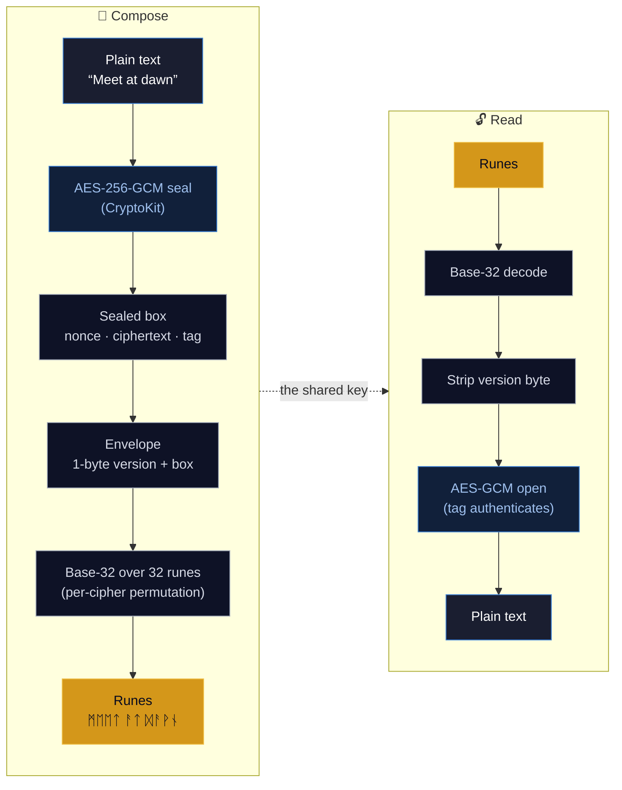
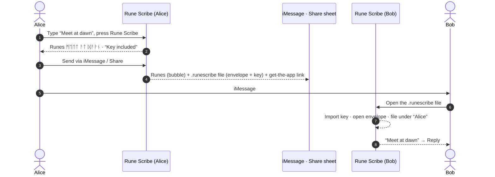
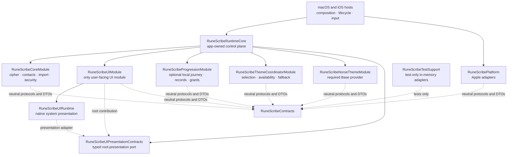

<div align="center">

# ᚱᚢᚾᛖ ᛋᚲᚱᛁᛒᛖ &nbsp;·&nbsp; Rune Scribe

**Encrypt a message, wear it as Norse runes, and share it anywhere.**

A private, on-device encrypted-messaging app for **macOS** and **iOS**. Type a
message and Rune Scribe seals it with **AES-256-GCM** and renders the ciphertext
as a string of Unicode runes. Send a friend your cipher — by QR, iMessage, link,
or file — and they can read it; without it, the runes are just runes.


A product of **Raven Forge Software**.

</div>

---

## ✨ Features

- **🔐 Real encryption, runic skin** — every message is sealed with **AES-256-GCM**
  (authenticated encryption) under a shared key, then rendered as Norse runes for
  the journey. The runes are a reversible, cosmetic costume; the security is the
  key. A wrong key doesn't garble the text — it simply refuses to open.
- **📚 Cipher library** — keep **multiple labelled ciphers**, each its own 256-bit
  key. Pick the active one, switch any time, and create, rename, export, import,
  link to a contact, or delete them.
- **👥 Contacts & per-contact ciphers** — organise ciphers by person. Import from
  Apple Contacts (or add by hand); each imported contact is auto-assigned its own
  fresh cipher, so every conversation has its own key.
- **💬 Send over iMessage & Share** — encode a message and send it straight through
  **iMessage** (iOS) or the **system Share sheet** (both platforms). The runes ride
  in the bubble; on the **first** message to a contact a `.runescribe` file carries the
  sealed message and the cipher key, so the recipient reads it with one tap and never
  sees a key-exchange step. Every later message is runes only — they already hold the key.
- **🤝 Share a cipher, two ways** — hand someone a cipher by **Share** / **QR** (an offline
  `runescribe://import` deep link the recipient taps to open the app and import) or as a
  portable **`.runescribe` decoder file** from Export. Both carry the same validated key;
  the file also carries font bytes. No server, no Universal Link.
- **🔒 App lock** — an optional **4-digit PIN** gates the app on launch and when it
  returns from the background. The PIN is never stored: a salted
  **PBKDF2-HMAC-SHA256** hash lives in the Keychain, and repeated wrong guesses
  trigger an escalating lockout that survives relaunch.
- **🪄 Living transformation** — pressing **Rune Scribe** inscribes the text in
  place, rune by rune, each glyph flaring as it lands. No popups, no spinners —
  the text frame itself transforms.
- **🎨 Crafted interface** — a Metal-rendered Norse background, a bundled
  **Noto Sans Runic** font so every rune renders sharply, and one cohesive design
  system across both platforms. Appearance is now driven by the runtime Theme
  coordinator and the required Norse Base provider; production Elven series
  providers are not shipped.
- **🏆 Local Journey** — optional Achievements, Codex gates, and the Vault/Progress
  view stay on-device. Unlock reveals are queued accessibly, and encode/decode
  still work if Progression is unavailable.
- **🎬 Cold-launch intro** — a short, skippable Raven Forge splash video plays on
  first open and at most once every **30 days** thereafter (tap anywhere or **Skip**),
  bypassed automatically if the video asset isn't bundled.

---

## 🔮 How a message becomes runes

Rune Scribe is **encrypt-then-encode**. The security lives entirely in the
AES-256-GCM layer; the runes are a reversible base-32 rendering on top, carrying no
secrecy of their own.



**The pipeline, exactly:**

1. **Seal** — `plaintext → AES.GCM.seal` produces a combined sealed box:
   **12-byte nonce ‖ ciphertext ‖ 16-byte authentication tag**. A fresh random
   nonce is used every time.
2. **Frame** — `MessageEnvelope.wrap` prepends a single **version byte** (`0x01`).
   No key identifier is stored.
3. **Encode** — `RuneCodec` turns those bytes into runes with **base-32**
   (5 bits per rune, RFC 4648 bit order, no padding) over a fixed **32-rune
   alphabet** (`U+16A0–U+16BF`, core Elder Futhark — chosen for broad system-font
   coverage). Each cipher applies its own private **decorative permutation** of the
   32 glyphs, so the *same* message under two ciphers looks different — purely
   cosmetically.

Reading reverses each step. Because the AEAD tag authenticates the key, a wrong or
tampered message **fails to open** rather than returning garbage — the receiver
simply tries each cipher it holds until exactly one succeeds.

> **The runes are not the secret.** They're a faithful, reversible rendering of an
> encrypted envelope — anyone can decode the runes back to bytes, but those bytes
> stay sealed without the 256-bit key. Guard the key, not the runes.

---

## 🤝 Sharing a cipher

A cipher is the shared secret: whoever holds it can read — and write — your runes.
Rune Scribe gives two ways to hand one to a friend, both funnelling through the
**same validated import path**, and both fully offline.

- **Share link / QR code.** A cipher is packed into a compact **129-byte record**
  (version, an 8-byte public ID, the 32-byte key, the 32-glyph permutation, the font
  reference, and a SHA-256 checksum) carried as base64url inside an offline
  `runescribe://import` deep link. **Cipher Library → Share** sends that link through
  the system share sheet (Messages, Mail, Notes, …); the same link is also rendered as
  a **QR code**. The recipient taps the link (or scans the QR with Camera / the in-app
  scanner) and Rune Scribe opens with a **one-tap import**. Nothing leaves your devices:
  no server, no Universal Link.
- **Decoder file.** A portable `.runescribe` package (the same 129-byte record plus
  optional **font bytes**) from **Cipher Library → Export** (or the file exporter).
  Import from **Cipher Library → Import**, or open the file with Rune Scribe. Use this
  when you need the font bytes to travel with the key; message attachments still use
  `.runescribe` files for first-message key delivery.

Every channel — Share link, QR, file, or a pasted `runescribe://` link — is validated on arrival:
the record must be the right version and length, a true 0–31 permutation, and pass its
checksum, or the import is rejected with a friendly message. The in-app **QR scanner is
iOS-only**; on macOS you import via the file or a pasted link.

> **macOS note.** Automatic cipher import from Messages is not supported on Mac.
> On macOS, import a received cipher manually from **Cipher Library → Import**, by
> opening the `.runescribe` file, or by pasting a `runescribe://` import link.

> **Guard the cipher.** A shared QR image or `.runescribe` file carries the actual
> **256-bit key** — anyone who has it can read your runes, so hand it over privately
> and don't post it publicly.

---

## 💬 Sending a message

Encode a message and Rune Scribe makes sending the obvious next step — **Send via
iMessage** (iOS) or **Share** (both platforms). On the **first** message to a contact,
what goes out is:

1. **The runes, as plain text** — what a human sees in the bubble. Meaningless without
   the key, so they leak nothing.
2. **A `.runescribe` file attachment** carrying the **sealed envelope** and the
   sender's display name — and, on this first message (when the cipher is linked to the
   contact and hasn't been delivered yet), the **cipher key** itself, so the recipient
   decodes instantly. The compose screen says which: **“Key included”** vs **“Uses your
   shared key.”**
3. **A plain “get the app” link** to the Rune Scribe page, for a recipient who doesn't
   have the app yet.

Every **later** message to that contact is **runes only** — no file, no key, no link.
The recipient already holds the cipher and reads the runes directly. No Universal
Links, no server.



**Recipient with the app** opens the `.runescribe` attachment: Rune Scribe imports the
embedded key (if present), opens the envelope by trying its ciphers (the AEAD tag picks
exactly one), shows the decrypted message in a sheet, and **auto-files the cipher under
a contact** named after the sender — then offers **Reply**. **Recipient without the
app** taps the plain "get the app" link to the Rune Scribe page. Rotating a key is
manual: make a new cipher for that contact, and its next message re-embeds the new key,
which the other side auto-imports.

Automatic cipher import from Messages is an iOS flow. macOS users can still exchange
the same `.runescribe` cipher files, but must import them manually before using the
new key. See [Platform notes](docs/platform-notes.md) for the supported import paths.

> The wire formats are pinned by tests: `CipherSharePayloadTests` and
> `MessageSharePayloadTests` (encode, decode, round-trip, embedded-key,
> version/checksum rejection), `FileRouterTests` (cipher-vs-message classification by
> the leading version byte), and `MessageServiceTests` / `MessageCoordinatorTests`
> (try-all decryption + contact auto-association).

---

## 🏛 Architecture

Rune Scribe is a SwiftUI + Metal application split across compile-time package
boundaries. All cryptography and storage happen on-device; the current shipping app
makes **no network calls**.



The macOS and iOS hosts are composition roots. Product behavior lives in
`RuneScribeCoreModule`; exactly one UI Module owns the SwiftUI view tree. The controlling
target makes `RuneScribeRuntimeCore` the continuing app-owned control plane: every
cross-module call remains runtime-mediated, and the runtime owns operational I/O,
persistent Settings, lifecycle, resources, and system-presentation sessions.
`RuneScribeUIRuntime` contains the narrow Apple presentation bridges, while the UI
module retains product views and normalized state only. Runtime modules do not import
one another, and test support is excluded from shipping products.

The current applications link nine shipping package products: Contracts, Runtime
Core, UI Runtime, Platform, Core Module, Progression Module, Theme Coordinator, Norse
Base Theme, and the sole UI Module. Optional Progression failure falls back without
blocking cipher workflows, and the Norse Base provider remains required. No production
Elven provider target is linked into either application.

The current source is being remediated to that target. Existing provider-object,
platform-I/O, Settings, and lifecycle deviations are tracked explicitly and are not
treated as compliant merely because the compile-time package graph is modular. An
external Forsetti package, binary, source copy, fetch, or local checkout is permanently
prohibited.

See [Module Graph](docs/architecture/ModuleGraph.md),
[Contracts and Capabilities](docs/architecture/ContractsAndCapabilities.md), and
[Roadmap Alignment](docs/architecture/RoadmapAlignment.md) for historical evidence. The
[controlling Forsetti policy](docs/architecture/FORSETTI_CONTROLLING_POLICY.md) defines
the current boundary and dependency rules.

---

## 🗺 Implementation roadmap

The remediation program is intentionally incremental: every phase must preserve the
shipping cipher workflows while tightening one architectural boundary. The current
repository status is:

| Phase | Scope | Status |
| --- | --- | --- |
| P00 | Worktree protection, evidence capture, and clean final baseline | Complete (controls remain continuous) |
| P01 | Controlling policy, supersession rules, and report-only compliance guard | Complete |
| P02 | Per-call runtime command, query, state, and ingress spine | Complete |
| P03 | UI and host migration to runtime clients | Complete |
| P04 | Runtime-owned I/O and system-presentation gateways | Active |
| P05 | Runtime settings, metadata, and opaque operational handles | Planned |
| P06 | Uniform module contracts, policy classes, and generated catalog | Planned |
| P07 | State, contribution, resource, and diagnostics registries | Planned |
| P08 | Live-gate reconciliation and optional-failure isolation | Planned |
| P09 | Theme-module readiness scaffold and sole-UI rendering | Complete |
| P10 | Typed durable event and coordination rail | Planned |
| P11 | Permanent compliance guards, negative mutations, and CI | Planned |
| P12 | Full Xcode, parity, device, final audit, and handoff | Planned |

P04 has landed the runtime I/O gateway, normalized inbound-file delivery, opaque
resource and share leases, the metatype-only module factory, and typed root
presentation. Its remaining phase closure work is tracked by the report-only FG-007
finding. FG-016 remains open across the later resource, theme, and permanent-guard
phases; neither finding is treated as a pass simply because the package and focused
tests build successfully.

### Product roadmap

The locked roadmap evolves Rune Scribe in deliberately separated stages:

1. Preserve current behavior and compatibility fixtures.
2. Complete the app-owned Forsetti control plane and retain exactly one UI Module.
3. Separate cipher material from Script presentation and add a typed `.runescribe`
   container while keeping legacy readers.
4. Prove one semantic UI scaffold with the Base Codex and two placeholder providers.
5. Add deterministic local progression, Vault, Archive, achievements, and unlocks.
6. Add themed Quick Share, Share Builder, and Encounter handling.
7. Add private iCloud progression sync and optional Game Center reporting.
8. Replace placeholders with reviewed production themes.

The repository now includes the behavior-preserving modular foundation, the optional
local Progression Module, and the Phase A/B Theme scaffold: approved Achievements,
Codex gates, the Vault/Progress view, durable unlock reveals, privacy-safe
existing-user migration, the runtime Theme coordinator, and the required Norse Base
provider. Production Elven series providers, cloud synchronization, and Game Center
remain disabled. All nine Elven Series recovery findings pass simultaneously. The
corrected v3.1 production package contains 56 logical resources and 184 shipping
outputs with complete provenance and deterministic-regeneration evidence.
Phase C is complete and ready for Phase D. Phase D has not started, and no production
Elven provider target has been added to the shipping app. Later Theme and sharing work also
remains gated by the local runtime, compatibility, and physical-device program; there
is no external-framework prerequisite.

Current architecture and dependency authority lives in the
[controlling Forsetti policy](docs/architecture/FORSETTI_CONTROLLING_POLICY.md),
[supersession index](docs/architecture/ForsettiSupersessionIndex.md),
[roadmap status ledger](docs/verification/roadmap-alignment.json), and nonconflicting
[architecture decisions](docs/architecture/decisions/README.md). The hash-locked
[Codex System Specification](docs/product-roadmap/Rune-Scribe-Codex-System-Spec-v1.0.md)
and [implementation roadmap](docs/product-roadmap/Rune-Scribe-Codex-Current-App-Delta-and-Implementation-Roadmap-v1.0.md)
remain authoritative only for nonconflicting product requirements, compatibility
anchors, and sequencing evidence; their external-framework direction is superseded.

---

## 🔐 Security & privacy

- **Real authenticated encryption.** Messages are sealed with **AES-256-GCM**
  (CryptoKit) under a per-cipher 256-bit key. A fresh random nonce is used per
  message, and the GCM tag authenticates both key and contents — a wrong key or any
  tampering makes decryption **fail**, never silently mis-decode.
- **On-device only.** Encrypting, decrypting, and key storage all happen locally.
  Rune Scribe has no servers, no accounts, and makes no network calls.
- **Keys at rest.** Each cipher's key lives inside the cipher library, which is
  itself **AES-256-GCM encrypted** with a symmetric key held in the **Keychain**
  (`WhenUnlockedThisDeviceOnly`, no iCloud sync). Contacts are encrypted with the
  same key and written to an on-disk file (with complete file protection on iOS).
- **Local sharing surfaces.** Sending a cipher or message hands a link, QR, or file
  to the OS share sheet — the app still makes no network calls. Inbound links and
  scanned QR codes are validated entirely on-device (correct version, length,
  permutation, checksum) and a cipher never imports without your **one-tap
  confirmation** — and your PIN first, if App Lock is on. iOS QR scanning uses the
  camera only to read the code; frames are processed on-device and never saved or
  sent.
- **The PIN is never stored.** Only a random 16-byte salt and a
  **PBKDF2-HMAC-SHA256** derivation (120,000 iterations) are kept in the Keychain,
  compared in constant time. A persistent, escalating lockout (15s → 30s → 60s →
  120s → 300s after five wrong guesses) blunts brute-force attempts even across
  relaunches.
- **Honest scope.** Rune Scribe is a personal-privacy tool: strong, standard
  encryption with a **manual, peer-to-peer key hand-off** and a fun Norse aesthetic.
  It is *not* a vetted secure messenger — there's no forward secrecy, no server-side
  verification, and no protection once a key is shared. A cipher — `.runescribe` file,
  QR image, or link — **is** the key; guard it accordingly and don't post it publicly.

---

## 🧱 Project structure

```
RuneScrib/
├── AppHost/      SwiftUI entry, delegates, composition, lifecycle and input forwarding
├── Metal/        Shipping Metal shader
└── Resources/    Assets, Noto Sans Runic font, splash video and licenses
Packages/RuneScribeArchitecture/
├── Sources/
│   ├── RuneScribeContracts/      Neutral IDs, DTOs and service protocols
│   ├── RuneScribeRuntimeCore/    App-owned runtime and mediation control plane
│   ├── RuneScribeUIPresentationContracts/ Typed root-presentation contracts
│   ├── RuneScribeUIRuntime/      Native system-presentation boundary
│   ├── RuneScribePlatform/       Keychain, files, Contacts, fonts and system adapters
│   ├── RuneScribeCoreModule/     Domain, crypto, persistence, import and app lock
│   ├── RuneScribeProgressionModule/ Local achievements, grants, migration and recovery
│   ├── RuneScribeThemeCoordinatorModule/ Runtime Theme selection, fallback and diagnostics
│   ├── RuneScribeNorseThemeModule/ Required Norse Base provider and verified resources
│   ├── RuneScribeUIModule/       SwiftUI product views, state projection and navigation
│   └── RuneScribeTestSupport/    In-memory adapters; never linked into shipping apps
└── Tests/                        826 Swift package tests
RuneScribTests/                   Hosted macOS composition and compatibility tests
RuneScribIOSTests/                Hosted iOS routing, migration and presentation tests
RuneScribIOSUITests/              iPhone/iPad product parity tests
RuneScribMacParityTests/          Isolated macOS product parity tests
RuneScribArchitectureTests/       Repository architecture guard
docs/                             Architecture, verification and locked product roadmap
scripts/                          Architecture and built-product qualification guards
```

The Xcode project is generated from `project.yml` with
[XcodeGen](https://github.com/yonsm/XcodeGen) — `project.yml` is the source of
truth; regenerate with `xcodegen generate`.

---

## 🛠 Building

Requires Xcode 26+ on macOS.

```bash
# Regenerate the Xcode project from project.yml
xcodegen generate

# Fast, password-free package and architecture checks
scripts/check-architecture.sh
swift test --package-path Packages/RuneScribeArchitecture

# Build & test macOS with ad-hoc signing
xcodebuild -project RuneScrib.xcodeproj -scheme RuneScrib-macOS \
  -configuration Debug -destination 'platform=macOS,arch=arm64' \
  CODE_SIGN_STYLE=Manual CODE_SIGN_IDENTITY=- DEVELOPMENT_TEAM= test

# Build (iOS simulator)
xcodebuild -project RuneScrib.xcodeproj -scheme RuneScrib-iOS \
  -configuration Debug -destination 'generic/platform=iOS Simulator' \
  CODE_SIGN_STYLE=Manual CODE_SIGN_IDENTITY=- DEVELOPMENT_TEAM= build
```

Two app targets — **RuneScrib-macOS** (macOS 15) and **RuneScrib-iOS** (iOS 17) —
share the thin host sources and link the same local package products, built in **Swift
6** language mode. The macOS target ships with App Sandbox + Hardened Runtime enabled
for Mac App Store distribution. Debug and Simulator qualification use ad-hoc signing so
automated checks do not require a login-Keychain password.

Both targets register the **`runescribe://`** URL scheme and a single exported
**`com.runescribe.runescribe`** document type — the `.runescribe` cipher/message file,
disambiguated by its leading version byte — and declare Contacts and (iOS) camera usage
strings. Sharing is fully offline: there are no associated domains or Universal Links.
Those Info.plist keys and entitlements — and the bundled splash video — are configured
in `project.yml` and `Config/`, the source of truth.

---

## ✅ Testing

The local Swift package currently contains **826 package tests** (737 XCTest cases and
89 Swift Testing cases), supplemented by repository architecture guards, hosted
macOS/iOS tests, iPhone/iPad UI parity, and an
isolated macOS parity host. The package suite uses deterministic in-memory adapters and
does not access the operator's login Keychain.

| Suite | What it covers |
|---|---|
| Runtime and architecture | Manifest validation, capability denial, optional isolation, durable outbox/migration handoff, factory lifecycle, exactly one UI Module, dependency and shipping-product guards |
| Core domain | AES-GCM, rune codec, ciphers, encrypted repositories, contacts, imports, fonts, PIN lock, privacy-safe progression evidence and share lifetime |
| Compatibility | Exact cipher v3/message v1 fixtures, encrypted existing-install fixtures, links, routes and no-rewrite migration |
| Progression | Exact catalog/rule boundaries, atomic grants, deduplication, scalable migration, quarantine, rebuild, catalog upgrade and fault injection |
| Theme | Versioned contracts, coordinator selection/fallback, Norse Base resources, and synthetic provider conformance |
| UI Module | Session projection, sensitive-state cleanup, routing, attachment policy, sharing, Vault snapshots and durable accessible reveals |
| Platform adapters | Keychain contract, protected files and SQLite state, scoped inbound reads, Contacts, fonts, resources, feedback, clipboard and share artifacts |
| Hosted and parity tests | Composition, isolated Simulator Keychain migration, native share outcomes, accessibility, iPhone/iPad and macOS product flows |

Some behaviors can only be release-qualified on physical hardware. The retained device
matrix covers Contacts permission, inbound file handoff, QR generation/scanning,
MessageUI, system sharing, and background locking; Simulator coverage is not presented
as a substitute for those gates.

---

## 📜 License

Rune Scribe is **proprietary** software, licensed (not sold) under the
[End-User License Agreement](EULA.md). The bundled *Noto Sans Runic* font is used
under the SIL Open Font License. © Raven Forge Software. All rights reserved.

---

## 📖 Documentation

Detailed guides, architecture deep-dives, and diagrams live in the
**[project wiki](https://github.com/flynn33/rune-scribe/wiki)** and the tracked
[`docs`](docs) directory. Start with [Roadmap Alignment](docs/architecture/RoadmapAlignment.md)
for the current implementation boundary and dependencies. Elven Series status is in
the [resolution ledger](docs/verification/ElvenSeriesBlockingResolutionLedger.md),
[recovery state](docs/verification/elven-recovery-v3/RecoveryState.json), and
[recovery final audit](docs/verification/elven-recovery-v3/RecoveryFinalAudit.md), and
[Phase C final audit](docs/verification/elven-phase-c/PhaseCFinalAudit.md).
Run `scripts/check-documentation-alignment.py` to verify release versions, roadmap
status, recovery authority, and publication policy together.

<div align="center">

**ᚱᚨᚹᛖᚾ ᚠᛟᚱᚷᛖ ᛋᛟᚠᛏᚹᚨᚱᛖ** · [ravenforgesoftware.com](https://ravenforgesoftware.com)

</div>
