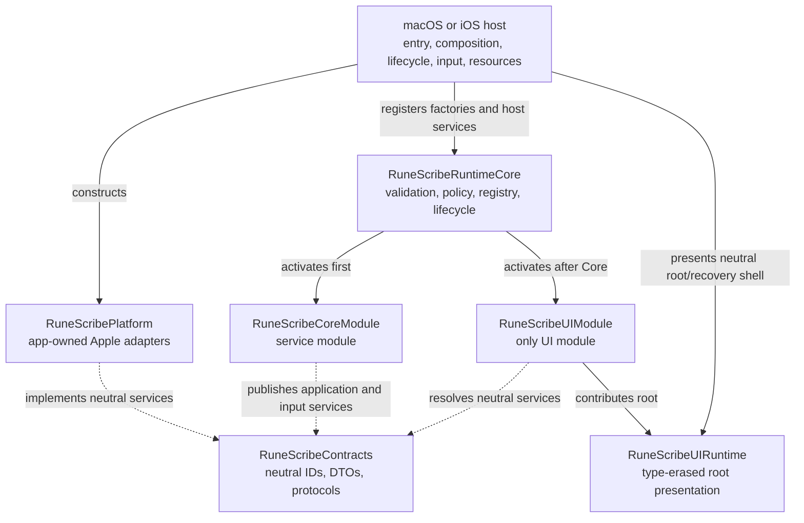

# Rune Scribe Forsetti Compliance

## Status and interpretation

> **Locked-roadmap supersession.** This report preserves the historical P8
> current-shipping-state evidence. The Codex roadmap now requires migration to official
> Forsetti released public products once the upstream gate clears. The current
> `RuneScribeRuntimeCore` and `RuneScribeUIRuntime` are transitional; the earlier
> permanent no-dependency interpretation is superseded by
> [`ADR-RS-001`](decisions/ADR-RS-001-module-packaging-and-target-graph.md).

Rune Scribe currently implements the Forsetti Pattern B policy as original, app-owned code. This report records committed cleanup snapshot `01e2fcf655a3139a856787fc96f17a58db3f3ad0`. The application has one Core service module, exactly one UI module, a runtime-mediated service boundary, app-owned Apple-platform adapters, and thin macOS and iOS hosts.

At the recorded snapshot, “Forsetti” was architecture-policy terminology rather than a
source, binary, package, submodule, build-time, or runtime dependency. The current local
package still has no external dependencies. Official Forsetti commit `f0199a4` reports
source version `0.1.5`, has no release tag, and lacks required public entitlement,
reconciliation, contribution, resource, and service APIs. Rune Scribe therefore adds no
unused dependency or private fork while Wave 0B is blocked upstream.

This architecture status is separate from release qualification. The committed verification ledgers record all automatable architecture gates as passed, while seven feature-parity cases remain explicitly classified as physical-device validation in [`feature-parity-matrix.json`](../verification/feature-parity-matrix.json). This document does not convert those external gates into a release pass.

## Pattern B implementation



The arrows above describe runtime composition. Compile-time dependencies are stricter and are documented in [`ModuleGraph.md`](ModuleGraph.md). In particular, neither module implementation imports the other, and neither imports `RuneScribePlatform`.

## Compliance result

| Policy rule | Implementation | Evidence |
|---|---|---|
| Thin hosts | The shared host sources contain entry, adapter/factory composition, runtime start/stop, typed OS-input conversion, and the neutral root shell. They contain no cipher, message, contact, font, PIN, import, navigation, or screen implementation. | [`RuneScrib/AppHost`](../../RuneScrib/AppHost), `T-014` in [`p7-test-matrix.json`](../verification/p7-test-matrix.json) |
| Exactly one active UI module | The runtime rejects zero or multiple eligible UI modules. The only shipping UI descriptor is `com.runescribe.module.ui`. | [`Runtime.swift`](../../Packages/RuneScribeArchitecture/Sources/RuneScribeRuntimeCore/Runtime.swift), [`UIModule.swift`](../../Packages/RuneScribeArchitecture/Sources/RuneScribeUIModule/UIModule.swift), `T-004` |
| Separate Core service module | `com.runescribe.module.core` owns business, persistence, security, import, and message state. It publishes neutral application and inbound-input services. | [`CoreModule.swift`](../../Packages/RuneScribeArchitecture/Sources/RuneScribeCoreModule/CoreModule.swift), `T-005` |
| No implementation-to-implementation communication | Package target dependencies and import allowlists prohibit Core/UI/Platform implementation edges. UI resolves `RuneScribeApplicationService`; Core resolves platform protocols. | [`Package.swift`](../../Packages/RuneScribeArchitecture/Package.swift), [`check-architecture.sh`](../../scripts/check-architecture.sh), `T-011` |
| Runtime-mediated service access | Every module service publish/resolve operation checks descriptor declarations, capability policy, role policy, lifecycle lease, and registered type. | [`Services.swift`](../../Packages/RuneScribeArchitecture/Sources/RuneScribeRuntimeCore/Services.swift), [`Policy.swift`](../../Packages/RuneScribeArchitecture/Sources/RuneScribeRuntimeCore/Policy.swift), `T-007` |
| Default deny | Unknown capabilities, missing mappings, undeclared services, disallowed roles, unavailable services, and inactive contexts fail with typed runtime errors. | [`ManifestValidator.swift`](../../Packages/RuneScribeArchitecture/Sources/RuneScribeRuntimeCore/ManifestValidator.swift), [`RuntimeError.swift`](../../Packages/RuneScribeArchitecture/Sources/RuneScribeRuntimeCore/RuntimeError.swift), `T-007` |
| Strict manifests | Unknown or missing fields, duplicate values, malformed identifiers, unsupported profiles, production diagnostics, incompatible versions, unsupported platforms, and descriptor mismatches are rejected. | [`ManifestDecoder.swift`](../../Packages/RuneScribeArchitecture/Sources/RuneScribeRuntimeCore/ManifestDecoder.swift), [`ManifestValidator.swift`](../../Packages/RuneScribeArchitecture/Sources/RuneScribeRuntimeCore/ManifestValidator.swift), `T-001` through `T-003` |
| Factory registration | Runtime closure invocation is lazy. Both shipping factories construct a fresh module only when invoked during activation; UI factory creation neither creates a module nor presents a root. | [`CoreModule.swift`](../../Packages/RuneScribeArchitecture/Sources/RuneScribeCoreModule/CoreModule.swift), [`UIModule.swift`](../../Packages/RuneScribeArchitecture/Sources/RuneScribeUIModule/UIModule.swift) |
| Deterministic lifecycle | Eligible modules are topologically ordered, service modules precede the UI, failed starts roll back in reverse order, stop is idempotent, and stopped contexts lose services, subscriptions, and message destinations. | [`Runtime.swift`](../../Packages/RuneScribeArchitecture/Sources/RuneScribeRuntimeCore/Runtime.swift), `T-006` and `T-009` |
| No app-owned boundary singleton | The composition root owns concrete instances; Core publishes a scoped facade; UI owns one observable session. The architecture ratchet records zero app-owned singleton declarations and zero legacy singleton references. | [`RuneScribeRuntimeComposition.swift`](../../RuneScrib/AppHost/RuneScribeRuntimeComposition.swift), [`architecture-ratchet.json`](../../scripts/architecture-ratchet.json), `T-012` |
| No cross-module `NotificationCenter` | Product coordination uses typed services and streams. The only allowed `NotificationCenter.default` calls are the add/remove pair for the local `AVPlayerItem` completion observer in `VideoSplashView`. | [`VideoSplashView.swift`](../../Packages/RuneScribeArchitecture/Sources/RuneScribeUIModule/Views/VideoSplashView.swift), [`check-architecture.sh`](../../scripts/check-architecture.sh), `T-013` |
| Secret-safe boundaries | Contracts expose key-free summaries, opaque share references, typed failure codes, and a non-serializable `PINInput` access closure. Raw keys, PIN values, persistence records, and payload bytes remain inside Core or Platform. | [`ApplicationContracts.swift`](../../Packages/RuneScribeArchitecture/Sources/RuneScribeContracts/ApplicationContracts.swift), [`ContractSafetyTests.swift`](../../Packages/RuneScribeArchitecture/Tests/RuneScribeArchitectureTests/ContractSafetyTests.swift), `T-027` |
| Framework machinery is invisible | The UI module supplies existing product screens; the host presents boot, product root, or recovery state. There is no module-management interface. | [`RootViewPresentation.swift`](../../Packages/RuneScribeArchitecture/Sources/RuneScribeUIRuntime/RootViewPresentation.swift), [`RootView.swift`](../../Packages/RuneScribeArchitecture/Sources/RuneScribeUIModule/Views/RootView.swift), feature-parity evidence |
| No unused, private, or copied Forsetti code | The current guard rejects package/import/product references, fetched code, and vendored source while the upstream gate is blocked. It must become conditional on one pinned official release when migration begins, while continuing to reject private forks and copies. | [`Package.swift`](../../Packages/RuneScribeArchitecture/Package.swift), [`check-architecture.sh`](../../scripts/check-architecture.sh), `T-010`, [`ADR-RS-001`](decisions/ADR-RS-001-module-packaging-and-target-graph.md) |

## Owned architecture surfaces

| Product | Responsibility | Allowed dependency direction |
|---|---|---|
| `RuneScribeContracts` | Stable identifiers, capability/service vocabulary, key-free DTOs, service protocols, inbound inputs, and safe event payloads | Foundation only |
| `RuneScribeRuntimeCore` | Transitional manifest validation, factory registry, policy, scoped services, events, directed messages, eligibility, activation, and shutdown | Contracts and Foundation; migrate to official released Forsetti products |
| `RuneScribeUIRuntime` | Transitional root-view type erasure, exactly-one contribution selection, boot and recovery presentation | Contracts and SwiftUI; migrate or adapt at the official Forsetti gate |
| `RuneScribePlatform` | Keychain, protected files, inbound reads, share artifacts, Contacts, clipboard, fonts, resources, clock, and UUID adapters | Contracts and narrowly required Apple frameworks |
| `RuneScribeCoreModule` | Cipher/key domain, persistence, crypto/codecs, contacts, fonts, import/message state, sharing lifetime, PIN/lock policy, safe snapshots | Contracts, Runtime Core, CryptoKit/CommonCrypto |
| `RuneScribeUIModule` | All screens, UI session, commands/navigation, accessibility, Metal, splash, QR, document/share surfaces, and MessageUI | Contracts, Runtime Core, UI Runtime, UI frameworks |
| `RuneScribeTestSupport` | Deterministic in-memory contract adapters for package and hosted tests only | Contracts only; excluded from shipping app linkage and binaries |
| `RuneScrib-macOS` / `RuneScrib-iOS` | Composition, lifecycle/input forwarding, root shell, resources, Info.plists, entitlements, signing configuration | All six shipping products; never Test Support; no product logic |

The complete physical graph and per-component ownership are in [`ModuleGraph.md`](ModuleGraph.md). Contract, capability, and extension details are in [`ContractsAndCapabilities.md`](ContractsAndCapabilities.md).

## Manifest and activation policy

The two bundled manifests are:

- [`RuneScribeCoreModule/Resources/module-manifest.json`](../../Packages/RuneScribeArchitecture/Sources/RuneScribeCoreModule/Resources/module-manifest.json), service role `runescribe.core`;
- [`RuneScribeUIModule/Resources/module-manifest.json`](../../Packages/RuneScribeArchitecture/Sources/RuneScribeUIModule/Resources/module-manifest.json), UI role `runescribe.ui.primary`.

Both declare schema `1.0`, policy profile `forsetti-pattern-b-standalone`, minimum runtime `1.0.0`, module version `1.0.34`, iOS 17/macOS 15 support, no entitlement requirement, and production diagnostics disabled. The runtime compares each decoded manifest with its compiled `ModuleDescriptor` before a factory can be used. It does not invoke a registered factory closure until activation. Core and UI factories each create a fresh module when invoked; UI service resolution, session creation, resource resolution, and root presentation occur only in `start(context:)`.

Both current modules use `AlwaysEligibleProvider`. Core has no required module role. UI requires `runescribe.core`; the runtime also orders every eligible service module before the UI. Core must publish both declared descriptor services before its activation succeeds. The UI can then resolve the application facade and contribute its root view.

Shutdown proceeds in reverse activation order. A module context lease is invalidated after stop, module-owned services are removed, event subscriptions are finished, directed-message destinations are removed, and retained contexts fail closed.

## Communication and input routing

Current product commands that require a result use the neutral `RuneScribeApplicationService`. Application state is a key-free `AsyncStream<RuneScribeApplicationSnapshot>`, and host menu commands use a separate typed stream. Runtime events and directed messages are implemented and tested as extension mechanisms, but current Core/UI product flow does not route domain behavior through them unnecessarily.

The runtime event bus stamps event ID, source module, timestamp, and monotonic sequence; subscribers receive immutable encoded payload values and no replay. The directed-message router accepts a typed encodable payload, stamps source identity, delivers to one registered neutral role, and fails if the role is unavailable. Modules need explicit event/message capabilities before either operation is available.

Cold and warm inputs follow one path:

```text
OS callback
  -> host converts URL, file, lifecycle, or menu input to a key-free DTO
  -> SerialInboundInputForwarder admits it to a bounded FIFO queue
  -> runtime starts Core and resolves RuneScribeInboundInputService for the host
  -> forwarder attaches one service and drains in order
  -> Core bounds, deduplicates, queues, validates, and processes the input
  -> Core publishes a safe snapshot or menu-stream value
  -> UI session updates presentation on the main actor
```

The host forwarder retains at most 512 inputs, reserves control and security-lifecycle capacity, reports overflow, and does not silently replace a live destination. Core applies its own bounds and deduplication and gives background-lock control delivery priority while data presentation is paused. [`SerialInboundInputForwarder.swift`](../../Packages/RuneScribeArchitecture/Sources/RuneScribeRuntimeCore/SerialInboundInputForwarder.swift) and [`RuneScribeCoreApplicationService.swift`](../../Packages/RuneScribeArchitecture/Sources/RuneScribeCoreModule/Application/RuneScribeCoreApplicationService.swift) define the exact behavior.

## Resource strategy

Shipping resources remain owned by the two application targets through [`project.yml`](../../project.yml): the asset catalog, Noto Sans Runic font and license, splash video, and Metal shader. The composition root gives `Bundle.main` to `BundleApplicationResourceLocator`; package code requests stable `ApplicationResource` handles instead of assuming its own bundle. Core uses that service for bundled-font validation/registration, and UI uses it for splash-video and Metal-library URLs. Each module manifest is separately processed as a `Bundle.module` resource of its owning package target.

The Release product guard verifies resource membership, manifests, Info.plists, entitlements, signatures, linked products, dependency paths, and exclusion of test-only support from the built macOS and iOS Simulator products. The current committed-source inspection passed 50 of 50 checks; its evidence is retained at `/tmp/RuneScribe-P8-release-final.XsJS4P`.

## Architecture verification

Canonical local checks are:

```sh
scripts/check-architecture.sh
swift test --package-path Packages/RuneScribeArchitecture
xcodebuild -project RuneScrib.xcodeproj \
  -scheme RuneScrib-macOS \
  -configuration Debug \
  -destination 'platform=macOS,arch=arm64' \
  CODE_SIGN_STYLE=Manual CODE_SIGN_IDENTITY=- DEVELOPMENT_TEAM= \
  CODE_SIGN_ENTITLEMENTS= test
```

`scripts/check-architecture.sh` also runs as `RuneScribArchitectureTests/ArchitectureGuardrailTests.swift` in the macOS scheme. Evidence for committed snapshot `01e2fcf655a3139a856787fc96f17a58db3f3ad0` records:

- all 17 architecture ratchets passed at `/tmp/RuneScribe-P8-final-package.yGz7qs/check-architecture.log`;
- all 283 SwiftPM tests passed with zero failures at `/tmp/RuneScribe-P8-final-package.yGz7qs/swift-test.log`;
- two XcodeGen generations produced byte-identical project and shared-scheme surfaces, with committed `RuneScrib.xcodeproj/project.pbxproj` SHA-256 `5fcafb2ffd877311dd1ea973f58526036e7af543e6e6ff45d36b1a80beb56a30`;
- the current Release product inspection passed 50 of 50 checks at `/tmp/RuneScribe-P8-release-final.XsJS4P/shipping-products-50-of-50.log`;
- cleanup and mutation evidence at `/tmp/RuneScribe-P8-cleanup.bxBuUN` and `/tmp/RuneScribe-P8-guard-audit.4gkAfP` shows the architecture and shipping guards reject `project.yml` or generated-project source drift, shipping linkage to `RuneScribeTestSupport`, and a shipping package target that consumes Test Support.

Test identifiers and phase evidence are retained in [`p7-test-matrix.json`](../verification/p7-test-matrix.json). Migration and original-test closure are recorded in [`ForsettiMigrationReconciliation.json`](../verification/ForsettiMigrationReconciliation.json) and [`ForsettiTestReconciliation.json`](../verification/ForsettiTestReconciliation.json).

## Extending the graph

New service modules and a future replacement UI contribution must follow the procedure in [`ContractsAndCapabilities.md`](ContractsAndCapabilities.md). A service addition may coexist with Core when it has a unique role and an acyclic activation dependency. A new UI contribution may not activate beside the current UI; eligibility must still resolve to exactly one user-facing UI module. Extension work must not add any of the out-of-scope future product systems merely to exercise the architecture. The official Forsetti migration is separately gated by [`RoadmapAlignment.md`](RoadmapAlignment.md) and ADR-RS-001.

Consequential migration decisions and compatibility anchors are recorded in [`MigrationDecisions.md`](MigrationDecisions.md).
