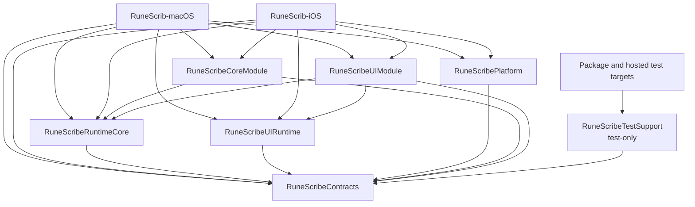
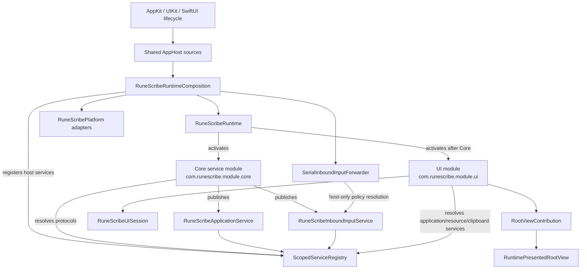
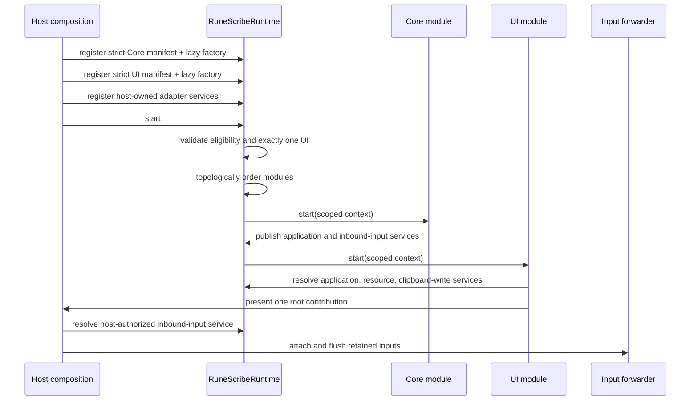

# Rune Scribe Module Graph

> **Superseded architecture snapshot:** This graph records the pre-remediation layout. The [controlling Forsetti policy](FORSETTI_CONTROLLING_POLICY.md) governs current boundaries; historical target, build, and test observations remain evidence.

## Graph conventions

In the compile-time graph below, `A --> B` means “A imports or links B.” The graph is intentionally acyclic inside the app-owned package. The logical runtime graph is different: it shows which component registers, publishes, resolves, activates, or presents another component through neutral interfaces.

This graph describes committed cleanup snapshot `01e2fcf655a3139a856787fc96f17a58db3f3ad0`.

> **Current interpretation.** This is the verified historical graph, not the final
> compliant call graph. `RuneScribeRuntimeCore` remains app-owned and is remediated into
> the permanent per-call control plane. No external Forsetti dependency, binary, source
> copy, fetch, or local checkout is permitted.

## Physical compile-time graph



There are no compile-time edges among `RuneScribeCoreModule`, `RuneScribeUIModule`, and `RuneScribePlatform`. In particular:

```text
RuneScribeUIModule   -X-> RuneScribeCoreModule
RuneScribeUIModule   -X-> RuneScribePlatform
RuneScribeCoreModule -X-> RuneScribeUIModule
RuneScribeCoreModule -X-> RuneScribePlatform
RuneScribePlatform   -X-> RuneScribeCoreModule
RuneScribePlatform   -X-> RuneScribeUIModule
```

[`Packages/RuneScribeArchitecture/Package.swift`](../../Packages/RuneScribeArchitecture/Package.swift) declares six one-target shipping library products, one one-target test-only library product, and five package test targets. It declares no external packages. [`project.yml`](../../project.yml) references that local package and links exactly the six shipping products into each app target. `RuneScribeTestSupport` is consumed only by package/hosted tests and is prohibited from shipping app linkage. The committed [`RuneScrib.xcodeproj`](../../RuneScrib.xcodeproj) is generated from `project.yml`; two final regenerations were byte-identical, and `project.pbxproj` has SHA-256 `5fcafb2ffd877311dd1ea973f58526036e7af543e6e6ff45d36b1a80beb56a30`.

## Logical runtime graph



`RuneScribePlatform` is not a module. Its concrete adapters are created only by the composition root and registered as host-owned implementations of neutral contracts. Core and UI receive protocol existentials from their scoped `ModuleContext`; they do not receive the composition root or adapter concrete types.

## Component responsibilities

| Component | Role and ownership | Must not own |
|---|---|---|
| [`RuneScribeContracts`](../../Packages/RuneScribeArchitecture/Sources/RuneScribeContracts) | Stable module, role, capability, service, event, message, domain, and input IDs; key-free command/result DTOs; `RuneScribeApplicationService`; `RuneScribeInboundInputService`; platform protocols; safe event payloads | SwiftUI/AppKit/UIKit, Security/Contacts/CoreText implementation types, raw keys or PIN values, persistence entities, orchestration |
| [`RuneScribeRuntimeCore`](../../Packages/RuneScribeArchitecture/Sources/RuneScribeRuntimeCore) | Semantic versions, strict manifests, compiled descriptors, factories, eligibility, capability/service policy, scoped contexts, event bus, directed messages, deterministic activation/rollback/stop, host input forwarder | Rune Scribe cipher/contact/font/message/PIN semantics or platform adapter implementations |
| [`RuneScribeUIRuntime`](../../Packages/RuneScribeArchitecture/Sources/RuneScribeUIRuntime) | Type-erased root contribution, exactly-one root selection, and boot/ready/recovery presentation | Product screens, product navigation, Core implementation knowledge |
| [`RuneScribePlatform`](../../Packages/RuneScribeArchitecture/Sources/RuneScribePlatform) | Apple Keychain; protected and inbound files; opaque share storage; Contacts values; pasteboard; CoreText registration; application-bundle lookup; clock and UUID | Module lifecycle, navigation, app-lock policy, cipher/contact/font orchestration, test doubles, Core or UI imports |
| [`RuneScribeCoreModule`](../../Packages/RuneScribeArchitecture/Sources/RuneScribeCoreModule) | Key-bearing cipher domain and encrypted repositories; codecs and wire formats; contacts, fonts, imports, messages, share leases, PIN/lock policy; safe snapshots; application and inbound-input services | SwiftUI/AppKit/UIKit/MessageUI, UI navigation, Platform concrete types, raw-key exposure |
| [`RuneScribeUIModule`](../../Packages/RuneScribeArchitecture/Sources/RuneScribeUIModule) | Sole UI session and every product screen; navigation, commands, accessibility, Metal rendering, splash playback, QR, document/share/MessageUI surfaces, copy | Core or Platform imports, persistence implementation, key material, host lifecycle ownership |
| [`RuneScribeTestSupport`](../../Packages/RuneScribeArchitecture/Sources/RuneScribeTestSupport) | Deterministic in-memory implementations of neutral contracts for package and hosted tests | Shipping app linkage, Apple framework adapters, product orchestration |
| [`RuneScrib/AppHost`](../../RuneScrib/AppHost) | App entry and delegates; adapter/factory registration; runtime start/stop; typed URL/file/lifecycle/menu forwarding; app metadata; root/recovery shell | Product business rules, feature state, screens, direct Core service construction outside factory registration |

## Module identity and manifest graph

| Module | Kind | Role | Entry point | Required role | Published descriptor services |
|---|---|---|---|---|---|
| `com.runescribe.module.core` | service | `runescribe.core` | `RuneScribeCoreModule` | none | `RuneScribeApplicationService`, `RuneScribeInboundInputService` |
| `com.runescribe.module.ui` | UI | `runescribe.ui.primary` | `RuneScribeUIModule` | `runescribe.core` | none |

The manifests live with their module implementations:

- [`Core module manifest`](../../Packages/RuneScribeArchitecture/Sources/RuneScribeCoreModule/Resources/module-manifest.json)
- [`UI module manifest`](../../Packages/RuneScribeArchitecture/Sources/RuneScribeUIModule/Resources/module-manifest.json)

The compiled descriptors live in [`CoreModule.swift`](../../Packages/RuneScribeArchitecture/Sources/RuneScribeCoreModule/CoreModule.swift) and [`UIModule.swift`](../../Packages/RuneScribeArchitecture/Sources/RuneScribeUIModule/UIModule.swift). Runtime registration compares identity, version, kind, entry point, role, requested capabilities, required services, and required roles. Publication is a compiled descriptor property checked against the service access policy and verified after `start(context:)` returns.

At the recorded snapshot, the strict JSON decoder accepted only the schema keys then in
force. The Core and UI manifests targeted iOS and macOS, required runtime `1.0.0`,
carried module version `1.0.34`, used no entitlement requirement, and disabled
production diagnostics. Unknown fields and duplicate array entries failed before
activation. Current Core, Progression, and UI module version `1.0.40` is recorded in
their compiled descriptors and manifests; the current graph is governed by the
controlling policy and `project.yml`, not this snapshot.

## Composition and activation sequence



The runtime lifecycle is:

```text
registered -> validated -> eligible -> activating -> active
active -> stopping -> stopped
activating/start failure -> reverse rollback -> failed
```

Important guarantees:

- registration rejects duplicate module IDs, entry points, and roles;
- exactly one eligible UI module is required before any activation;
- every UI module depends on all eligible service modules, and explicit required roles add topological edges;
- the runtime invokes factory closures only during activation and requires the produced descriptor to equal the registered descriptor;
- both shipping factories create a fresh module per invocation, and UI factory creation does not present or mutate the root store;
- all required services must exist before a module starts;
- every declared published service must exist after a module starts;
- start failure stops the failing module and all previously activated modules;
- shutdown stops modules in reverse activation order;
- context invalidation removes module-owned services, event subscriptions, and directed-message destinations;
- repeated `start` while running and repeated `stop` after stop are safe;
- a stop requested during activation joins rollback rather than leaving a partially active runtime.

At the composition layer, the input rail is flushed and detached before runtime shutdown. Concurrent stop calls share one stop operation, and a later start waits for that operation. A startup failure presents the neutral recovery state and permits a later retry.

## Host and resource graph

Both shipping targets compile the same three Swift host files:

- [`RuneScribApp.swift`](../../RuneScrib/AppHost/RuneScribApp.swift)
- [`AppDelegate.swift`](../../RuneScrib/AppHost/AppDelegate.swift)
- [`RuneScribeRuntimeComposition.swift`](../../RuneScrib/AppHost/RuneScribeRuntimeComposition.swift)

Platform conditional compilation narrows delegate and lifecycle integration to AppKit or UIKit without forking business logic. The targets additionally own:

- [`RuneScrib/Resources`](../../RuneScrib/Resources): asset catalog, font, font license, and splash video;
- [`RuneScrib/Metal/Shaders.metal`](../../RuneScrib/Metal/Shaders.metal): compiled into the application Metal library;
- [`Config`](../../Config): platform Info.plists and entitlements;
- bundle identity, version, deployment, signing, sandbox, URL scheme, UTI, document, orientation, camera, and Contacts configuration in [`project.yml`](../../project.yml).

`BundleApplicationResourceLocator` is initialized with the host bundle. Core requests the bundled font through a neutral resource handle; UI requests splash-video and default-Metal-library handles. Module manifests remain resources of their own package targets and are loaded with `Bundle.module`.

## Test graph

The local package owns target-aligned suites:

| Test target | Primary boundary |
|---|---|
| `RuneScribeRuntimeCoreTests` | Manifest, policy, service, event/message, activation, shutdown, and input-forwarder behavior |
| `RuneScribePlatformTests` | Adapter semantics and Platform import boundary |
| `RuneScribeCoreModuleTests` | Domain, persistence, wire, contacts, fonts, imports, messages, sharing, and PIN/lock behavior |
| `RuneScribeUIModuleTests` | UI session, root contribution, commands, contact picker, message attachments, PIN formatting, and splash scheduling |
| `RuneScribeArchitectureTests` | Product importability, contract safety, resource handles, and integrated Core-before-UI boot |

`RuneScribeTestSupport` is a public package product solely so package and generated-project test targets can share deterministic contract adapters without exporting them from `RuneScribePlatform`. It depends only on Contracts. `RuneScribePlatformTests` and `RuneScribeArchitectureTests` consume it inside SwiftPM; `RuneScribTests`, `RuneScribIOSTests`, and `RuneScribMacParityTests` consume it through `project.yml`. Neither shipping app target links it, and the shipping-product guard checks that its binary is absent.

The generated project adds:

| Target | Purpose |
|---|---|
| `RuneScribArchitectureTests` | Runs the repository-wide architecture ratchet from the macOS scheme |
| `RuneScribTests` | Hosted macOS composition and frozen compatibility checks |
| `RuneScribIOSTests` | Hosted iOS input, Keychain migration, native sharing, and platform presentation |
| `RuneScribIOSUITests` | iPhone/iPad product parity flow |
| `RuneScribMacParityHost` / `RuneScribMacParityTests` | Isolated macOS product and native-share parity validation |

[`scripts/check-architecture.sh`](../../scripts/check-architecture.sh) enforces the current shipping products, test-only product classification, target edges, import allowlists, manifest count, shipping-app linkage, thin-host thresholds, singleton/notification closure, and the permanent prohibition on external Forsetti package material. [`scripts/architecture-ratchet.json`](../../scripts/architecture-ratchet.json) makes structural expectations explicit. [`scripts/check-shipping-products.sh`](../../scripts/check-shipping-products.sh) separately proves that built app products do not link or embed Test Support.

At the recorded snapshot, the package suite passed 283 of 283 tests and the architecture ratchet passed 17 of 17 checks under `/tmp/RuneScribe-P8-final-package.yGz7qs`; the current Release inspection passed 50 of 50 checks under `/tmp/RuneScribe-P8-release-final.XsJS4P`. Negative fixtures under `/tmp/RuneScribe-P8-cleanup.bxBuUN` and `/tmp/RuneScribe-P8-guard-audit.4gkAfP` confirm that both guards fail on source-allowlist drift, generated-project drift, a shipping target linked to `RuneScribeTestSupport`, or a shipping package target made to depend on it.
