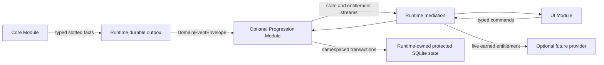
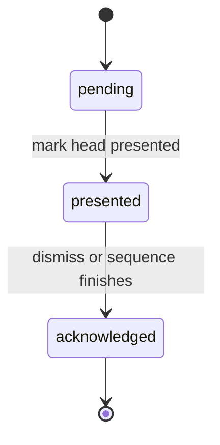

# Progression Architecture

## Authority and scope

Progression is an optional, local-first Rune Scribe service module. The controlling
architecture remains [FORSETTI_CONTROLLING_POLICY.md](FORSETTI_CONTROLLING_POLICY.md).
The bundled approved catalog, event catalog, schema, and future Theme binding contract
are immutable resources validated before module activation.

This implementation owns Achievements, statistics, Codex gates, grants, ownership,
earned entitlements, Encounters, Titles, the reveal queue, existing-user migration,
diagnostics, quarantine, rebuild, and additive catalog upgrade. It does not add a
production Theme provider, GameKit, CloudKit, StoreKit, network service, or reset
operation.

## Module and port boundary

`RuneScribeProgressionModule` is declared optional. A missing resource, catalog
validation failure, unavailable state store, or activation failure leaves Core and UI
utility available. The module imports only Contracts and Runtime Core; it does not
import Core, UI, Platform, or a Theme implementation.

The runtime mediates every port:

- Core submits typed, privacy-safe event facts through the runtime Progression outbox.
- Progression publishes immutable state and entitlement streams.
- UI reads those streams and sends typed mark-presented, acknowledge-reveal,
  select-title, and diagnostics commands.
- Recovery is a separately capability-gated command and is disabled in production.
- Core sends the privacy-safe existing-user migration through a dedicated runtime
  handoff; UI cannot consume that endpoint.
- Progression receives protected transactional storage, catalog bytes, Settings,
  availability, sound, and haptic behavior only through runtime-owned ports.

No arrow is a direct module reference. Runtime endpoint declarations, capabilities,
opaque operation metadata, and lifecycle generations authorize every call.

## Event evidence and delivery

Core creates typed `ProgressionEventFact` values at the authoritative domain commit.
For durable Core mutations, the encrypted Core ledger stores the domain change,
runtime-issued opaque operation context, and complete bounded fact group in one write.
For an encode operation, the encrypted handle and pending fact evidence are committed
before the result is returned. A failed optional rail never rolls back encryption,
decryption, import, or share utility.

One operation is divided into deterministic batches of at most 127 slotted facts.
Runtime authenticates the opaque context, makes each batch durable, assigns stable
event identities, and submits in batch/slot order. Core retains the evidence until the
returned receipts have been persisted, acknowledged through Runtime, and cleared.
Exact retries return the original result; a changed payload under the same identity is
a collision and fails closed.

Terminal share evidence is normalized by Runtime. Runtime reserves journal capacity
before platform presentation, durably records the terminal result before returning it,
and replays unconsumed evidence after relaunch. Core stores prepared artifact linkage
before exposing a share artifact, then atomically records terminal progression and
key-delivery effects before artifact cleanup. Presentation alone, cancellation,
failure, file export, clipboard, and QR display never earn share or first-delivery
progress.

## Event eligibility definitions

The event payload is a closed typed contract. Missing, extra, invalid, or forbidden
fields are rejected.

- `runescribe.cipher.created`: after a durable generated-cipher commit. It requires
  cipher token and origin=`generated`; the cipher token is its semantic identity.
- `runescribe.cipher.imported`: after a confirmed imported-cipher commit. It requires
  cipher token, origin=`imported`, and route class; the cipher token is its semantic
  identity.
- `runescribe.message.encoded`: after authenticated encryption and decorative encoding
  succeed for a new logical operation. It requires message token, cipher token,
  origin=`generated`, and Codex IDs; the message token is its semantic identity.
- `runescribe.share.completed`: after an eligible terminal route result and before
  artifact cleanup. It requires message token, route class, Codex IDs, key-included,
  and linked-relationship; relationship token and Artifact IDs are optional. Semantic
  identity is the message token plus canonical Codex IDs.
- `runescribe.cipher.first-delivery-completed`: once, after an eligible terminal result
  atomically changes key delivery from pending to completed. It requires cipher token,
  relationship token, key-included=`true`, and linked-relationship=`true`; the
  relationship token is its semantic identity.
- `runescribe.message.imported`: after a valid incoming message package is admitted. It
  requires package token, origin=`imported`, route class, Codex IDs, and embedded-cipher;
  Artifact IDs and provenance status are optional. The package token is its semantic
  identity.
- `runescribe.message.decoded`: after authenticated decryption of an incoming package
  succeeds. It requires package token, origin=`imported`, and Codex IDs; relationship
  token, Artifact IDs, and provenance status are optional. The package token is its
  semantic identity.
- `runescribe.exchange.bidirectional-established`: once when a relationship aggregate
  changes from one-way to qualifying two-way activity. It requires and deduplicates by
  relationship token.
- `runescribe.presentation.observed`: after known presentation IDs in an incoming
  package are validated, regardless of current ownership. It requires package token and
  Codex IDs; Artifact IDs and provenance status are optional. Semantic identity is the
  package token plus canonical Codex and Artifact IDs; absent Artifact IDs use an
  explicit empty identity.

The eligible terminal route matrix is exact:

| Route | Terminal result | Share progress | First delivery |
|---|---|---:|---:|
| Messages | `sent-confirmed` | yes | yes* |
| Share sheet | `completed-by-system` | yes | yes |
| AirDrop | `completed-by-system` | yes | yes |
| File export | `completion-unavailable` | no | no |
| Clipboard | `completion-unavailable` | no | no |
| QR display | `completion-unavailable` | no | no |
| Any route | `presented`, `cancelled`, or `failed` | no | no |

\* Messages additionally require attachment acceptance when key delivery is involved.

Events and durable evidence never contain plaintext, encrypted payload bytes, cipher
keys, complete decorative mappings, phone numbers, email addresses, contact names, raw
Contacts identifiers, recipient identity, Game Center player IDs, clipboard contents,
or file/package bytes.

## Durable state and atomic reduction

The runtime-owned protected SQLite adapter exposes only versioned namespaced records,
paged scans, health, quarantine, and bounded transactions. A record is protected by an
integrity digest; transaction receipts make ambiguous after-commit responses exactly
reconcilable. Transactions are limited to 128 mutations, 1 MiB per record, and 8 MiB
in aggregate.

Progression stores:

- projection metadata and catalog/migration fingerprints;
- applied and terminal processed-event records, applied-order chaining, semantic
  dedupe, and distinct opaque-token records;
- statistic counters and per-Codex content-use facts;
- Achievement progress/completion and milestone completion;
- grant, ownership, entitlement, Encounter, and Title-selection records;
- pending/presented reveal records, queue linkage, and acknowledgements;
- existing-user migration seeds and staged-generation markers;
- command receipts, rebuild staging, typed quarantine evidence, and bounded
  diagnostics.

For an accepted event, one logical commit records the processed event and all changed
projection shards: statistics, completion cascade, grants, ownership, entitlements,
Encounters, and one combined reveal. The reducer evaluates approved rules to a bounded
fixpoint. Stable grant identities and ownership links prevent duplicate grants during
same-event cascades and replay. Artifact-count and completed-Achievement rules cannot
count their own reward/completion as a prerequisite.

Snapshots are read models. UI receives display text, exact component progress,
ownership, provider availability, archive support, reveal state, and diagnostics; it
does not receive opaque tokens and does not evaluate rules.

## Reveal state machine

Every durable non-included unlock joins at most one combined FIFO reveal transaction.
The durable state machine is:

Only the queue head may transition. UI must durably mark `pending` as `presented`
before sound, haptic, animation, or an explicit accessibility announcement. A
relaunched `presented` reveal resumes as a static, dismissible card without repeating
one-shot feedback. It remains visible until acknowledgement succeeds. Acknowledgement
advances the FIFO and an acknowledged reveal is never reconstructed by rebuild or
catalog upgrade.

## Ownership and provider availability

Ownership is durable Progression truth; provider availability is live runtime truth.
An owned content item may remain unavailable when its optional provider is missing or
failed. Child content is not usable until its parent Codex is owned. Runtime observes
earned entitlement changes and may activate a matching optional provider without an
app restart. Provider failure never removes ownership and never blocks Norse/Core/UI.

## Existing-user migration

The migration snapshot contains only canonical cipher tokens and generated/imported
origin. It never derives delivery, relationship, share, decode, or Encounter history
from legacy flags. The operation is versioned and exact-idempotent.

At most 4,096 ciphers use the schema-v1 single-snapshot handoff. A larger valid
library uses the schema-v2 aggregate handoff: Runtime canonicalizes the full set,
assigns one transaction ID and aggregate digest, stores a bounded manifest plus pages
of at most 4,096 ciphers, and delivers the pages in index order. Each page remains
below the 1 MiB endpoint limit. Progression binds every staged page to the same page
count, total cipher count, transaction ID, and aggregate digest. Duplicate tokens,
missing pages, changed retries, or digest/count mismatches fail before promotion.

Progression stages migration seeds in an inactive generation, validates the canonical
count/digest and uniqueness, evaluates only the safely derivable Archivist rules, then
atomically promotes the finished projection. New install and zero-cipher migration are
valid. Migration can create at most one combined reveal. The transaction ID, schema
version, canonical digest, staging marker, and command receipt make interruption,
ambiguous commit, relaunch, and changed-payload retry deterministic. Rebuild restores
the migration seeds before replaying later events.

## Compatibility

Progression is additive. Existing cipher/message wire formats, encrypted library
records, contact associations, PIN behavior, import routing, and legacy outbound
formats remain readable and usable. Legacy `delivered` values remain cryptographic
continuity only and do not become first-delivery, share, relationship, or Encounter
facts. New opaque seeds and pending evidence live inside the versioned encrypted Core
ledger and do not alter shared payload bytes. If Progression or any optional provider
is unavailable, Base/Norse presentation and all communication utility remain usable.

## Catalog upgrade, quarantine, and recovery

Catalog resources are strict-decoded, cross-referenced, cycle-checked, and hash-bound.
Only additive compatible upgrades are accepted. Upgrade replays sanitized historical
facts into a staged generation, verifies monotonic and replay-exact state, validates
pending/acknowledged reveals against the rebuilt projection, then atomically promotes
the new generation. New rewards earned from historical facts create exactly one
version-bound reveal and acknowledgements prevent resurrection.

Every decoded record is structurally and cross-reference validated. Invalid records
are quarantined with bounded typed diagnostic evidence; valid state is never replaced
with an empty projection. Guarded rebuild uses the redundant applied ledger and
replay-derived indexes when reconstruction is safe. Irreconstructible terminal,
acknowledgement, or command-receipt loss fails closed and leaves the active generation
unchanged. Staged generations and scratch records are operation-bound, resumable, and
reaped before a fresh operation so repeated faults remain bounded.

## Stable statistic IDs

- `stat.message.encoded.unique`
- `stat.share.eligible-message.unique`
- `stat.relationship.first-delivery.unique`
- `stat.message.incoming-decoded.unique`
- `stat.relationship.bidirectional.unique`
- `stat.cipher.created-or-imported.unique`
- `stat.share.relic-used.unique`
- `stat.share.seal-used.unique`
- `stat.share.codex-used.unique`
- `stat.encounter.codex.unique`
- `stat.ownership.artifact-count`
- `stat.achievement.completed-count`
- `stat.codex.share.unique-message`
- `stat.codex.incoming-decode.unique-package`
- `stat.codex.relationship-presented.unique`
- `stat.codex.relic-used.unique`
- `stat.codex.seal-used.unique`
- `stat.codex.observed.unique-package`

## Stable Achievement IDs

- `achievement.first-inscription` — 5 points; reward `grant-group.first-inscription`
- `achievement.first-dispatch` — 5 points; reward `grant-group.first-dispatch`
- `achievement.echo-returns` — 10 points; reward `grant-group.echo-returns`
- `achievement.correspondent` — 10 points; reward `grant-group.correspondent`
- `achievement.courier-1` — 10 points; reward `grant-group.courier-1`
- `achievement.courier-2` — 20 points; reward `grant-group.courier-2`
- `achievement.five-circles` — 25 points; reward `grant-group.codex.moonleaf.unlock`
- `achievement.archivist-1` — 10 points; reward `grant-group.archivist-1`
- `achievement.archivist-2` — 25 points; reward `grant-group.archivist-2`
- `achievement.relic-bearer` — 10 points; reward `grant-group.relic-bearer`
- `achievement.seal-keeper` — 10 points; reward `grant-group.seal-keeper`
- `achievement.many-worlds` — 20 points; reward `grant-group.many-worlds`
- `achievement.explorer` — 10 points; reward `grant-group.explorer`
- `achievement.collector` — 20 points; reward `grant-group.collector`
- `achievement.master-scribe` — 30 points; reward `grant-group.master-scribe`

The catalog total is 220 local points. Game Center identifiers remain unconfigured and
no GameKit calls are present.

## Stable rule IDs

- `rule.codex.moonleaf.known-in-five-circles`
- `rule.codex.sunspire.reciprocal-light`
- `rule.codex.wildwood.roots-of-memory`
- `rule.codex.gloamthorn.beyond-the-gloam`
- `rule.codex.moonleaf.first-share`
- `rule.codex.moonleaf.three-shares`
- `rule.codex.moonleaf.incoming-five`
- `rule.codex.moonleaf.ten-shares`
- `rule.codex.moonleaf.encounter`
- `rule.codex.moonleaf.mastery`
- `rule.codex.sunspire.first-share`
- `rule.codex.sunspire.three-shares`
- `rule.codex.sunspire.incoming-five`
- `rule.codex.sunspire.ten-shares`
- `rule.codex.sunspire.encounter`
- `rule.codex.sunspire.mastery`
- `rule.codex.wildwood.first-share`
- `rule.codex.wildwood.three-shares`
- `rule.codex.wildwood.incoming-five`
- `rule.codex.wildwood.ten-shares`
- `rule.codex.wildwood.encounter`
- `rule.codex.wildwood.mastery`
- `rule.codex.gloamthorn.first-share`
- `rule.codex.gloamthorn.three-shares`
- `rule.codex.gloamthorn.incoming-five`
- `rule.codex.gloamthorn.ten-shares`
- `rule.codex.gloamthorn.encounter`
- `rule.codex.gloamthorn.mastery`
- `rule.codex.norse.echo-five`
- `rule.codex.norse.mastery`

## Stable journey IDs

- `journey.codex.norse` — included `codex.norse`
- `journey.codex.moonleaf` — gate `rule.codex.moonleaf.known-in-five-circles`
- `journey.codex.sunspire` — gate `rule.codex.sunspire.reciprocal-light`
- `journey.codex.wildwood` — gate `rule.codex.wildwood.roots-of-memory`
- `journey.codex.gloamthorn` — gate `rule.codex.gloamthorn.beyond-the-gloam`

## Stable content and unlock IDs

### Codices

- `codex.gloamthorn`
- `codex.moonleaf`
- `codex.norse`
- `codex.sunspire`
- `codex.wildwood`

### Unlock entitlements

- `unlock.codex.gloamthorn`
- `unlock.codex.moonleaf`
- `unlock.codex.norse`
- `unlock.codex.sunspire`
- `unlock.codex.wildwood`

### Scripts

- `script.base-runes`
- `script.gloamthorn`
- `script.moonleaf`
- `script.sunspire`
- `script.wildwood`

### Crests

- `crest.gloamthorn.gloam-sovereign`
- `crest.moonleaf.moonbloom`
- `crest.norse.forge-master`
- `crest.sunspire.first-light`
- `crest.wildwood.heartwood-crown`

### Frames

- `frame.gloamthorn.briar-court`
- `frame.moonleaf.silvervine`
- `frame.norse.carved-knotwork`
- `frame.progression.collector`
- `frame.progression.mastery`
- `frame.sunspire.laurel-of-dawn`
- `frame.wildwood.living-root`

### Relics

- `relic.gloamthorn.duskbriar-stele`
- `relic.gloamthorn.nightthorn-tablet`
- `relic.gloamthorn.umbral-plaque`
- `relic.moonleaf.ivybound-plaque`
- `relic.moonleaf.tablet`
- `relic.moonleaf.whisperbark-stele`
- `relic.norse.ironbound-shield`
- `relic.norse.raven-medallion`
- `relic.norse.runestone.blackstone`
- `relic.norse.runestone.frozen`
- `relic.norse.runestone.weathered`
- `relic.norse.sealed-parchment`
- `relic.progression.collector`
- `relic.sunspire.auric-stele`
- `relic.sunspire.dawnfire-tablet`
- `relic.sunspire.solvine-plaque`
- `relic.wildwood.elderbark-stele`
- `relic.wildwood.mossbound-plaque`
- `relic.wildwood.rootsong-tablet`

`relic.norse.runestone.frozen` is deferred and has no active rule.

### Seals

- `seal.gloamthorn.echo-wisp`
- `seal.gloamthorn.eclipse-bloom`
- `seal.gloamthorn.nightglass-moth`
- `seal.gloamthorn.pact-crown`
- `seal.gloamthorn.thornmoon`
- `seal.gloamthorn.veiled-serpent`
- `seal.moonleaf.crescentleaf`
- `seal.moonleaf.echo-firefly`
- `seal.moonleaf.moonwell`
- `seal.moonleaf.night-owl`
- `seal.moonleaf.starflower`
- `seal.moonleaf.woodland-stag`
- `seal.norse.echo-rune`
- `seal.norse.forge-flame`
- `seal.norse.forge-hammer`
- `seal.norse.knotwork`
- `seal.norse.longship`
- `seal.norse.raven`
- `seal.progression.echo`
- `seal.progression.relic-bearer`
- `seal.sunspire.dawnflower`
- `seal.sunspire.echo-ember`
- `seal.sunspire.golden-lark`
- `seal.sunspire.radiant-spire`
- `seal.sunspire.sunleaf-crest`
- `seal.sunspire.sunwheel`
- `seal.wildwood.acorn-knot`
- `seal.wildwood.echo-seed`
- `seal.wildwood.fern-spiral`
- `seal.wildwood.lantern-moth`
- `seal.wildwood.rooted-tree`
- `seal.wildwood.wild-fox`

### Titles

- `title.archivist`
- `title.listener`
- `title.master-scribe`
- `title.wayfarer`
