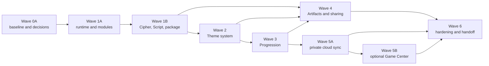

# Codex Roadmap Alignment

> **Superseded dependency sequencing:** Product requirements remain relevant, but the former external-framework gate and transitional-runtime direction are superseded. Current architecture work follows the [controlling Forsetti policy](FORSETTI_CONTROLLING_POLICY.md) and uses an app-owned implementation with a permanent external-dependency prohibition.

## Authority and scope

**Current application:** version 1.0.40 build 40

The hash-locked [Codex System Specification](../product-roadmap/Rune-Scribe-Codex-System-Spec-v1.0.md)
and [Current-App Delta and Implementation Roadmap](../product-roadmap/Rune-Scribe-Codex-Current-App-Delta-and-Implementation-Roadmap-v1.0.md)
remain authority only for nonconflicting product requirements, compatibility anchors,
and sequencing evidence. They do not control framework ownership, runtime mediation,
operational I/O, Settings, or dependency direction. Their repository SHA-256 values are
respectively
`7c4c460815064fca87a6769766fb875f267eb692795bbab2635eec5d55d8f88d` and
`884ad563f7849ebda8326bc742493ce67fb89cfacc14b39e56c792c4f7c52db4`.
The separate [Roadmap Remediation Amendment v1.1](../product-roadmap/Rune-Scribe-Codex-Roadmap-Remediation-Amendment-v1.1.md),
SHA-256 `2b6ce54c50538419d324692ebfeec1bb29de46add9f354368d39169d6f74ed40`,
records the controlling remediation variances without changing either locked v1.0 file.

The exhaustive machine-readable status is
[`roadmap-alignment.json`](../verification/roadmap-alignment.json). It records all 124
requested BAS, FOR, MOD, DOM, PKG, THM, PRO, SHR, CLD, GC, and REL work packages with status,
dependencies, repository evidence, and notes. This page explains the dependency gates
and the implementation boundary in plain language.

The ledger classifies FOR-001 through FOR-011 as
`variance-accepted-app-owned-equivalent`, not complete as written. BAS-006, SHR-001,
and SHR-015 use `simulator-replacement-complete` for the supported automated
qualification boundary. `non-gating-external` is reserved for live-account or public
distribution actions outside source remediation; it never denotes shipment.

Historical P8 verification remains valid evidence for the app state it measured; it is
not the final Codex architecture. The controlling policy and current ledger govern
architecture. The roadmap-specific [`ADR-RS-*` records](decisions/README.md) remain
effective only where they do not conflict with that authority.

## Current result

Version 1.0.40 build 40 carries the source-complete authorized roadmap baseline and the
Theme Fidelity source remediation. Final-source qualification passes 1,238/1,238 Swift
tests, 255/255 Python tests, architecture, roadmap, documentation, resource, mutation,
named source and mutation gates. The iOS Release build and arm64-only unsigned macOS
Release build pass. Local ad-hoc built-product content, resource, privacy, signature,
Hardened Runtime, and entitlement inspection passes 101/101 checks; distribution identity
and provisioning are explicitly unassessed.
The candidate is a **repository-qualified release candidate** and is deliberately **not
shipped**. All repository-controlled release gates pass. The repository now contains:

- app-owned runtime composition, bounded contracts, capability policy, thin hosts,
  serialized ingress, and permanent dependency guards;
- exact legacy Cipher and Message readers plus a fail-before-allocation typed-container
  parser and complete old/new destination matrix;
- the required Norse provider and four optional production Elven providers—Moonleaf,
  Sunspire, Wildwood, and Gloamthorn—built from the accepted v3.1 corpus and v4.3
  canonical source masters with 56 logical provider resources and 245 unique shipping
  outputs;
- runtime-bound Progression ownership and live provider activation without any
  provider-side rule evaluation;
- a data-driven Artifact renderer, persisted Codex/Relic/Seal/Frame defaults, themed
  vNext cipher/message files, legacy link and QR compatibility, fail-soft receiving,
  Encounter recording, and provenance state;
- local-first private progression synchronization with deterministic merge, offline and
  account-change policy, corruption quarantine, runtime-owned CloudKit I/O, and no
  secret-bearing cloud fields; and
- optional Game Center mapping/report policy with a frozen 15-achievement, 220-point
  catalog, monotonic outbox, runtime-owned GameKit I/O, and no local grant authority.

The repository-controlled release bar passes core user flows, clean tests, iOS/macOS
Release builds, deterministic UI coverage, accessibility, privacy, exact assets, negative
mutations, and built-product inspection with no known release-blocking defects. The iPhone 17 Pro
headless UI run on iOS 26.5 passes 7 tests, skips 1 iPad-only test, and fails 0. The iPad
Pro 13-inch (M5) headless UI run on iOS 26.5 passes 5 tests, skips 3 phone-specific tests
by design, and fails 0. Manual hardware observations are superseded by supported
Simulator, hosted, and deterministic equivalents. Distribution signing and entitlement
inspection remain external because no matching profile or distribution identity is
available.

### Retained package-audit history

The superseded v4.3 package audit remains available for traceability in
[`final-qualification.json`](../verification/theme-fidelity-v4-3/final-qualification.json).
That audit stopped at 18/40 gates with 0/50 canonical candidates, 0/400 responsive
states, 0/576 runtime probes, and 0/1,104 mappings. Its Moonleaf audit binding and
evidence/publication self-binding mechanics also remained open. These facts describe an
incomplete historical package audit; they do not control product release readiness.

The validated Elven Series recovery boundary remains intact: Recovery is PASS / CLOSED,
the corrected v3.1 package is ACCEPTED, and Phase C is PASS / MERGED TO MAIN via PR #45 at
`e9e0e0c8814aaa107d7480e070f14a6fe9b09975`. This completion branch begins at the
post-Phase-C main revision `131f101069d1a8053f72e60918092e81373e2687`; it does not
rewrite that history.

Automated and supported-host evidence establishes only the checks it actually ran.
Repository-controlled Simulator, hosted, and deterministic equivalents fully replace
direct-device observations in the current qualification bar. Live iCloud/Game Center
configuration, App Store Connect, distribution signing, archive/export, notarization,
upload, rollout, and release are
separate external actions performed only when their credentials and services are
available; their absence does not determine product shippability.

## App-owned runtime and Forsetti scope

`RuneScribeRuntimeCore` is the permanent app-owned composition and lifecycle control
plane. The UI owns views, Core owns cryptographic and message-domain authority, and
dedicated Platform/UIRuntime products contain Apple-system adapters. The executable
17-ratchet architecture guard enforces the shipping target graph, implementation import
boundaries, thin hosts, provider manifests, resource ownership, and TestSupport exclusion.

The stricter P11 Forsetti scanner is deliberately report-only. Its current result is not
a compliance pass and remains architecture backlog; under the operator-approved
product-focused scope, it is not a standalone release gate unless a finding produces a
concrete product, security, data-loss, or shipping-guard failure. This distinction avoids
claiming per-call runtime mediation that the report-only scanner has not proven.

External Forsetti packages, binaries, source copies, submodules, fetch scripts, and
machine-local checkout paths remain prohibited. The executable architecture guard
checks the shipping dependency graph, import boundaries, host composition, provider
manifests, resource ownership, and negative mutations.

## Dependency order

The graph remains executable: a downstream requirement is satisfied only when its
source, tests, guard evidence, and gating dependencies are present. Hardware wording is
qualified through the amendment's hosted, Simulator, deterministic-adapter, and
release-product replacement boundary.

## Work-package status

| Group | Current ledger | Completion evidence |
|---|---|---|
| BAS-001…010 | 8 satisfied, 1 simulator-replacement-complete, 1 not-applicable | Exact baseline, decisions, build/fixture evidence, destination matrix, and aligned publication sources are recorded. |
| FOR-001…011 | 11 variance-accepted-app-owned-equivalent | Former external-framework wording is not complete as written; the amended permanent app-owned equivalent controls. |
| MOD-001…013 | 13 satisfied | Runtime mediation, manifests where appropriate, standard ports, adapters, ingress, hosted tests, and guards are complete. |
| DOM-001…007 | 7 satisfied | Cipher/Script migration, imported-font rendering, separate presentation state, and explicit terminal key delivery are tested. |
| PKG-001…006 | 6 satisfied | Legacy readers, typed container, bounded allocation ordering, malformed corpus, resources, and magic-first routing pass. |
| THM-001…012 | 12 satisfied | Contracts, registries, Coordinator, semantic UI, Norse Base, provider conformance, selection, fallback, and diagnostics pass. |
| PRO-001…016 | 16 satisfied | Durable facts, exact catalogs/rules, grants, migration, live entitlement projection, UI, quarantine, and recovery pass. |
| SHR-001…017 | 15 satisfied, 2 simulator-replacement-complete | Artifact rendering, builder/defaults, themed transport, terminal events, intake fallback, Encounters, provenance, QR/static fallback, and compatibility pass. |
| CLD-001…011 | 11 satisfied | Schema, entitlements, runtime/platform boundary, merge, queue/status, account change, quarantine, reset omission, and multi-device simulations pass. |
| GC-001…010 | 10 satisfied | Frozen catalog/strategy, capabilities, optional opt-in, mapping, outbox, prior completion, status, and deterministic adapter tests pass. |
| REL-001…011 | 10 satisfied, 1 non-gating-external | Exact providers/assets, conformance, budgets, accessibility, security/privacy, documentation, placeholder guards, and no-ship handoff are recorded; staged rollout is not performed. |

The machine-readable JSON ledger is normative. `BAS-006`, `SHR-001`, and `SHR-015`
are the only `simulator-replacement-complete` tasks. `REL-011` is the only
`non-gating-external` task and may not be called complete or shipped. `BAS-005` remains
not applicable because no approved scrubbed real-user corpus was supplied.

## Frozen compatibility and safety decisions

### Typed container

[`ADR-RS-004`](decisions/ADR-RS-004-typed-runescribe-container.md) freezes the 8-byte
`RSCRPKG\n` magic, 32-byte big-endian header, independent payload kind/version,
canonical unique contiguous sections, and SHA-256 trailer. Total, section, resource,
preview, image, and provenance bounds are allocation-ordered and mutation-tested.
Unknown optional sections are skipped; unknown required sections and unsupported
required versions return an update-required outcome.

### Outbound compatibility

[`ADR-RS-005`](decisions/ADR-RS-005-forward-compatibility.md) authorizes bounded vNext
files as the normal themed path. New builds retain exact legacy readers. Compact link
and QR invitations remain legacy-compatible. Omitting presentation on a prepare command
selects the deliberate legacy writer, which is the source-controlled rollback switch.
Optional presentation corruption never changes Core payload admission or decryption.
For an installed requested provider, receive-time compatibility resolves Script, Relic,
Seal, Frame, and resource identity against the coordinator's bounded inventory before
rendering. Unknown selections are incompatible; role, media type, length, dimensions,
or digest drift is corrupt. Both states retain the valid Core payload and select Norse.

### Share completion

[`ADR-RS-006`](decisions/ADR-RS-006-share-route-completion.md) makes presentation
nonterminal. Delivery and Progression facts require eligible terminal evidence and
required-attachment acceptance. Cancellation, failure, sheet presentation, copy, tap,
or export alone grants nothing. Runtime operation identity and the durable Core journal
make replay idempotent.

### Local-first services

[`ADR-RS-008`](decisions/ADR-RS-008-progression-persistence.md) keeps local Progression
authoritative and constrains private-cloud records and deterministic merge.
[`ADR-RS-011`](decisions/ADR-RS-011-game-center-records.md) freezes the optional Game
  Center catalog and grouping strategy while leaving App Store Connect configuration as
  a separate external publication action. Persisted Game Center opt-in authorizes one restored authentication attempt
per activation, including a single later application-active retry only when cold-launch
presentation was unavailable. Cancellation, denial, connectivity wakes, and concurrent
explicit opt-in cannot create an authentication loop. Neither service may grant or
revoke local ownership.

## Completion and release boundary

The retained roadmap-completion baseline required the full Swift package, architecture
and roadmap guards, documentation guard, Xcode project regeneration, macOS Release,
iPhone and iPad Simulator Release/parity tests, shipping-product inspection, exact asset
validation, negative mutations, and attribution audit. Those historical results live under
[`docs/verification/roadmap-completion`](../verification/roadmap-completion/).

For the retained roadmap-completion baseline, those gates established:

- **CODE COMPLETE**
- **AUTOMATED TESTS PASS**
- **SUPPORTED HOST/SIMULATOR TESTS PASS**
- **MANUAL HARDWARE VALIDATION SUPERSEDED**
- **NOT SHIPPED**

The version 1.0.40 build 40 release candidate adds a separate product acceptance boundary:

- **FINAL-SOURCE REPOSITORY GATES PASS**
- **REPOSITORY-QUALIFIED RELEASE CANDIDATE**
- **IPHONE HEADLESS UI QUALIFICATION PASS**
- **IPAD HEADLESS UI QUALIFICATION PASS**
- **DISTRIBUTION SIGNING AND ENTITLEMENT CHECKS EXTERNAL**
- **NOT SHIPPED**

Repository-controlled Simulator, hosted, and deterministic checks replace physical or
manual validation for Messages/share destinations, camera/QR fixtures, Contacts,
accessibility, performance, account-state policy, and service failure handling. Signing,
archive/export, notarization, App Store metadata, upload, and rollout remain distinct
external publication actions; none is implied by product release qualification.
