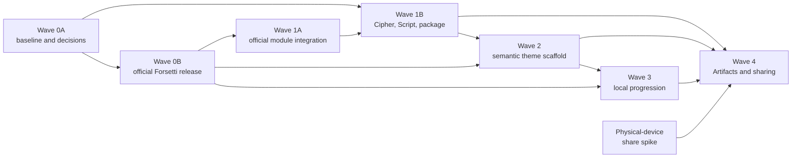

# Codex Roadmap Alignment

## Authority and scope

The locked [Codex System Specification](../product-roadmap/Rune-Scribe-Codex-System-Spec-v1.0.md)
and [Current-App Delta and Implementation Roadmap](../product-roadmap/Rune-Scribe-Codex-Current-App-Delta-and-Implementation-Roadmap-v1.0.md)
control Codex work. Their repository SHA-256 values are respectively
`7c4c460815064fca87a6769766fb875f267eb692795bbab2635eec5d55d8f88d` and
`884ad563f7849ebda8326bc742493ce67fb89cfacc14b39e56c792c4f7c52db4`.

The exhaustive machine-readable status is
[`roadmap-alignment.json`](../verification/roadmap-alignment.json). It records all 92
requested BAS, FOR, MOD, DOM, PKG, THM, PRO, and SHR work packages with status,
dependencies, repository evidence, and notes. This page explains the dependency gates
and the implementation boundary in plain language.

Historical P8 verification remains valid evidence for the app state it measured; it is
not the final Codex architecture. The roadmap-specific
[`ADR-RS-*` records](decisions/README.md) supersede an earlier migration decision only
where the locked roadmap changed direction.

## Current result

The repository now has a coherent, compatibility-preserving foundation for the first
Codex domain and package work:

- a versioned Cipher Record migration that preserves keys and converts the mapping into
  an explicit symbol permutation;
- a validated 32-symbol Script descriptor and Base Rune Script with exact current
  output;
- an explicit key-delivery state that does not turn legacy `delivered` into progression
  proof;
- stable neutral Codex, package, operation, relationship, entitlement, and event
  vocabulary;
- the frozen bounded typed `.runescribe` parser/builder and magic-first file routing;
- permanent legacy cipher v3 and message v1 intake, with current sharing still emitting
  legacy formats only; and
- twelve accepted or explicitly blocked architecture decisions, plus this auditable
  roadmap ledger.

That slice is intentionally usable without external services, a physical device,
Contacts permission, login Keychain access, App Store Connect, iCloud, or Game Center.
It does not declare an unused framework dependency and does not claim that theme,
progression, cloud, or public-sharing work is complete.

## Forsetti upstream gate

Wave 0B is **blocked upstream**. The official repository is
`https://github.com/flynn33/Forsetti-Framework-Mac-iOS`. The audited revision is
`f0199a4f2f0becd1372dbfd5db714e85619c88bc`; its source reports version `0.1.5`, but no
semantic release tag contains that revision.

The release also needs public generalized entitlement requirements, composite
entitlement sources, runtime reconciliation, keyed contribution registration, opaque
resource resolution, app-defined capability-scoped services, source/lifecycle and
duplicate-ID enforcement, the neutral Pattern B sample, tests, migration notes, and a
semantic release. Until those are available:

- `RuneScribeRuntimeCore` and `RuneScribeUIRuntime` remain transitional app-owned
  infrastructure;
- the repository does not add an unused remote dependency;
- no private fork, copied source, vendored binary, or developer-machine checkout is an
  acceptable substitute; and
- current architecture guards retain the blocked-gate rule, then change atomically with
  the official released dependency, manifests, composition, and tests.

[`ADR-RS-001`](decisions/ADR-RS-001-module-packaging-and-target-graph.md) supersedes the
earlier permanent “never a dependency” direction. It does not alter the historical fact
that the P8 shipping snapshot had no external dependency.

## Dependency order

The graph is a gate, not just a preferred order. Theme Modules cannot be finalized
against missing Forsetti contribution/resource APIs. Progression cannot activate earned
providers without released entitlement reconciliation. Themed sharing cannot promise
portable presentation until the Theme scaffold, package validation, progression event
contract, and physical-device transport spike all pass.

## Work-package status

| Group | Current ledger | Dependency and evidence |
|---|---|---|
| BAS-001…010 | 6 satisfied, 2 partial, 1 blocked-device, 1 not-applicable | P8 baseline/build/fixture evidence remains; ADRs and repository policy exist. The old/new destination matrix and documentation checklist remain partial; physical capture requires devices. |
| FOR-001…011 | 11 blocked-upstream | Every item depends on the official tagged release described by `forsettiGate`; consumer-only entitlement vocabulary is not framework completion. |
| MOD-001…013 | 8 satisfied, 4 transitional, 1 partial | Current Core/UI separation, adapters, ingress, lock gating, architecture tests, and hosted tests exist. Runtime/manifests/bootstrap remain transitional until FOR-011. |
| DOM-001…007 | 4 satisfied, 3 partial | Cipher/Script migration and an explicit delivery-state foundation exist. End-to-end legacy-font proof, selected-Codex/per-share presentation stores, and removal of the writable `delivered` compatibility rail remain. |
| PKG-001…006 | 4 satisfied, 2 partial | The typed container, legacy readers, policy, and magic-first router exist. Complete fail-before-allocation proof, randomized malformed-input coverage, and allocation instrumentation remain in PKG-003/005. |
| THM-001…012 | 11 not-started, 1 partial | A current UI design system exists, but no descriptor, Coordinator, Base/placeholder Theme Modules, preference/fallback service, or conformance suite exists. FOR-011 is an upstream prerequisite. |
| PRO-001…016 | 14 not-started, 2 partial | Event and opaque-token contract foundations exist; the module, store, outbox, rules, catalog, atomic grants, entitlement bridge, views, quarantine, and recovery do not. |
| SHR-001…017 | 7 not-started, 6 partial, 2 decision-frozen, 2 blocked-device | Current legacy share, QR, MessageUI, and completion foundations remain. Final composition and Quick Look decisions require the physical-device spike; themed work depends on PKG, THM, and PRO gates. |

The per-task records in the JSON ledger are normative for status automation. A group
summary never upgrades a child task or removes its explicit `dependsOn` edges.

## Frozen compatibility and safety decisions

### Typed container

[`ADR-RS-004`](decisions/ADR-RS-004-typed-runescribe-container.md) freezes an 8-byte
`RSCRPKG\n` magic, 32-byte big-endian fixed header, independent payload kind/version,
16-byte directory records, canonical unique contiguous sections, and full 32-byte
SHA-256 trailer. The package is bounded to 16 MiB and 16 sections, with independent
limits for Core, presentation, preview, resources, and provenance. Unknown optional
sections are retained/skipped; unknown required sections are rejected. Missing magic
falls back to the legacy byte classifier.

### Outbound compatibility

[`ADR-RS-005`](decisions/ADR-RS-005-forward-compatibility.md) keeps production outbound
sharing legacy-only until product review approves a measured transition. The vNext
parser and builder do not authorize emitting vNext content, and metadata is never
appended to legacy trailing font bytes.

### Share completion

[`ADR-RS-006`](decisions/ADR-RS-006-share-route-completion.md) makes presentation
nonterminal and distinguishes cancellation, public-system completion, confirmed sent,
failure, and unavailable completion. A tap, export, copy, or opened sheet is not
delivery or progression proof. First delivery advances only after an eligible terminal
result and required attachment acceptance.

## Next executable gates

1. Finish PKG-003/005 fail-before-allocation proof, randomized malformed-input tests,
   and bounded-allocation instrumentation without changing legacy outbound behavior.
2. Finish DOM-005/006/007 compatibility rendering, presentation-state ownership, and
   atomic delivery-state migration while keeping legacy decode behavior.
3. Complete BAS-008's old/new compatibility and update-required test matrix.
4. Track the official Forsetti repository; begin Wave 0B only at a tagged public release
   that closes every listed blocker.
5. After FOR-011, migrate the transitional runtime and manifests before starting the
   three-provider Theme scaffold.
6. Run SHR-001 on physical devices before selecting permanent invitation composition or
   Quick Look scope.

These gates preserve unattended development: package, architecture, and ad-hoc-signed
Simulator/macOS tests should be preferred until a task explicitly requires external
configuration or physical-device evidence.
