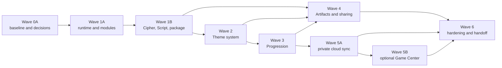

# Codex Roadmap Alignment

> **Superseded dependency sequencing:** Product requirements remain relevant, but the former external-framework gate and transitional-runtime direction are superseded. Current architecture work follows the [controlling Forsetti policy](FORSETTI_CONTROLLING_POLICY.md) and uses an app-owned implementation with a permanent external-dependency prohibition.

## Authority and scope

**Current application:** version 1.0.38 build 38

The hash-locked [Codex System Specification](../product-roadmap/Rune-Scribe-Codex-System-Spec-v1.0.md)
and [Current-App Delta and Implementation Roadmap](../product-roadmap/Rune-Scribe-Codex-Current-App-Delta-and-Implementation-Roadmap-v1.0.md)
remain authority only for nonconflicting product requirements, compatibility anchors,
and sequencing evidence. They do not control framework ownership, runtime mediation,
operational I/O, Settings, or dependency direction. Their repository SHA-256 values are
respectively
`7c4c460815064fca87a6769766fb875f267eb692795bbab2635eec5d55d8f88d` and
`1c6e3cf79e6cd60d105c848a5fab65418daac799ae94db0d0c61504fc2c5679a`.

The exhaustive machine-readable status is
[`roadmap-alignment.json`](../verification/roadmap-alignment.json). It records all 124
requested BAS, FOR, MOD, DOM, PKG, THM, PRO, SHR, CLD, GC, and REL work packages with status,
dependencies, repository evidence, and notes. This page explains the dependency gates
and the implementation boundary in plain language.

Historical P8 verification remains valid evidence for the app state it measured; it is
not the final Codex architecture. The controlling policy and current ledger govern
architecture. The roadmap-specific [`ADR-RS-*` records](decisions/README.md) remain
effective only where they do not conflict with that authority.

## Current result

Version 1.0.38 build 38 is source-complete for the authorized roadmap-completion
program. It is deliberately **not shipped**. The repository now contains:

- complete app-owned runtime mediation, bounded contracts, capability policy, thin
  hosts, serialized ingress, runtime Settings, and permanent dependency guards;
- exact legacy Cipher and Message readers plus a fail-before-allocation typed-container
  parser and complete old/new destination matrix;
- the required Norse provider and four optional production Elven providers—Moonleaf,
  Sunspire, Wildwood, and Gloamthorn—built from the accepted v3.1 corpus with 56 logical
  resources and 184 unique shipping outputs;
- runtime-bound Progression ownership and live provider activation without any
  provider-side rule evaluation;
- a data-driven Artifact renderer, persisted Codex/Relic/Seal/Frame defaults, themed
  vNext cipher/message files, legacy link and QR compatibility, fail-soft receiving,
  Encounter recording, and provenance state;
- local-first private progression synchronization with deterministic merge, offline and
  account-change policy, corruption quarantine, runtime-owned CloudKit I/O, and no
  secret-bearing cloud fields; and
- optional Game Center mapping/report policy with a frozen 15-achievement, 220-point
  catalog, monotonic outbox, runtime-owned GameKit I/O, and no local grant authority.

The validated Elven Series recovery boundary remains intact: Recovery is PASS / CLOSED,
the corrected v3.1 package is ACCEPTED, and Phase C is PASS / MERGED TO MAIN via PR #45 at
`e9e0e0c8814aaa107d7480e070f14a6fe9b09975`. This completion branch begins at the
post-Phase-C main revision `131f101069d1a8053f72e60918092e81373e2687`; it does not
rewrite that history.

Automated and supported-host evidence can establish code completion and owner-test
readiness. It cannot establish physical-device behavior, live iCloud/Game Center
provisioning, App Store Connect configuration, distribution signing, archive/export,
notarization, upload, rollout, or shipment. Those actions remain explicitly outside
this program.

## App-owned Forsetti completion gate

`RuneScribeRuntimeCore` is the permanent control plane. It owns lifecycle, capability
checks, cross-module calls, operational I/O, persistent Settings, state orchestration,
Theme selection, platform presentation sessions, CloudKit calls, and GameKit calls.
The UI owns views and submits typed intent. Core owns cryptographic and message-domain
authority. Theme, Progression, Cloud, and Game Center policy products do not call one
another or own platform side effects.

External Forsetti packages, binaries, source copies, submodules, fetch scripts, and
machine-local checkout paths remain prohibited. The executable architecture guard
checks the shipping dependency graph, import boundaries, host composition, provider
manifests, resource ownership, and negative mutations.

## Dependency order

The graph remains executable: a downstream status is satisfied only when its source,
tests, guard evidence, and non-optional dependencies are present. Owner-only hardware
observations supplement the record but never silently become Agent Coding gates.

## Work-package status

| Group | Current ledger | Completion evidence |
|---|---|---|
| BAS-001…010 | 8 satisfied, 1 owner-optional, 1 not-applicable | Exact baseline, decisions, build/fixture evidence, destination matrix, and aligned publication sources are recorded. |
| FOR-001…011 | 11 superseded | Former external-framework tasks remain historical identifiers; the permanent app-owned policy controls. |
| MOD-001…013 | 13 satisfied | Runtime mediation, manifests where appropriate, standard ports, adapters, ingress, hosted tests, and guards are complete. |
| DOM-001…007 | 7 satisfied | Cipher/Script migration, imported-font rendering, separate presentation state, and explicit terminal key delivery are tested. |
| PKG-001…006 | 6 satisfied | Legacy readers, typed container, bounded allocation ordering, malformed corpus, resources, and magic-first routing pass. |
| THM-001…012 | 12 satisfied | Contracts, registries, Coordinator, semantic UI, Norse Base, provider conformance, selection, fallback, and diagnostics pass. |
| PRO-001…016 | 16 satisfied | Durable facts, exact catalogs/rules, grants, migration, live entitlement projection, UI, quarantine, and recovery pass. |
| SHR-001…017 | 15 satisfied, 2 owner-optional | Artifact rendering, builder/defaults, themed transport, terminal events, intake fallback, Encounters, provenance, QR/static fallback, and compatibility pass. |
| CLD-001…011 | 11 satisfied | Schema, entitlements, runtime/platform boundary, merge, queue/status, account change, quarantine, reset omission, and multi-device simulations pass. |
| GC-001…010 | 10 satisfied | Frozen catalog/strategy, capabilities, optional opt-in, mapping, outbox, prior completion, status, and deterministic adapter tests pass. |
| REL-001…011 | 11 satisfied | Exact providers/assets, conformance, budgets, accessibility, security/privacy, documentation, placeholder guards, and no-ship handoff are recorded. |

The machine-readable JSON ledger is normative. `BAS-006`, `SHR-001`, and `SHR-015`
are the only owner-optional tasks. `BAS-005` remains not applicable because no approved
scrubbed real-user corpus was supplied. Physical-device rows in Wave 6 and live-service
configuration are owner pre-ship requirements, not source-code incompleteness.

## Frozen compatibility and safety decisions

### Typed container

[`ADR-RS-004`](decisions/ADR-RS-004-typed-runescribe-container.md) freezes the 8-byte
`RSCRPKG\n` magic, 32-byte big-endian header, independent payload kind/version,
canonical unique contiguous sections, and SHA-256 trailer. Total, section, resource,
preview, image, and provenance bounds are allocation-ordered and mutation-tested.
Unknown optional sections are skipped; unknown required sections and unsupported
required versions return an update-required outcome.

### Outbound compatibility

[`ADR-RS-005`](decisions/ADR-RS-005-forward-compatibility.md) authorizes bounded vNext
files as the normal themed path. New builds retain exact legacy readers. Compact link
and QR invitations remain legacy-compatible. Omitting presentation on a prepare command
selects the deliberate legacy writer, which is the source-controlled rollback switch.
Optional presentation corruption never changes Core payload admission or decryption.
For an installed requested provider, receive-time compatibility resolves Script, Relic,
Seal, Frame, and resource identity against the coordinator's bounded inventory before
rendering. Unknown selections are incompatible; role, media type, length, dimensions,
or digest drift is corrupt. Both states retain the valid Core payload and select Norse.

### Share completion

[`ADR-RS-006`](decisions/ADR-RS-006-share-route-completion.md) makes presentation
nonterminal. Delivery and Progression facts require eligible terminal evidence and
required-attachment acceptance. Cancellation, failure, sheet presentation, copy, tap,
or export alone grants nothing. Runtime operation identity and the durable Core journal
make replay idempotent.

### Local-first services

[`ADR-RS-008`](decisions/ADR-RS-008-progression-persistence.md) keeps local Progression
authoritative and constrains private-cloud records and deterministic merge.
[`ADR-RS-011`](decisions/ADR-RS-011-game-center-records.md) freezes the optional Game
Center catalog and grouping strategy while leaving App Store Connect configuration to
the owner. Persisted Game Center opt-in authorizes one restored authentication attempt
per activation, including a single later application-active retry only when cold-launch
presentation was unavailable. Cancellation, denial, connectivity wakes, and concurrent
explicit opt-in cannot create an authentication loop. Neither service may grant or
revoke local ownership.

## Completion and owner-test boundary

Repository completion requires the full Swift package, architecture and roadmap guards,
documentation guard, Xcode project regeneration, macOS Release, iPhone and iPad
Simulator Release/parity tests, shipping-product inspection, exact asset validation,
negative mutations, and attribution audit. Results live under
[`docs/verification/roadmap-completion`](../verification/roadmap-completion/).

After those gates are green, the correct state is:

- **CODE COMPLETE**
- **AUTOMATED TESTS PASS**
- **SUPPORTED HOST/SIMULATOR TESTS PASS**
- **OWNER TEST REQUIRED**
- **NOT SHIPPED**

The owner checklist covers physical Messages/share-sheet destinations, camera QR,
Contacts, accessibility services, device performance/memory, iCloud container/account,
Game Center records and sandbox login, signing, archive/export, notarization, App Store
metadata entry, TestFlight/App Store upload, and rollout approval. None of those actions
is performed by this branch.
