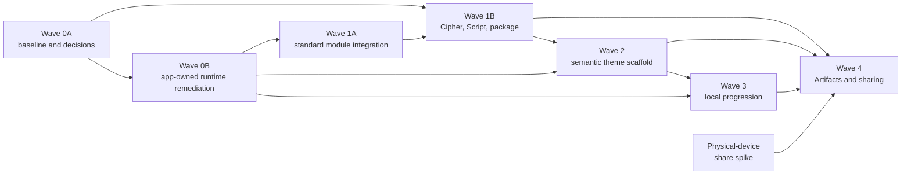

# Codex Roadmap Alignment

> **Superseded dependency sequencing:** Product requirements remain relevant, but the former external-framework gate and transitional-runtime direction are superseded. Current architecture work follows the [controlling Forsetti policy](FORSETTI_CONTROLLING_POLICY.md) and uses an app-owned implementation with a permanent external-dependency prohibition.

## Authority and scope

The hash-locked [Codex System Specification](../product-roadmap/Rune-Scribe-Codex-System-Spec-v1.0.md)
and [Current-App Delta and Implementation Roadmap](../product-roadmap/Rune-Scribe-Codex-Current-App-Delta-and-Implementation-Roadmap-v1.0.md)
remain authority only for nonconflicting product requirements, compatibility anchors,
and sequencing evidence. They do not control framework ownership, runtime mediation,
operational I/O, Settings, or dependency direction. Their repository SHA-256 values are
respectively
`7c4c460815064fca87a6769766fb875f267eb692795bbab2635eec5d55d8f88d` and
`884ad563f7849ebda8326bc742493ce67fb89cfacc14b39e56c792c4f7c52db4`.

The exhaustive machine-readable status is
[`roadmap-alignment.json`](../verification/roadmap-alignment.json). It records all 92
requested BAS, FOR, MOD, DOM, PKG, THM, PRO, and SHR work packages with status,
dependencies, repository evidence, and notes. This page explains the dependency gates
and the implementation boundary in plain language.

Historical P8 verification remains valid evidence for the app state it measured; it is
not the final Codex architecture. The controlling policy and current ledger govern
architecture. The roadmap-specific [`ADR-RS-*` records](decisions/README.md) remain
effective only where they do not conflict with that authority.

## Current result

The repository now has a coherent, compatibility-preserving foundation for the first
Codex domain and package work:

- a versioned Cipher Record migration that preserves keys and converts the mapping into
  an explicit symbol permutation;
- a validated 32-symbol Script descriptor and Base Rune Script with exact current
  output;
- an explicit key-delivery state that does not turn legacy `delivered` into progression
  proof;
- stable neutral Codex, package, operation, relationship, entitlement, and event
  vocabulary;
- the frozen bounded typed `.runescribe` parser/builder and magic-first file routing;
- permanent legacy cipher v3 and message v1 intake, with current sharing still emitting
  legacy formats only; and
- one superseded, nine accepted, and two explicitly blocked architecture decisions,
  plus this auditable roadmap ledger.

That slice is intentionally usable without external services, a physical device,
Contacts permission, login Keychain access, App Store Connect, iCloud, or Game Center.
It does not declare an unused framework dependency and does not claim that theme,
progression, cloud, or public-sharing work is complete.

## App-owned Forsetti remediation gate

Wave 0B is local architecture work. The app-owned runtime must provide generalized
entitlement requirements, live reconciliation, keyed contribution registration, opaque
resource resolution, capability-scoped command/query/state ports, lifecycle and
generation enforcement, optional failure isolation, tests, and permanent guards.

`RuneScribeRuntimeCore` is the continuing control plane. External Forsetti packages,
binaries, source copies, submodules, fetch scripts, and developer-machine checkout paths
are permanently prohibited. Theme and Progression work cannot pass their gates until
the applicable local runtime capabilities and negative enforcement are green.

## Dependency order

The graph is a gate, not just a preferred order. Theme Modules cannot be finalized
against missing runtime contribution/resource APIs. Progression cannot activate earned
providers without live eligibility reconciliation. Themed sharing cannot promise
portable presentation until the Theme scaffold, package validation, progression event
contract, and physical-device transport spike all pass.

## Work-package status

| Group | Current ledger | Dependency and evidence |
|---|---|---|
| BAS-001…010 | 6 satisfied, 2 partial, 1 blocked-device, 1 not-applicable | P8 baseline/build/fixture evidence remains; ADRs and repository policy exist. The old/new destination matrix and documentation checklist remain partial; physical capture requires devices. |
| FOR-001…011 | 11 superseded | The former external-release work packages are retained as historical identifiers; local runtime remediation is governed by the controlling policy and remediation phases. |
| MOD-001…013 | 8 satisfied, 4 transitional, 1 partial | Historical Core/UI separation, adapters, ingress, lock gating, architecture tests, and hosted tests exist. Runtime mediation, manifests, and bootstrap remain incomplete under the controlling policy. |
| DOM-001…007 | 4 satisfied, 3 partial | Cipher/Script migration and an explicit delivery-state foundation exist. End-to-end legacy-font proof, selected-Codex/per-share presentation stores, and removal of the writable `delivered` compatibility rail remain. |
| PKG-001…006 | 4 satisfied, 2 partial | The typed container, legacy readers, policy, and magic-first router exist. Complete fail-before-allocation proof, randomized malformed-input coverage, and allocation instrumentation remain in PKG-003/005. |
| THM-001…012 | 11 not-started, 1 partial | A current UI design system exists, but no descriptor, Coordinator, Base/placeholder Theme Modules, preference/fallback service, or conformance suite exists. Local runtime registries and module contracts are prerequisites. |
| PRO-001…016 | 14 not-started, 2 partial | Event and opaque-token contract foundations exist; the module, store, outbox, rules, catalog, atomic grants, entitlement bridge, views, quarantine, and recovery do not. |
| SHR-001…017 | 7 not-started, 6 partial, 2 decision-frozen, 2 blocked-device | Current legacy share, QR, MessageUI, and completion foundations remain. Final composition and Quick Look decisions require the physical-device spike; themed work depends on PKG, THM, and PRO gates. |

The per-task records in the JSON ledger are normative for status automation. A group
summary never upgrades a child task or removes its explicit `dependsOn` edges.

## Frozen compatibility and safety decisions

### Typed container

[`ADR-RS-004`](decisions/ADR-RS-004-typed-runescribe-container.md) freezes an 8-byte
`RSCRPKG\n` magic, 32-byte big-endian fixed header, independent payload kind/version,
16-byte directory records, canonical unique contiguous sections, and full 32-byte
SHA-256 trailer. The package is bounded to 16 MiB and 16 sections, with independent
limits for Core, presentation, preview, resources, and provenance. Unknown optional
sections are retained/skipped; unknown required sections are rejected. Missing magic
falls back to the legacy byte classifier.

### Outbound compatibility

[`ADR-RS-005`](decisions/ADR-RS-005-forward-compatibility.md) keeps production outbound
sharing legacy-only until product review approves a measured transition. The vNext
parser and builder do not authorize emitting vNext content, and metadata is never
appended to legacy trailing font bytes.

### Share completion

[`ADR-RS-006`](decisions/ADR-RS-006-share-route-completion.md) makes presentation
nonterminal and distinguishes cancellation, public-system completion, confirmed sent,
failure, and unavailable completion. A tap, export, copy, or opened sheet is not
delivery or progression proof. First delivery advances only after an eligible terminal
result and required attachment acceptance.

## Next executable gates

1. Finish PKG-003/005 fail-before-allocation proof, randomized malformed-input tests,
   and bounded-allocation instrumentation without changing legacy outbound behavior.
2. Finish DOM-005/006/007 compatibility rendering, presentation-state ownership, and
   atomic delivery-state migration while keeping legacy decode behavior.
3. Complete BAS-008's old/new compatibility and update-required test matrix.
4. Complete the app-owned runtime's per-call mediation, standard ports, I/O, Settings,
   resource, contribution, state, and live-reconciliation gates.
5. Make the applicable compliance rules and negative mutations blocking before starting
   the three-provider Theme scaffold.
6. Run SHR-001 on physical devices before selecting permanent invitation composition or
   Quick Look scope.

These gates preserve unattended development: package, architecture, and ad-hoc-signed
Simulator/macOS tests should be preferred until a task explicitly requires external
configuration or physical-device evidence.
