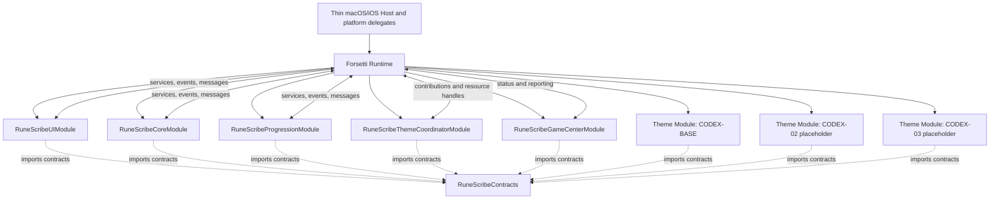
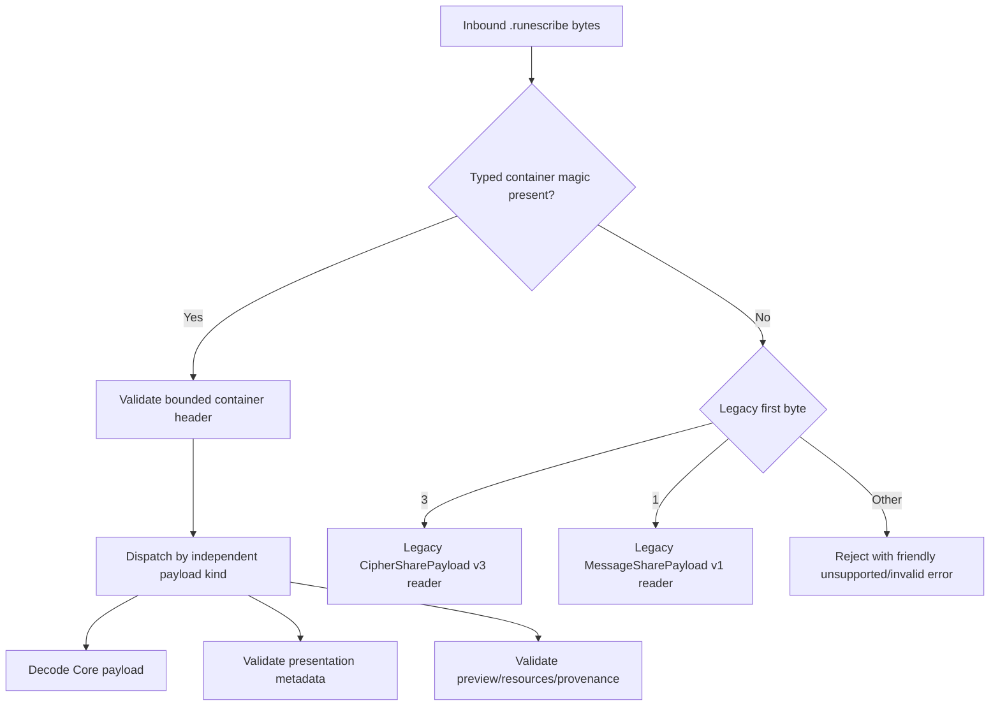
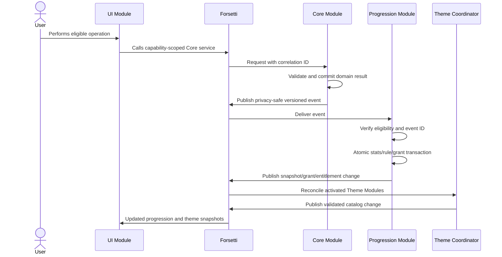

# Rune Scribe Codex System
## Current-App Delta Assessment and Implementation Roadmap

**Document version:** 1.0  
**Decision status:** Implementation planning baseline  
**Date:** August 7, 2026  
**Product:** Rune Scribe for macOS and iOS  
**Parent specification:** *Rune Scribe Codex System Specification v1.0*  
**Framework:** Forsetti Framework for Mac/iOS, Pattern B  
**Code-change status:** No production code was changed for this assessment.

---

# 1. Purpose and authority

This document answers two questions:

1. **What must be preserved, refactored, extended, or newly built on top of the current Rune Scribe application to implement the locked Codex System?**
2. **In what order should that work be implemented so the existing app remains usable, secure, backward-compatible, and releasable throughout the migration?**

This is an app-specific implementation roadmap. It is subordinate to the locked product and architecture decisions in *Rune Scribe Codex System Specification v1.0*. It does not reopen the product terminology, Forsetti Pattern B topology, progression ownership model, Game Center role, iCloud scope, or collectible rules already locked there.

Where this document identifies a current-code constraint, the attached Rune Scribe source archive is the authority. Where it describes the target product behavior, the locked Codex specification is the authority. Where it describes Forsetti behavior, the public Forsetti contracts and documentation are the authority.

---

# 2. Executive assessment

## 2.1 Overall conclusion

The Codex System should be implemented as a **staged extraction and extension of the existing app, not a rewrite**.

The current application is small enough to modularize safely, and several load-bearing subsystems are already separated into focused models and services:

- AES-GCM message encryption and authenticated opening.
- Message framing and Base-32/rune conversion.
- Cipher-library persistence.
- Contact organization and encrypted contact storage.
- Cipher and message import routing.
- First-delivery key inclusion.
- Versioned `.runescribe` payloads.
- Font identity, hash validation, storage, and registration.
- QR generation and import.
- iOS MessageUI attachment handling.
- App Lock and cold-launch import gating.

Those components provide a strong migration base. They do **not**, however, already constitute Forsetti modules. The current app is a shared-source SwiftUI monolith with app-wide singletons, direct `EnvironmentObject` injection, direct `NotificationCenter` navigation signals, hard-coded Norse presentation, and no progression, iCloud, Game Center, Theme Module, or artifact-rendering layer.

The implementation therefore has five broad jobs:

1. **Establish the Forsetti runtime and module boundaries without changing the product.**
2. **Separate cipher/security state from visual presentation and introduce a safe extensible package envelope.**
3. **Replace the hard-coded Rune interface with one semantic UI scaffold and conforming placeholder Theme Modules.**
4. **Add the Progression Module, Vault, Archive, achievements, unlocks, statistics, and earned-entitlement bridge.**
5. **Add themed sharing, encounter handling, private iCloud synchronization, and optional Game Center reporting.**

## 2.2 Recommended release strategy

Do not combine the entire architecture migration and all visible Codex features into one first public build.

The safest sequence is:

1. **Foundation maintenance release:** Forsetti host, Core Module, UI Module, contract boundaries, and compatibility tests; no visible redesign.
2. **Internal Codex scaffold build:** Base and two placeholder Theme Modules; semantic UI scaffold; no production theme identities.
3. **Codex beta:** local progression, Vault, Archive, achievements, unlocks, and themed sharing.
4. **Synchronization beta:** iCloud merge and Game Center reporting.
5. **Public Codex release:** production themes replace placeholders only after the scaffold and conformance suite are proven.

This sequencing makes regressions attributable. A failure in cipher import after the foundation release is an architecture migration defect; a failure in an Artifact preview in the Codex beta is a presentation defect. Combining both in one release would make diagnosis and rollback unnecessarily difficult.

## 2.3 Critical path


Two workstreams may begin early in parallel with the critical path:

- A physical-device sharing spike to determine the best Messages presentation for an image, `.runescribe` package, deep link, and Quick Look thumbnail.
- Design and unit testing of the progression event schema and rule catalog, provided no production module imports are created before the Contracts target is settled.

---

# 3. Audit baseline and limitations

## 3.1 Source baseline

The assessment used the attached source archive:

- **Archive:** `rune-scribe-main.zip`
- **SHA-256:** `cda6ac0c236f019de1febe659562bee92f5f85868202697f960c6847a45973d1`
- **Declared app version:** 1.0.33
- **Declared build:** 33
- **Swift language version:** 6.0
- **Minimum macOS:** 15.0
- **Minimum iOS:** 17.0
- **Bundle identifier in both app targets:** `com.runescribe.app`

The locked specification assessed was:

- **Document:** `Rune-Scribe-Codex-System-Spec-v1.0.md`
- **SHA-256:** `7c4c460815064fca87a6769766fb875f267eb692795bbab2635eec5d55d8f88d`

Two attached `.runescribe` examples were also inspected. They are byte-identical, begin with the current cipher payload version byte `3`, and can be retained as a real-world legacy fixture after confirming that they contain no material that should be excluded from the test repository.

## 3.2 Static inventory

| Measure | Current archive |
|---|---:|
| App Swift files | 51 |
| App Swift source lines | 6,588 |
| Unit-test Swift files | 22 |
| Unit-test source lines | 1,802 |
| Statically identified `test…` methods | 148 |
| App targets | 2: macOS and iOS |
| Test targets | 1 macOS-hosted unit-test bundle |
| Swift package dependencies declared in `project.yml` | 0 |
| Forsetti dependency or module manifest | None |
| UI-test target | None |
| Quick Look extension target | None |

The README contains conflicting test-count references, and the consolidated Wiki is materially older than the source archive in several areas. The source code and current `project.yml` were therefore treated as authoritative for this assessment. Documentation synchronization is a roadmap work item, not an optional cleanup.

## 3.3 Verification limitation

This review was performed in a Linux analysis environment without Xcode, Apple SDKs, Simulator runtimes, signing identities, Keychain services, MessageUI, GameKit, CloudKit, or macOS/iOS runtime support. The source could be statically inspected, but the Xcode schemes and tests could not be compiled or executed here.

Consequently:

- This document does not claim that the current test suite passed during this review.
- Physical-device behavior in Messages, Share sheets, Universal Links, document opening, Quick Look, iCloud, and Game Center remains subject to Apple-platform testing.
- The first implementation phase must establish a reproducible macOS/iOS build-and-test baseline before moving files across targets.

---

# 4. Current application assessment

## 4.1 Project composition

The project is generated with XcodeGen from `project.yml` and currently contains:

- `RuneScrib-macOS`
- `RuneScrib-iOS`
- `RuneScribTests`

Both application targets compile the same `RuneScrib` source directory. There are no app-owned Swift package products or Forsetti module targets. The app entry point directly constructs the current root UI and injects five global observable singletons:

- `KeyManager.shared`
- `AppLock.shared`
- `ImportCoordinator.shared`
- `MessageCoordinator.shared`
- `ContactManager.shared`

The app and scene delegates also call global services directly. This is workable in the current compact app, but it conflicts with the locked Forsetti rules requiring constructor-defined boundaries, capability-scoped service access, framework-mediated communication, and no direct runtime-module coupling.

## 4.2 Current UI composition

The current interface is one SwiftUI application rooted in `RootView` and `ContentView`.

The largest UI files are:

| File | Approximate lines | Current responsibility |
|---|---:|---|
| `ContentView.swift` | 625 | Main encode/decode workspace, recipient selection, share construction, message sending, navigation state |
| `CipherLibraryView.swift` | 513 | Cipher list, active selection, contact assignment, share link, QR, export, rename, delete |
| `ContactsView.swift` | 309 | Contact management |
| `VideoSplashView.swift` | 223 | Splash scheduling and platform video surfaces |
| `ContactImportPicker.swift` | 205 | Contact-import UI and selection flow |
| `RuneTheme.swift` | 197 | Global metrics, hard-coded colors, runic font resolution, header and panel components |
| `QRScannerView.swift` | 197 | iOS camera scanner |
| `SettingsView.swift` | 194 | App Lock, Contacts, About, and License |

The current design language is consistently implemented, but it is **hard-coded as one Norse theme**:

- Global `Color.rune…` values.
- Global `RuneMetrics` values.
- `RuneHeader` and `RunePanel` components.
- Hard-coded runic labels in screens.
- A fixed runic font resolution path.
- Rune-specific Metal presentation.
- Rune-specific terminology in About copy.

This means the existing `RuneTheme.swift` is a useful starting inventory, but it is not a reusable Theme Module contract. It must be refactored into semantic UI roles interpreted by the one UI Module.

## 4.3 Current domain and security model

### Cipher model

`Cipher` currently combines four distinct concerns:

1. **Cryptographic material:** 32-byte AES key.
2. **Shared decoder identity:** 8-byte public ID and 32-entry symbol permutation.
3. **Presentation:** `FontRef` and a fixed Rune alphabet interpretation.
4. **Relationship state:** contact ID and a Boolean first-delivery flag.

This is the most important current-model seam. The key and symbol permutation are reusable. The font and future Codex selection cannot remain intrinsic to the cipher if the same cipher may be presented through multiple Scripts and Codices.

### Message cryptography

The app already uses authenticated encryption and separates:

- `MessageCryptor`
- `MessageEnvelope`
- `MessageService`
- `RuneCodec`

These are strong candidates for preservation behind Core Module protocols. They should not be rewritten merely to create modules.

### Secure persistence

- The Cipher Library is serialized and AES-GCM encrypted, with storage managed through the Keychain path in `KeyManager`/`KeychainService`.
- Contacts are AES-GCM encrypted in Application Support, using a Keychain-held symmetric key.
- The app-lock PIN and throttle state are kept through Keychain-backed logic.
- Imported fonts are content-addressed by SHA-256, validated before storage, and registered only after validation.

The new progression database must remain separate from all of these stores, as required by the locked specification.

### Current contact-store ambiguity

`ContactStore.load()` returns an empty book both when the file is genuinely absent and when an existing file cannot be read or decrypted. Its own comments warn callers not to overwrite that ambiguous empty result. The current behavior should not be copied into the progression store. All new persistent stores need explicit load outcomes such as absent, loaded, migration-required, quarantined, unreadable, or corrupt.

## 4.4 Current import and routing model

The app has one conceptual inbound funnel:

- App/scene callbacks and SwiftUI `onOpenURL` call `InboundOpenRouter`.
- File URLs go to `FileRouter`.
- Custom-scheme or legacy HTTPS links go to `LinkRouter`.
- Cipher inputs surface through `ImportCoordinator`.
- Message files surface through `MessageCoordinator`.
- `RootView` gates import/decrypted-message presentation behind the splash and App Lock.

This topology is worth preserving. What must change is **how the components are reached**:

- Static routers currently call singleton coordinators.
- Coordinators directly call concrete managers and `FontStore.shared`.
- Root UI directly observes those concrete coordinators.
- Reply navigation uses `NotificationCenter`.

Under Forsetti, the app/scene entry points should convert platform input into a small host-to-framework route request. Core should normalize and validate it. The UI should receive a framework-mediated presentation state. No host callback should reach into a concrete runtime module singleton.

## 4.5 Current `.runescribe` formats

### Cipher share payload

The current cipher payload is version 3 and exactly 129 bytes before optional font bytes:

```text
version(1)
publicID(8)
keyMaterial(32)
decorativeMapping(32)
fontID(16)
fontVersion(4)
fontSHA256(32)
checksum(4)
```

A file may append raw font bytes after the 129-byte record.

### Message share payload

The current message payload is version 1:

```text
version(1)
flags(1)
senderNameLength(1)
senderName(variable)
envelopeLength(2)
envelope(variable)
optional embedded CipherSharePayload v3 (129)
checksum(4)
optional trailing font bytes
```

### Current file-type classification

Both records use the same UTI and `.runescribe` extension. `FileRouter` identifies the payload kind by comparing the **first byte** to:

- `3` for a cipher payload.
- `1` for a message payload.

This means “payload kind” and “payload format version” currently occupy the same byte namespace. It worked while there were two fixed formats, but it is not safe as the foundation for messages, cipher invitations, presentation metadata, official challenges, signed grants, future resource sections, and provenance.

A typed container envelope is therefore a prerequisite—not an optional cleanup.

## 4.6 Current outbound sharing behavior

### Cipher Library share

The Cipher Library currently shares a raw `runescribe://import?...` URL through `ShareLink`. Export still produces a `.runescribe` file. QR uses the same import URL.

This is precisely the user-facing path the new Artifact presentation is intended to replace or visually mask. The link must remain available as a transport/fallback where required, but it should no longer be the dominant visible object.

### Message share

The current first message to a linked contact may include:

- Visible rune text.
- Product link.
- A `.runescribe` message file containing the encrypted envelope and embedded cipher key.

Subsequent messages are plain rune text only. No file is attached because the recipient already has the key.

That later-message policy is insufficient for arbitrary Codex Scripts because plain text alone does not reliably carry:

- Codex ID.
- Script ID.
- Relic/Seal/Frame/Effect IDs.
- Static preview.
- Provenance.
- Custom Script portability rules.

The Codex sharing design should therefore treat a versioned message package as the canonical transport for every customized/themed share, while including the key only when the existing first-delivery rule requires it. “Copy Runes” can remain a manual plain-text fallback with documented Script limitations.

### Completion semantics defect for progression

The iOS `MessageComposeView` path correctly waits for an actual `.sent` result and confirms that a required attachment was accepted before consuming first delivery.

The generic `ShareLink` path does not have equivalent evidence. It currently marks the cipher delivered through a tap gesture as soon as the Share sheet is opened. A user may cancel immediately, yet `delivered` becomes true.

Implications:

- Existing `delivered == true` cannot be treated as reliable historical proof of a completed share.
- It should not retroactively grant “Known in Five Circles” or similar achievements.
- Generic Share handling must be replaced or wrapped with a route that exposes completion/cancellation semantics before progression awards an eligible share event.
- First-key-delivery state and progression share-completion state should become separate concepts even when one action updates both.

## 4.7 Current Fonts and Scripts

The existing font system is unusually useful for the Codex migration:

- `FontRef` has an ID, version, and SHA-256 identity.
- `FontStore` validates bytes against the expected hash.
- Imported fonts are content-addressed to prevent path traversal through an attacker-controlled ID.
- The bundled font is not redundantly attached.

However, the current codec assumes one fixed Unicode Rune alphabet. A Codex Script requires two layers:

1. The cipher's existing 32-entry symbol permutation, which remains shared decoder state.
2. A Script-provided ordered set of 32 display symbols/resources.

The existing Noto Sans Runic presentation becomes the Base Codex Script. Imported per-cipher fonts remain supported as legacy/custom rendering compatibility; they do not become executable Theme Modules and do not define unlock rules.

## 4.8 Current cloud and game-service state

The app currently has:

- No CloudKit/Core Data/SwiftData progression store.
- No iCloud container entitlement.
- No GameKit integration.
- No Game Center entitlement.
- No Game Center identifiers or reporting queue.
- No network behavior in the app's normal cipher/message path.

These integrations are net-new and should be added only after local progression is deterministic and tested.

## 4.9 Current tests

The current unit tests provide valuable coverage for:

- Cipher models and library mutation.
- AES-GCM message cryptography.
- Message envelope framing.
- Rune codec behavior.
- Cipher and message payloads.
- Link and file routing.
- Contacts and encrypted contact storage.
- Font validation.
- First-delivery and MessageUI attachment policy.
- App Lock behavior.

The missing test categories are:

- Forsetti module-boundary and manifest tests.
- Architecture import-policy tests.
- UI tests.
- Theme descriptor and resource-conformance tests.
- Snapshot tests across themes/platforms.
- Accessibility tests.
- Typed package vNext compatibility/fuzz tests.
- Progression idempotency and rule-engine tests.
- iCloud merge tests.
- Game Center reporting tests.
- Quick Look extension tests.
- Full physical-device Messages and cold-launch matrices.

---

# 5. Build-on, refactor, and new-build matrix

## 5.1 Preserve behind a Core boundary

These components should be retained conceptually and moved behind protocols/adapters with minimal behavioral change first:

| Current component | Disposition | Notes |
|---|---|---|
| `MessageCryptor` | Preserve | Keep AES-GCM behavior and golden vectors. |
| `MessageEnvelope` | Preserve | Keep legacy reader; add package-container framing outside it. |
| `MessageService` | Preserve/refine | Expose through Core service contract. |
| `CipherLibrary` | Preserve/migrate | Add explicit schema migration; do not replace key material. |
| `KeychainService` | Preserve/refactor | Remove global access; inject narrow secure-storage interfaces. |
| `AppLock` algorithm and throttle | Preserve/refactor | UI presentation stays in UI Module; secure logic stays Core. |
| `Contact`, `ContactBook` | Preserve | Keep data minimization and local organization. |
| `ContactStore` encryption | Preserve/refine | Add explicit load-state and corruption handling. |
| `FontRef` and hash checks | Preserve | Generalize resource vocabulary without weakening validation. |
| `FontStore` validation/storage | Preserve/refactor | Inject it; split legacy imported fonts from official theme resources. |
| `QRCodeGenerator` | Preserve | UI requests generation through an appropriate service. |
| Pure router classification | Preserve | Dispatch through framework services instead of singletons. |
| `MessageAttachmentPolicy` | Preserve | Continue testing pure completion/attachment rules. |
| Legacy payload decoders | Preserve indefinitely | Current and prior supported `.runescribe` content must remain readable. |

## 5.2 Refactor before visible features

| Current area | Required change |
|---|---|
| `RuneScribApp` | Becomes a thin composition root that boots Forsetti and renders the one UI Module. |
| `AppDelegate` / scene delegate | Forward platform opens into a host-level framework route service; no concrete module singleton calls. |
| `KeyManager` | Split persistence/domain service from UI-observable state; inject storage/font dependencies; publish snapshots through Forsetti. |
| `ContactManager` | Split domain mutations from UI observation; inject store and Core cipher relationship service. |
| `ImportCoordinator` | Replace singleton UI state with Core intake result plus UI presentation state. |
| `MessageCoordinator` | Separate package admission, key ingestion, decryption, association, and UI read model. |
| `RootView` | Move into UI Module shell; preserve lock/splash/inbound gating. |
| `ContentView` | Split workspace view, workspace view model, encode/decode commands, and share orchestration. |
| `CipherLibraryView` | Split read model and commands; route sharing into the new Share Builder/Quick Share service. |
| `NotificationCenter` navigation | Replace with UI-owned router state and Forsetti events/messages for cross-module changes. |
| `@EnvironmentObject` concrete managers | Replace with UI-module view models/read services constructed from capability-scoped interfaces. |
| Global Rune design tokens | Replace with semantic tokens resolved from selected Codex. |
| `Cipher.fontRef` as current presentation | Migrate to legacy compatibility/default metadata; active Codex lives outside cipher. |
| `Cipher.delivered` | Retain for migration/key exchange but evolve into explicit delivery state; do not use as generic share proof. |
| Leading-byte file classification | Retain as legacy fallback only; add a typed vNext container. |

## 5.3 Entirely new construction

The current app has no equivalent for the following:

- `RuneScribeContracts` neutral target.
- Forsetti Pattern B manifests and module factories.
- Thin Forsetti host/bootstrap.
- `RuneScribeCoreModule` wrapper and service contracts.
- `RuneScribeUIModule` target.
- `RuneScribeProgressionModule`.
- `RuneScribeThemeCoordinatorModule`.
- Optional `RuneScribeGameCenterModule`.
- Base Theme Module extracted from current presentation.
- `[CODEX-02]` placeholder Theme Module.
- `[CODEX-03]` placeholder Theme Module.
- Generalized earned-entitlement bridge to Forsetti.
- Keyed theme-contribution registry and opaque resource resolution if absent upstream.
- Theme descriptor/resource schemas and validation.
- Semantic UI token interpreter.
- Theme conformance harness.
- Vault, Archive, Achievements, and Statistics screens.
- Unlock reveal flow.
- Local progression database and event ledger.
- Rule engine and initial 15-Achievement catalog.
- Pseudonymous relationship-token service.
- Artifact ownership, Encounter, provenance, and availability records.
- Typed `.runescribe` package container.
- Presentation metadata section.
- Artifact/static-preview renderer.
- Quick Share defaults and customizable Share Builder.
- Quick Look thumbnail extension, subject to spike validation.
- Private iCloud progression synchronization and deterministic merge.
- Game Center authentication/reporting/outbox.
- New entitlements, App Store Connect configuration, and privacy disclosures.
- Architecture, UI, cloud, Game Center, and theme-conformance tests.

---

# 6. Architecture decisions required before implementation

The locked specification defines the target architecture. The following app-specific decisions must be recorded as Architecture Decision Records before production migration begins.

## ADR-RS-001 — Module packaging and target graph

**Recommended decision:** Implement app-owned modules as local Swift Package targets or equivalently isolated Xcode framework targets, while retaining the existing macOS and iOS host application targets generated by XcodeGen.

Required dependency direction:

```text
Host applications
  ├── Forsetti public products
  ├── RuneScribeUIModule factory
  ├── RuneScribeCoreModule factory
  ├── RuneScribeProgressionModule factory
  ├── RuneScribeThemeCoordinatorModule factory
  ├── RuneScribeGameCenterModule factory
  └── Theme Module factories

Every runtime module
  ├── Forsetti public products
  └── RuneScribeContracts

No runtime module imports another runtime module.
```

The Host may import module factories because it is the composition root. Runtime implementation targets may not import one another.

## ADR-RS-002 — Cipher material versus Script presentation

**Recommended decision:** Preserve the existing 32-entry permutation as shared cipher/decoder state, but rename its role to a symbol permutation. A Script supplies the ordered 32-symbol presentation alphabet.

Conceptual transformation:

```text
Encrypted envelope bytes
      ↓ base-32 value 0...31
Cipher symbol permutation
      ↓ symbol slot 0...31
Selected Codex Script
      ↓ visible glyph/resource
```

This allows the same AES key and shared permutation to render through multiple Scripts without key rotation.

The active Codex, Relic, Seal, Frame, and Effect must not be stored as cryptographic cipher material.

## ADR-RS-003 — Legacy custom-font compatibility

**Recommended decision:** Preserve existing `FontRef` values in a legacy presentation compatibility record. Imported fonts remain Core-managed, hash-validated resources. They are not Theme Modules and do not gain arbitrary UI or unlock behavior.

Existing ciphers migrate to:

- The unchanged key and symbol permutation.
- Base Codex as the ordinary presentation default.
- A legacy font override only where needed to render historical or imported cipher content.

## ADR-RS-004 — Typed `.runescribe` container

**Recommended decision:** Add a container with a magic value, independent container version, independent payload kind, bounded section lengths, and optional presentation/resource/provenance sections. Continue legacy classification when the magic value is absent.

Conceptual sections:

```text
Magic
Container version
Payload kind
Flags
Core payload length
Presentation metadata length
Preview/resource table lengths
Core cipher/message payload
Presentation metadata
Optional safe preview/resources
Integrity checksum
Optional signed provenance
```

The exact binary encoding is an implementation detail to freeze in this ADR. Required properties are:

- Payload kind and version are not conflated.
- Unknown optional fields can be skipped.
- Required unsupported versions fail safely.
- Section lengths and total package size are bounded before allocation.
- Theme code is never carried in the package.
- Plaintext, contact identity, and Game Center identity are excluded from presentation metadata.
- Legacy v3 cipher and v1 message readers remain available.

## ADR-RS-005 — Old-app forward compatibility policy

A new app can read old content. An old app cannot automatically understand an arbitrary vNext container.

Before vNext sharing is enabled publicly, choose one staged-rollout policy:

1. **Compatibility mode:** share a legacy transport plus themed preview during the transition.
2. **Dual-item share:** include a legacy `.runescribe` item and a static image/link where the destination supports it.
3. **Minimum-version transition:** enable vNext after a forced or strongly prompted update threshold.
4. **vNext-only with graceful old-client failure:** acceptable only after product review confirms the installed-base impact.

Do not attempt to append Codex metadata to the current message payload's trailing bytes. Current decoders interpret all trailing bytes as a font blob, so such overloading is ambiguous and unsafe.

## ADR-RS-006 — Share-route completion semantics

Define a normalized route result model:

- Presented.
- Cancelled.
- Completed by operating-system callback.
- Sent-confirmed by MessageUI.
- Failed.
- Completion unavailable.

Progression policy:

- Opening a share sheet never counts.
- A generic route may count as an “eligible share completed” only when its supported callback reports completion.
- MessageUI `.sent` may count as sent-confirmed.
- No route claims recipient identity, install, purchase, or successful reading.
- First-delivery progression requires a linked relationship and a valid first-delivery state transition.
- Exporting a file alone does not prove delivery.

## ADR-RS-007 — Themed follow-up transport

**Recommended decision:** Every themed/customized message share carries a message package, even after the cipher key has already been delivered. The key is embedded only on first delivery; subsequent packages carry only the encrypted envelope and presentation metadata.

Manual “Copy Runes” remains available, but it is a compatibility path rather than the authoritative Artifact transport.

## ADR-RS-008 — Progression persistence technology

Select a local-first model that can be mirrored into the user's private iCloud data while supporting deterministic merge and migration. The preferred candidate is an Apple-native Core Data/CloudKit stack because the required merge records are explicit and the locked specification already defines per-device counter shards and set-union records.

The ADR must document:

- Local entity schema.
- Cloud record mapping.
- Migration strategy.
- Store corruption/quarantine behavior.
- Reset/tombstone behavior.
- Test harness and in-memory store.
- Why the chosen API is preferable to alternatives for this product.

## ADR-RS-009 — Relationship-token derivation

The token must be:

- Stable enough for the local relationship's progression lifecycle.
- Non-reversible without a secret.
- Excluded from user-facing and share metadata.
- Safe to union in private iCloud data.
- Independent from a contact's name, phone, email, or Apple Contacts identifier.

The ADR must explicitly address multi-device duplicate relationships because ciphers and contacts are not currently synchronized through the new progression store.

## ADR-RS-010 — Theme resource delivery and size budgets

Theme Modules ship in the signed app bundle. Freeze:

- Maximum descriptor size.
- Maximum static image dimensions and bytes.
- Maximum animation/sound budgets.
- Allowed resource types.
- Hash algorithm and validation behavior.
- Whether fonts are registered per module or resolved through an opaque framework resource handle.
- Cache and memory-pressure policy.

## ADR-RS-011 — Game Center App Store record strategy

Verify whether macOS and iOS are platform versions in one App Store Connect app record or separate records. Record whether a Game Center group is required before permanent Achievement identifiers are created.

## ADR-RS-012 — Cipher-invitation presentation

The current Cipher Library shares a custom-scheme URL because it gives the most direct import path. The new plan needs a tested composition that looks like an Artifact while retaining a tappable/importable transport.

Evaluate on physical devices:

- Image plus custom-scheme URL.
- Image plus HTTPS rich link.
- `.runescribe` file with Quick Look thumbnail.
- Multiple share items in Messages, Mail, Notes, and AirDrop.
- Dedicated MessageUI composition.

The result of this spike controls the final Share Builder output for cipher invitations.

---

# 7. Target Forsetti topology

## 7.1 Runtime modules



The dotted contract arrows represent compile-time imports. Runtime arrows pass through Forsetti. There are no direct module-to-module runtime calls.

## 7.2 Neutral Contracts target

Minimum contract groups:

### Stable IDs

- Module ID.
- Codex ID.
- Script ID.
- Artifact/Relic/Seal/Frame/Effect ID.
- Achievement/rule/unlock ID.
- Event and correlation ID.
- Privacy-safe cipher/message/relationship tokens.
- Package kind and version IDs.

### Core service contracts

- Cipher-library read snapshot and commands.
- Encode/decode request and response.
- Package build/admit request and response.
- Contact/relationship organization snapshot and commands.
- App-lock state and commands.
- Share-route normalization command.
- Import-route command.

### Progression service contracts

- Progression snapshot.
- Achievement catalog/detail.
- Statistics snapshot.
- Ownership and Encounter snapshot.
- Pending unlock/reveal state.

### Theme contracts

- Theme descriptor.
- Semantic palette and typography roles.
- Script descriptor and portability class.
- Artifact descriptors.
- Share-layout contract.
- Opaque resource identifier/handle.
- Validation result and fallback reason.

### Event contracts

- Versioned event envelope.
- Core domain events.
- Progression completion/grant events.
- Theme catalog/selection events.
- Game Center status events.

The Contracts target must not include concrete stores, SwiftUI views, GameKit, CloudKit, Keychain access, or theme artwork.

## 7.3 Forsetti extension work

The current public Forsetti model clearly supports Pattern B, module manifests, capability-scoped services, framework events/messages, UI contributions, and entitlement reconciliation. The current entitlement manifest field is purchase-oriented through `iapProductID`; the Codex plan requires an earned entitlement namespace.

The framework phase must validate and, where absent, add public reusable support for:

1. **Generalized entitlement requirements** not named or modeled solely as IAP products.
2. **Composite entitlement sources** so included, earned, future StoreKit, and debug entitlements can coexist.
3. **Runtime entitlement-change reconciliation** after Progression grants a Codex creation right.
4. **Keyed content contributions** so multiple Theme Modules register by Codex ID without unordered “last contribution wins” behavior.
5. **Opaque resource resolution** so the UI/Theme Coordinator can resolve module-owned assets without importing a concrete Theme Module or guessing bundle paths.
6. **App-defined capability-scoped service registration**, if the current service container does not already expose a sufficient public extension point.
7. **Source identity and lifecycle enforcement** for contribution registration/removal.

All such changes belong in the Forsetti repository as general framework features with framework tests, documentation, and a released semantic version. Rune Scribe must not carry a private fork or copied framework source.

---

# 8. Current-file migration map

This is a planning map, not a directive to move every file unchanged. Several large views and managers should be split during migration.

## 8.1 Host/bootstrap

| Current file | Target disposition |
|---|---|
| `App/RuneScribApp.swift` | Reduce to Forsetti bootstrap, root host view, module-factory registration, and host-only commands. |
| `App/AppDelegate.swift` | Retain platform callbacks; route into a host/Forsetti ingress interface. |
| `project.yml` | Add Forsetti package, app-owned module products, manifests/resources, Quick Look extension, UI-test target, and entitlements. |
| Info plists/entitlements | Preserve current URL/UTI/permissions; later add iCloud, Game Center, and extension declarations. |

## 8.2 Core Module candidates

| Current file/group | Target disposition |
|---|---|
| `Models/Cipher.swift` | Migrate to versioned Core record; separate legacy presentation and explicit relationship/delivery state. |
| `Models/CipherLibrary.swift` | Core persistence model with migration. |
| `Models/MessageEnvelope.swift` | Core legacy-compatible framing. |
| `Models/CipherSharePayload.swift` | Legacy codec inside package subsystem. |
| `Models/MessageSharePayload.swift` | Legacy codec inside package subsystem. |
| `Models/Contact.swift`, `ContactBook.swift` | Core contact organization. |
| `Models/FontRef.swift` | Core legacy/imported Script resource identity and shared resource primitives where appropriate. |
| `Services/MessageCryptor.swift` | Core cryptography. |
| `Services/MessageService.swift` | Core compose/read service. |
| `Services/RuneCodec.swift` | Generalize to Script-aware symbol codec while retaining Base Rune behavior. |
| `Services/MessageSend.swift` | Replace with package/share-domain builder; keep pure attachment policies. |
| `Services/KeyManager.swift` | Split into cipher repository, cipher service, migration service, and read-model publisher. |
| `Services/KeychainService.swift` | Core platform secure-storage adapter behind protocol. |
| `Services/ContactStore.swift` | Core contact repository with explicit load states. |
| `Services/ContactManager.swift` | Split domain service from UI observable manager. |
| `Services/FontStore.swift` | Core legacy/imported font repository; no singleton. |
| `Services/AppLock.swift` | Core lock service; UI state exposed through snapshot. |
| `Services/FileRouter.swift` | Pure classifier/reader becomes Core intake; platform file access begins at Host/UI adapter. |
| `Services/LinkRouter.swift` | Pure link classifier becomes Core intake. |
| `Services/ImportCoordinator.swift` | Decompose into Core intake operation and UI pending-confirmation model. |
| `Services/MessageCoordinator.swift` | Decompose into package admission, key ingestion, decrypt, relationship update, and UI result. |

## 8.3 UI Module candidates

| Current file/group | Target disposition |
|---|---|
| `Views/RootView.swift` | UI shell, splash/lock overlay, inbound presentation gating. |
| `Views/ContentView.swift` | Split into Scribe workspace, view model, recipient section, result section, and share launcher. |
| `Views/CipherLibraryView.swift` | Library UI consuming Core snapshots; share action opens Quick Share/Share Builder. |
| `Views/ContactsView.swift` | UI over Core contact service. |
| `Views/SettingsView.swift` | Extend with Appearance/Codices, Game Center, iCloud Progression, and diagnostics. |
| `Views/ImportConfirmView.swift` | UI confirmation over an opaque pending-import handle. |
| `Views/ReceivedMessageView.swift` | UI over admitted/decrypted message read model; Reply becomes UI router intent. |
| `Views/Components/MessageComposeView.swift` | UI platform adapter; report normalized result to Core. |
| `Views/Components/QRScannerView.swift` | UI platform adapter; route decoded text through Core service. |
| `Views/ContactImportPicker.swift` and UI portions of `ContactImporter` | UI Module; Core receives sanitized selected contact data. |
| `Views/Components/DecoderDocument.swift` | UI/system transfer adapter using Core-produced bytes. |
| `Services/Clipboard.swift` | UI/platform adapter, not Core business logic. |
| `Metal/*` | UI Module rendering implementation behind semantic Theme inputs. |
| `VideoSplashView`, PIN views, License view | UI Module. |

## 8.4 Base Theme Module extraction

Extract from current resources/components:

- Current palette values, renamed as semantic roles.
- Current Noto Sans Runic Script resources.
- Current Rune background/Metal parameters.
- Base Codex card and locked silhouette.
- Placeholder Relics and Seals sufficient for conformance testing.
- Accessibility text and static fallbacks.

Do not move `RuneHeader`, buttons, panels, navigation, settings, or screens into the Base Theme Module. Those remain in the UI Module.

## 8.5 Progression, Theme Coordinator, and Game Center

These are new targets with no direct current-file migration. Only domain facts and UI integration points are derived from current behavior.

---

# 9. Core data-model migration

## 9.1 Cipher record

The existing encrypted Cipher Library remains the source of cipher keys. Migration must be idempotent and preserve every current key, public ID, symbol permutation, origin, contact link, creation date, and label.

Recommended conceptual Core record:

```text
CipherRecord
  identity
    local UUID
    public ID
    origin
    created date
    label
  cryptographic material
    AES key material
    symbol permutation
  relationship
    local contact link
    explicit key-delivery state
  compatibility
    original record version
    legacy FontRef / Script compatibility data
```

The selected Codex and per-share Artifact choices do not belong in this record.

## 9.2 Delivery state

Replace the ambiguous Boolean in the active domain model with an explicit state such as:

- Not linked.
- Linked, key not delivered.
- Delivery in progress.
- Key delivery completed under route semantics.
- Delivery state imported/migrated but not progression-verified.

The exact enum is implementation work. The important planning rule is that key-exchange state and progression evidence are not one Boolean.

## 9.3 Existing-user progression migration

On first Progression Module initialization:

- Grant Base Codex ownership/create entitlement.
- Grant Base default Relic and included Seals.
- Seed generated/imported cipher counts only from unambiguous current records.
- Do not invent past encode, decode, share, Artifact-use, or Encounter history.
- Do not award distinct-relationship achievements from current `delivered` flags.
- Optionally record a non-awarding migrated-delivery fact for future key-exchange continuity.
- Record migration version and transaction ID so relaunch or cloud replay cannot repeat grants.

## 9.4 Progression store isolation

The progression store contains no:

- Key material.
- Plaintext.
- Message envelope.
- Raw package bytes.
- Contact name.
- Phone number.
- Email address.
- Apple Contacts identifier.
- Game Center player identifier in shared presentation.

The existing cipher/contact stores remain independently encrypted and governed by Core.

---

# 10. Package and sharing architecture

## 10.1 New package reader order



## 10.2 Share purposes

The Share Builder should support a shared rendering pipeline but distinct Core payload purposes:

| Purpose | Core payload | Key behavior | Presentation behavior |
|---|---|---|---|
| Cipher invitation | Shared cipher payload | Always contains the cipher secret because the invitation is the decoder | Render chosen Relic/Seal and explicit “contains shared cipher” notice |
| Encrypted message, first delivery | Message envelope plus embedded cipher | Key included once for linked relationship | Render Artifact and fixed security indicator |
| Encrypted message, established relationship | Message envelope only | No key | Same Artifact pipeline; package still carries presentation metadata |
| Official challenge, future | Signed or locally verifiable challenge payload | No user cipher unless explicitly designed | Uses controlled official provenance |
| Signed collectible grant, future | Signed grant token | No message key | Intake routes to Progression/Ledger verification |

## 10.3 Quick Share

Quick Share remains one action after encode:

1. UI obtains current selected Codex and its default owned Relic/Seal.
2. UI resolves validated theme resources through Theme Coordinator/Forsetti.
3. UI renders a bounded static preview.
4. Core builds the message package and includes the key only if required.
5. UI presents the route.
6. Route result is normalized.
7. Core publishes eligible events.
8. Progression deduplicates and evaluates rules.

The user does not have to visit the Vault or Share Builder for every message.

## 10.4 Customize Share

The Share Builder adds:

- Codex picker limited to unlocked, activated, valid Codices.
- Relic picker limited to owned compatible Relics.
- Optional Seal, Frame, and Effect pickers.
- Live static preview.
- Fixed, non-themeable key-included/security notice.
- Quick reset to selected defaults.
- Share destination launch.

The UI can preview locked items only where the product design explicitly permits a teaser. A locked preview never counts as use.

## 10.5 Incoming fallback and Encounter

For a valid package referencing a Codex or Artifact the recipient cannot use:

- Core still validates and decrypts using the current cipher rules.
- UI displays the embedded safe static preview when valid.
- Interactive decode/reply UI uses Base Codex.
- Progression records Encounter for known unowned IDs.
- Ownership is never copied.
- Missing, corrupt, or incompatible theme resources do not block plaintext access.

## 10.6 Physical-device share spike

This spike should run before final Share Builder UI work. Test at minimum:

- Current and latest supported iOS on physical iPhone.
- Current and latest supported macOS on physical Mac.
- Messages, Mail, Notes, AirDrop, Files/Finder, and generic Share destinations.
- Cold launch and warm launch.
- App installed and app absent.
- Image only, URL only, image plus URL, file only, image plus file, and rich-link alternatives.
- Quick Look thumbnail extension behavior.
- Long message and large preview behavior.
- Accessibility labels exposed by the share item.

The spike must produce captured screenshots/video and a decision matrix. Do not rely on Simulator-only presentation.

---

# 11. Progression implementation architecture

## 11.1 Event flow



## 11.2 Initial event instrumentation

At minimum, instrument the locked event catalog at these current seams:

| Event | Current seam to adapt |
|---|---|
| Cipher created | Successful durable mutation in cipher repository |
| Cipher imported | Successful confirmed import commit |
| Message encoded | Successful `MessageService.compose` operation with a unique operation ID |
| Share completed | Normalized OS route result, not Share button tap |
| First delivery completed | Explicit key-delivery state transition |
| Incoming message imported | Package admitted and validated |
| Message decoded | Authenticated open succeeds |
| Bidirectional exchange established | Relationship aggregate changes from one-way to qualifying two-way |
| Presentation encountered | Valid package declares a known unowned presentation ID |

Each event needs:

- Unique event ID.
- Correlation ID.
- Event schema version.
- Source module ID.
- Occurred-at time.
- Minimal pseudonymous tokens.
- Eligibility reason/state.
- No plaintext or key material.

## 11.3 Event durability and deduplication

Core and Progression need a retry-safe handoff. An in-memory event alone is insufficient because a process may terminate after Core commits a cipher/message fact but before Progression records it.

Recommended pattern:

1. Core transaction commits the domain fact and a privacy-safe event-outbox record where applicable.
2. Core publishes the event through Forsetti.
3. Progression commits event ID, statistic changes, rule completions, and grants atomically.
4. Progression acknowledges processing.
5. Core may remove/compact acknowledged outbox records.
6. Replayed events are ignored by event ID.

For events that have no Core persistence mutation, the route-normalization layer still creates a durable or retry-safe operation identifier before publishing.

## 11.4 Rule engine

The first engine must implement the locked primitives:

- Count at least.
- Distinct count at least.
- All conditions.
- Any condition.
- Achievement dependency.
- Ownership dependency.
- Encounter dependency.
- Ordered sequence.
- Date/season window.
- Signed grant.
- Manual signed support grant.

Rules should be data-defined in a versioned bundled catalog consumed by Progression, but catalog parsing must produce validated typed rules before evaluation. Theme Modules may reference stable content IDs but cannot carry or evaluate the rule granting their entitlement.

## 11.5 Integrity model

Ordinary local progression can be made tamper-resistant and corruption-aware, but it cannot be made absolutely cheat-proof on a compromised client.

Required controls:

- Transactional persistence.
- Schema validation.
- Event IDs and replay prevention.
- Keychain-held local integrity material where practical.
- Structural re-derivation of ordinary grants from valid events/statistics where practical.
- Quarantine rather than destructive overwrite on corrupt records.
- Explicit diagnostic and support export without message/key data.
- Server-signed authority only for globally limited or Singular items.

## 11.6 Vault and Archive read models

The UI should not query persistence entities directly. Progression exposes immutable snapshots:

- Codices: owned, locked, unavailable, selected, progress teaser.
- Artifacts: owned, compatible Codex, rarity, availability, provenance.
- Achievements: progress, completed date, hidden state, Game Center mirror status.
- Statistics: privacy-safe counts.
- Archive: Encountered and unknown silhouettes.
- Titles: owned and selected.
- Pending unlock reveal queue.

---

# 12. UI scaffold and interaction additions

## 12.1 Existing workspace remains primary

The app still opens to the Scribe workspace after splash/App Lock. The Codex System does not replace the utility with a dashboard.

Required visible additions:

- Selected Codex indicator or discreet appearance control.
- Quick Share and Customize Share paths after encode.
- Vault entry.
- Unlock reveal presentation.
- Incoming Encounter presentation.
- Expanded Settings.

## 12.2 Semantic component scaffold

Replace Rune-specific global components with UI-owned semantic components such as:

- App shell/background.
- Header/navigation bar.
- Primary/secondary/destructive buttons.
- Panel/card.
- Eyebrow/section label.
- Text editor/result surface.
- Security notice.
- Codex card.
- Artifact tile.
- Progress meter.
- Locked/unavailable state.
- Empty/error/offline state.

Theme descriptors fill bounded semantic roles. They do not create screens or arbitrary SwiftUI view trees.

## 12.3 New screens and flows

### Vault

Sections:

- Codices.
- Artifacts.
- Achievements.
- Statistics.
- Archive.
- Titles, when enabled.

### Appearance/Codex Settings

Shows:

- Current selected Codex.
- Owned and activated choices.
- Unlocked but unavailable/invalid state.
- Locked teaser and requirement summary where visible.
- Base fallback behavior.

It never exposes Forsetti module names, manifests, activation controls, or developer terminology.

### Share Builder

Uses the current encoded result or selected cipher invitation as an opaque source handle. It never receives raw keys for display logic.

### Unlock reveal

A non-blocking celebration that:

- Appears after the grant is durably committed.
- Can be dismissed.
- Is replayable from the Vault only as history, not as a new grant.
- Respects Reduce Motion and sound settings.
- Does not obstruct decoding an inbound message.

### Encounter detail

Shows:

- What was encountered.
- Owned versus encountered distinction.
- Rarity and availability.
- Provenance/authenticity state where available.
- How to earn it only if the rule is visible.

## 12.4 Settings additions

Add sections for:

- Appearance / Codex.
- Game Center status and connect/disconnect behavior.
- iCloud Progression status.
- Progression diagnostics/retry state.
- Privacy explanation.
- Reset Progress only after a cloud-safe reset-generation design exists.

Retain App Lock, Contacts, About, and License.

---

# 13. iCloud implementation plan

## 13.1 Build local first

The local Progression store and deterministic merge model must exist before CloudKit is enabled. Do not develop rule truth directly against live CloudKit callbacks.

## 13.2 Record categories

Implement the locked merge behavior:

| Record | Merge |
|---|---|
| Achievement completion | Set union; earliest valid completion time |
| Unlock/owned item | Set union; earliest grant time; preserve provenance |
| Encounter | Set union; earliest first-seen, latest last-seen |
| Device counter shard | Maximum per device; sum shard maxima |
| Distinct token set | Set union with retention policy |
| Selected Codex/Title | Logical last valid write; fallback if unavailable |
| Pending Game Center report | Maximum progress/set union |
| Catalog/schema version | Highest supported migrated version |

## 13.3 Entitlements and configuration

Later project changes include:

- iCloud capability in both app targets.
- One private container shared by the macOS/iOS product strategy.
- CloudKit schema promotion process.
- Development and production container separation.
- Updated privacy policy and App Store privacy details.

## 13.4 Failure behavior

- No iCloud account: local progression continues.
- Temporary network failure: local progression continues and queues sync.
- Remote corruption: quarantine remote record and preserve local Vault.
- Merge conflict: deterministic rule; never arbitrary overwrite.
- Sign-out: locally earned ordinary content remains available on that device under the chosen account-transition policy.
- Reinstall recovery: restore when Apple platform conditions permit; never promise unconditional recovery.

---

# 14. Game Center implementation plan

## 14.1 Authority boundary

Progression is the sole local authority. Game Center receives monotonic reports after local completion and never grants an item back into Rune Scribe.

## 14.2 Implementation components

- Optional authentication coordinator.
- Permanent identifier map for the 15 locked evergreen Achievements.
- Integer percentage calculation.
- Pending-report outbox.
- Retry/backoff.
- Maximum-progress reconciliation after opt-in or reinstall.
- UI connection/status snapshot.
- Test adapter that does not call live GameKit.

## 14.3 Configuration gate

Before entering identifiers in App Store Connect:

- Freeze names, descriptions, points, hidden flags, and artwork.
- Confirm macOS/iOS app-record/group strategy.
- Verify total points and long-term budget.
- Verify no limited-edition item is required for a Game Center completion.
- Localize required metadata.

Once submitted/live, identifiers and point strategy should be treated as effectively permanent.

---

# 15. Detailed implementation roadmap

The phases below refine the seven locked specification phases against the actual app. They do not change their order of authority.

## Roadmap map

| Implementation wave | Locked specification phase | Release visibility |
|---|---|---|
| Wave 0A — Baseline and ADR freeze | Pre-work to Phase 0 | Internal |
| Wave 0B — Forsetti prerequisites | Phase 0 | Framework release/internal sample |
| Wave 1A — Host and module extraction | Phase 1 | Internal, then maintenance release candidate |
| Wave 1B — Domain/payload seams | Phase 1 plus prerequisites for Phase 2/4 | Maintenance release candidate |
| Wave 2 — Codex scaffold | Phase 2 | Internal placeholders |
| Wave 3 — Progression and Vault | Phase 3 | Internal/beta |
| Wave 4 — Themed sharing and Encounters | Phase 4 | Beta |
| Wave 5A — iCloud | Phase 5 | Beta |
| Wave 5B — Game Center | Phase 5 | Beta |
| Wave 6 — Production themes and public release | Phase 6 | Public |
| Wave 7 — Seasons and Forge Ledger | Phase 7 | Deferred separate program |

---

## Wave 0A — Baseline, fixtures, and decision freeze

### Objective

Create a trustworthy regression baseline before architecture changes.

### Work packages

- **BAS-001:** Pin the exact Rune Scribe source revision/archive hash.
- **BAS-002:** Build current macOS and iOS schemes in the Apple CI environment.
- **BAS-003:** Run and record all existing unit tests; reconcile README/Wiki counts with actual tests.
- **BAS-004:** Add golden fixtures for current cipher v3, message v1, deep links, QR strings, encrypted Cipher Library migration, contact store, and custom-font packages.
- **BAS-005:** Include scrubbed real `.runescribe` examples where safe.
- **BAS-006:** Capture current physical-device flows: cold launch, lock, import, first iMessage, generic Share, QR, reply, and follow-up message.
- **BAS-007:** Create the ADRs listed in Section 6.
- **BAS-008:** Define the old/new compatibility matrix.
- **BAS-009:** Add a consumer-repository architecture policy and verification script skeleton.
- **BAS-010:** Mark current documentation pages as source-current or stale; create documentation-update checklist.

### Exit gate

- Current app builds on both platforms.
- Current tests have recorded results.
- Golden fixtures decode through current code.
- Every app-specific ADR has an owner/status.
- No production source migration begins before the typed package, Script separation, and share-completion decisions are accepted.

---

## Wave 0B — Forsetti public prerequisites

### Objective

Provide all framework capabilities through an upstream Forsetti release, with no Rune Scribe-specific private patch.

### Work packages

- **FOR-001:** Pin the Forsetti version/revision used for integration.
- **FOR-002:** Validate Pattern B production bootstrap with exactly one UI Module and multiple service modules.
- **FOR-003:** Generalize entitlement requirements beyond `iapProductID`.
- **FOR-004:** Add composite entitlement sources for included, earned, debug, and future purchase rights.
- **FOR-005:** Verify entitlement-change reconciliation activates/deactivates eligible service modules safely.
- **FOR-006:** Add or validate keyed content-contribution registration by stable content ID.
- **FOR-007:** Add or validate opaque module resource resolution.
- **FOR-008:** Add or validate app-defined capability-scoped service registration.
- **FOR-009:** Enforce source module identity, contribution lifecycle, duplicate ID rejection, and capability checks.
- **FOR-010:** Create a neutral Pattern B sample: UI + Core-like service + earned-entitlement service + two content providers.
- **FOR-011:** Add framework tests, documentation, migration notes, and semantic version release.

### Exit gate

- A sample Progression-like module grants an earned entitlement.
- Forsetti reconciles and activates a previously locked content-provider module.
- The provider registers a keyed contribution.
- The UI module resolves an opaque provider resource without importing the provider.
- Duplicate IDs and unauthorized contributions fail deterministically.
- Rune Scribe consumes an official Forsetti release/tag.

---

## Wave 1A — Thin Host, Contracts, Core Module, and UI Module

### Objective

Move the current product into Forsetti Pattern B with no intended user-facing redesign.

### Work packages

- **MOD-001:** Create `RuneScribeContracts` and stable ID conventions.
- **MOD-002:** Create module manifests and registry/factory composition.
- **MOD-003:** Replace `RuneScribApp` body with thin Forsetti bootstrap and one UI root.
- **MOD-004:** Create `RuneScribeCoreModule` around current domain/security services.
- **MOD-005:** Create `RuneScribeUIModule` and move current SwiftUI/Metal presentation into it.
- **MOD-006:** Introduce protocol adapters around Keychain, cipher repository, contact repository, fonts, App Lock, and package intake.
- **MOD-007:** Replace concrete singleton injection with constructor-injected module services/view models.
- **MOD-008:** Replace cross-module `NotificationCenter` flows with UI router state or Forsetti events/messages as appropriate.
- **MOD-009:** Route app/scene opens through a host ingress contract.
- **MOD-010:** Preserve splash/App Lock gating for pending imports and messages.
- **MOD-011:** Move platform UI adapters to UI Module and keep Core free of SwiftUI/MessageUI view code.
- **MOD-012:** Add architecture tests that fail on runtime-module cross imports, global shared state, or unapproved NotificationCenter use.
- **MOD-013:** Preserve the test-host strategy without hiding production module boot defects.

### Exit gate

- Exactly one active user-facing UI Module.
- Current screens and behavior appear materially unchanged.
- No runtime module imports another runtime module.
- No app-domain runtime service is reached through `.shared` across module boundaries.
- Encode, decode, library, contact, app-lock, QR, link, file, MessageUI, and Share regressions pass.
- Framework controls are invisible.

### Recommended release gate

After regression and beta validation, ship this as a maintenance release before enabling user-visible Codex features. This isolates the architectural migration from the product expansion.

---

## Wave 1B — Cipher/Script separation and package foundation

### Objective

Create the domain seams required by multiple Codices while preserving existing keys and payloads.

### Work packages

- **DOM-001:** Introduce versioned Cipher Record migration.
- **DOM-002:** Rename/model the current 32-entry mapping as a cipher symbol permutation.
- **DOM-003:** Introduce Script descriptor and Script-aware codec interface.
- **DOM-004:** Implement Base Rune Script adapter using the current alphabet/font.
- **DOM-005:** Preserve legacy/custom `FontRef` behavior through a compatibility adapter.
- **DOM-006:** Separate selected Codex and per-share presentation from Cipher Record.
- **DOM-007:** Replace `delivered` in active behavior with explicit delivery state while retaining legacy decode.
- **PKG-001:** Implement typed `.runescribe` container parser/builder.
- **PKG-002:** Keep legacy cipher v3 and message v1 decoders and golden vectors.
- **PKG-003:** Add strict length, type, resource, checksum, and version validation.
- **PKG-004:** Implement compatibility-mode decision from ADR-RS-005.
- **PKG-005:** Add randomized malformed-input tests and bounded-allocation tests.
- **PKG-006:** Update file classification to check vNext magic first and legacy byte second.

### Exit gate

- Current encrypted libraries migrate with identical keys and decoder behavior.
- Existing rune messages still encode/decode identically under Base Script.
- Current `.runescribe` fixtures remain readable.
- New container can independently identify payload kind/version.
- Unknown optional fields are skipped; unsupported required versions fail safely.
- Selecting a different test Script does not mutate key material.

---

## Wave 2 — Theme Coordinator, semantic UI scaffold, and placeholders

### Objective

Prove that one stable UI can render multiple module-supplied Codices without theme-specific screens.

### Work packages

- **THM-001:** Freeze Theme descriptor schema and compatibility version.
- **THM-002:** Create `RuneScribeThemeCoordinatorModule`.
- **THM-003:** Implement keyed contribution registration and duplicate-ID validation.
- **THM-004:** Implement opaque resource resolution and hash/presence validation.
- **THM-005:** Convert `RuneTheme.swift` into UI-owned semantic components/tokens.
- **THM-006:** Extract current presentation into `[CODEX-BASE]` Theme Module.
- **THM-007:** Create `[CODEX-02]` placeholder with deliberately different test tokens/resources.
- **THM-008:** Create `[CODEX-03]` placeholder with a second Script portability test case.
- **THM-009:** Add selected-Codex preference and Base fallback.
- **THM-010:** Add Appearance/Codex Settings UI using product language only.
- **THM-011:** Add theme diagnostics visible only in debug/support tooling.
- **THM-012:** Build conformance tests: IDs, Script count, resources, hashes, safe areas, accessibility, Reduce Motion, snapshots, missing-resource fallback.

### Exit gate

- Three placeholders pass one conformance suite.
- Every existing screen renders from semantic tokens.
- Changing Codex does not change navigation or control placement.
- Locked Codices cannot be selected.
- Invalid/unavailable selected Codex falls back to Base without losing ownership.
- UI never imports a concrete Theme Module.
- No production cultural/fictional theme design is required yet.

---

## Wave 3 — Local Progression Module, Vault, Archive, and unlocks

### Objective

Add deterministic offline progression and earned Forsetti entitlements before cloud or Game Center.

### Work packages

- **PRO-001:** Create `RuneScribeProgressionModule` and local store.
- **PRO-002:** Implement versioned event envelope and catalog.
- **PRO-003:** Implement Core event outbox/Progression dedupe handshake.
- **PRO-004:** Implement privacy-safe relationship token generation.
- **PRO-005:** Implement statistics and rule-engine primitives.
- **PRO-006:** Implement the locked 15-Achievement evergreen catalog and 220-point mapping metadata.
- **PRO-007:** Implement Codex/Artifact/Title ownership and Encounter records.
- **PRO-008:** Implement atomic Achievement/milestone/grant transactions.
- **PRO-009:** Implement entitlement snapshot and Forsetti earned-entitlement bridge.
- **PRO-010:** Implement existing-user migration; do not backfill share achievements from `delivered`.
- **PRO-011:** Add Vault Codices view.
- **PRO-012:** Add Artifact collection view.
- **PRO-013:** Add Achievements and Statistics views.
- **PRO-014:** Add Archive/Encounter view.
- **PRO-015:** Add unlock reveal queue and accessibility alternatives.
- **PRO-016:** Add corruption quarantine, diagnostic export, and recovery tests.

### Exit gate

- Progress is awarded only from eligible Core events.
- Replayed events do not double count.
- Transaction interruption cannot produce an Achievement without its reward or a reward without its completion record.
- `[CODEX-02]` unlock grants its entitlement and Forsetti activates the module.
- Unlock survives relaunch.
- Game Center and iCloud are absent/disabled without impairing local progression.
- Existing-user migration is idempotent.

---

## Wave 4 — Artifact rendering, Share Builder, Quick Share, and Encounters

### Objective

Turn cipher invitations and encrypted messages into themed Artifacts while retaining secure transport and simple sharing.

### Work packages

- **SHR-001:** Complete physical-device share-composition spike and ADR-RS-012.
- **SHR-002:** Build UI-owned Artifact/static-preview renderer using validated Theme resources.
- **SHR-003:** Define size, crop, contrast, and text-safe constraints.
- **SHR-004:** Add Share Builder for cipher invitation and message purposes.
- **SHR-005:** Add Quick Share using selected defaults.
- **SHR-006:** Build message packages for first and established deliveries; key only on first.
- **SHR-007:** Build cipher-invitation package/link composition selected by the sharing ADR.
- **SHR-008:** Replace generic tap-based completion with normalized completion-capable adapters.
- **SHR-009:** Emit share and first-delivery events with stable operation IDs.
- **SHR-010:** Add presentation metadata to vNext packages.
- **SHR-011:** Add embedded safe preview/resource validation.
- **SHR-012:** Add incoming fallback for locked, unavailable, and unknown Codices.
- **SHR-013:** Record Encounters without ownership.
- **SHR-014:** Add provenance detail UI and unverified/verified status.
- **SHR-015:** Add Quick Look thumbnail extension if the spike validates its value.
- **SHR-016:** Preserve QR/social/print fallback with scan reliability tests.
- **SHR-017:** Test old/new compatibility matrix and “update required” behavior.

### Exit gate

- Quick Share remains one action after encode.
- Customize Share never exposes locked content as owned.
- First-delivery security warning is fixed and readable in every Codex.
- A cancelled Share sheet awards nothing.
- iOS MessageUI `.sent` and attachment acceptance remain correctly handled.
- Incoming locked/unknown Codex packages decrypt through Base fallback.
- Encounter does not copy ownership.
- Current/prior payloads remain readable.
- Physical-device screenshots/videos prove actual Messages behavior.

---

## Wave 5A — Private iCloud progression synchronization

### Objective

Back up and merge Progression without moving ciphers, keys, contacts, or plaintext into the progression cloud store.

### Work packages

- **CLD-001:** Finalize local/cloud persistence ADR and schema.
- **CLD-002:** Add iCloud container and target entitlements.
- **CLD-003:** Implement private-store mirroring/sync adapter.
- **CLD-004:** Implement set-union, earliest-date, latest-date, and per-device shard merge.
- **CLD-005:** Implement selected-Codex logical timestamp/fallback merge.
- **CLD-006:** Implement pending Game Center outbox merge schema even before Game Center activation.
- **CLD-007:** Implement offline queue/status UI.
- **CLD-008:** Implement account-change behavior.
- **CLD-009:** Implement corruption quarantine and local-preservation behavior.
- **CLD-010:** Decide and implement reset generation/tombstone or omit reset.
- **CLD-011:** Build two-device automated and manual test matrix.

### Exit gate

- iPhone offline earn later appears on Mac.
- Mac/iPhone offline counter increments both survive merge.
- Duplicate completion merges into one owned grant.
- Invalid remote state never deletes the local Vault.
- iCloud unavailable does not block ordinary use or local unlocks.
- No cipher/contact/message secret appears in CloudKit progression records.

---

## Wave 5B — Optional Game Center integration

### Objective

Mirror approved evergreen Achievements while keeping Rune Scribe authoritative.

### Work packages

- **GC-001:** Freeze App Store Connect identifiers, descriptions, points, hidden flags, images, and localization.
- **GC-002:** Verify app-record grouping strategy.
- **GC-003:** Add Game Center entitlement/capability to both targets.
- **GC-004:** Create `RuneScribeGameCenterModule`.
- **GC-005:** Add optional authentication flow outside mandatory first-run.
- **GC-006:** Implement Progression-to-Game Center mapping and integer percentages.
- **GC-007:** Implement monotonic report outbox/retry.
- **GC-008:** Report prior local completions after later opt-in.
- **GC-009:** Expose connection/report status to Settings and Achievement detail.
- **GC-010:** Add mocks, sandbox tests, offline tests, and duplicate-callback tests.

### Exit gate

- Declining Game Center changes no local capability.
- Local completion grants immediately before any report succeeds.
- Failed reports retry without duplicate local rewards.
- Later opt-in reports maximum local progress.
- Game Center cannot grant/revoke Rune Scribe ownership.
- macOS/iOS behavior matches the selected grouping strategy.

---

## Wave 6 — Production themes, hardening, and public Codex release

### Objective

Replace placeholders with approved theme content without changing the scaffold contracts.

### Work packages

- **REL-001:** Design actual production Codices using the locked theme brief template.
- **REL-002:** Complete original-IP, cultural, historical, font-rights, and trademark review.
- **REL-003:** Produce required Script, three Relics, six Seals, card, silhouette, background, fallbacks, accessibility, and integrity metadata per Codex.
- **REL-004:** Run conformance suite unchanged against production modules.
- **REL-005:** Tune unlock thresholds through beta evidence without altering locked architecture.
- **REL-006:** Run performance/memory/package-size testing on oldest supported devices.
- **REL-007:** Run accessibility audit: Dynamic Type, VoiceOver, contrast, keyboard, pointer, Reduce Motion, sound alternatives.
- **REL-008:** Run security/privacy review of package metadata, cloud records, logs, and diagnostics.
- **REL-009:** Update README, Wiki, support, privacy policy, App Store metadata, review notes, and demonstration recording.
- **REL-010:** Migrate beta users and verify no placeholder IDs leak into permanent public IDs unless deliberately retained.
- **REL-011:** Stage rollout with decode/import monitoring and rollback criteria.

### Exit gate

- Every production Codex passes the placeholder conformance suite.
- No theme-specific screen fork exists.
- Existing keys and payloads remain usable.
- App Review disclosures accurately describe iCloud, Game Center, sharing, and contacts.
- Placeholder content is removed from public-facing catalog unless intentionally retained as test-only build content.

---

## Wave 7 — Seasons and authoritative rarity

### Objective

Add recurring official content and true globally limited collectibles only after the ordinary Codex System is stable.

### Deferred work packages

- Season/catalog lifecycle.
- Signed official challenge format.
- Forge Ledger threat model.
- Claim/recovery/support model.
- Atomic edition assignment.
- Signed provenance and offline verification.
- Founding Fifty issuance.
- Singular item policy.
- Operational monitoring and incident response.

### Hard gate

No globally numbered or one-of-one item is announced or issued until the Ledger enforces supply and the recovery/support plan has passed audit.

---

# 16. Prioritized implementation backlog

## P0 — Blocking foundation

- BAS-001 through BAS-010.
- FOR-001 through FOR-011.
- MOD-001 through MOD-013.
- DOM-001 through DOM-007.
- PKG-001 through PKG-006.
- SHR-001 physical-device spike.

No production theme art, Game Center metadata, or cloud work should block or bypass these items.

## P1 — Codex minimum viable product

- THM-001 through THM-012.
- PRO-001 through PRO-016.
- SHR-002 through SHR-017.

This produces the actual local Codex loop: select, create, share, receive, progress, unlock, collect, encounter.

## P2 — Cross-device and public-platform integration

- CLD-001 through CLD-011.
- GC-001 through GC-010.
- REL-001 through REL-011.

## P3 — Deferred expansion

- Seasons.
- Forge Ledger.
- Limited/Singular issuance.
- Dedicated iMessage extension.
- Game Center leaderboards/challenges.
- Future StoreKit Codices, if ever approved.
- Trading remains out of scope.

---

# 17. Test and verification program

## 17.1 Architecture tests

Fail the build if:

- More than one UI Module is registered for Pattern B production.
- A runtime module imports another runtime module.
- UI imports a concrete Theme Module.
- Theme Module imports UI, Progression, Game Center, or Core implementation.
- A Theme Module contains unlock rules.
- New cross-module `.shared` singleton usage appears.
- Cross-module product flow uses `NotificationCenter`.
- Theme resources are resolved by guessed bundle path.
- App-specific Forsetti source is copied into Rune Scribe.

## 17.2 Legacy compatibility tests

Maintain golden fixtures for:

- Cipher payload v3 with bundled font.
- Cipher payload v3 with appended custom font.
- Message payload v1 with and without embedded cipher.
- Message payload v1 with appended font.
- Current custom-scheme cipher link.
- Legacy accepted HTTPS link.
- Current encrypted Cipher Library.
- Current encrypted Contact Book.
- User-provided real sample package where safe.

Test migration repeatedly and after interrupted writes.

## 17.3 Package vNext tests

- Every payload kind.
- Independent kind/version values.
- Unknown optional sections.
- Unknown required section/version.
- Truncated header/section.
- Oversized lengths.
- Duplicate section.
- Invalid UTF-8/ID bounds.
- Preview image/resource limits.
- Checksum failure.
- Signed provenance pass/fail.
- Legacy fallback classification.
- Random malformed input without crash or unbounded allocation.

## 17.4 Progression tests

- Every statistic eligibility definition.
- Duplicate event replay.
- Same correlation ID with distinct/duplicate event IDs.
- Atomic Achievement and reward.
- Five distinct relationship tokens.
- Repeated share to one relationship.
- Cancelled share.
- MessageUI sent/cancelled/failed.
- Bidirectional exchange establishment exactly once.
- Existing-user migration repeated.
- Catalog upgrade and alternate unlock path.
- Hidden/secret visibility.
- Clock anomaly/date-window handling.
- Store corruption/quarantine.

## 17.5 Theme tests

- Three placeholder conformance.
- 32 symbols exactly.
- Duplicate IDs.
- Missing resource.
- Wrong hash.
- Unsupported descriptor version.
- Locked module selection.
- Unlocked but failed activation.
- Selected module becomes unavailable.
- Base fallback.
- Share safe area at all supported sizes.
- Dynamic Type/VoiceOver/contrast/Reduce Motion.
- iPhone, iPad, and Mac snapshots.

## 17.6 Cloud tests

- Offline iPhone earn to Mac.
- Offline Mac and iPhone concurrent increments.
- Duplicate completion on two devices.
- Selected Codex conflict.
- Signed provenance merge.
- Remote corruption.
- iCloud sign-out/in.
- New device restore.
- Reset generation if implemented.

## 17.7 Game Center tests

- Decline auth.
- Late opt-in.
- Already-authenticated launch.
- Network failure.
- Report retry.
- Monotonic percentage.
- Duplicate callback.
- Mapping missing/invalid ID.
- macOS/iOS group behavior.
- No Game Center-to-ownership path.

## 17.8 Physical-device matrix

At minimum:

| Scenario | iPhone/iPad | Mac |
|---|---|---|
| Cold-launch `.runescribe` open | Required | Required |
| Warm-open `.runescribe` | Required | Required |
| App locked during open | Required | Required |
| First MessageUI send | Required | N/A |
| Generic Share completion/cancel | Required | Required |
| Cipher invitation Artifact | Required | Required |
| Themed established message | Required | Required |
| Recipient lacks Codex ownership | Required | Required |
| Recipient has older app | Required transition test | Required transition test |
| App not installed acquisition path | Required | Required where applicable |
| Quick Look thumbnail | Required if shipped | Required if shipped |
| iCloud merge | Required | Required |
| Game Center | Required | Required |

---

# 18. Current-specific risks and mitigations

| Risk | Current evidence | Mitigation / gate |
|---|---|---|
| Singleton coupling survives inside modules | Five global environment objects; routers call `.shared` | Architecture tests and constructor DI before Codex work |
| UI Module becomes another monolith | `ContentView` and Library already own domain/share behavior | Split view models/commands during Wave 1A; UI owns presentation only |
| Theme state remains tied to cipher | `Cipher` includes `fontRef`; codec fixed to Rune alphabet | ADR-RS-002/003 and versioned Cipher migration |
| New package collides with old version bytes | File type chosen by first byte 1 or 3 | Typed magic/kind/version container, legacy fallback |
| Metadata appended as “font” | Current message reader treats all trailing bytes as font | Never overload trailing bytes; use typed sections |
| Retroactive social unlocks are false | Generic Share marks `delivered` on tap | Do not backfill; separate evidence/state and use completion callbacks |
| Follow-up themed message loses Script metadata | Current follow-ups are runes-only | Package every themed share; key only first |
| Theme art obscures security notice | Current key indicator sits in themed UI | Fixed non-themeable security component with conformance tests |
| Inbound app-lock behavior regresses | RootView currently carefully gates pending intake | Golden UI/integration flows before/after module extraction |
| Contact data enters progression | Current Core managers expose contacts directly to UI | Only pseudonymous relationship tokens cross into Progression |
| Contact-store corruption gets overwritten | Ambiguous `.empty` load result | Explicit store-load states and quarantine in new persistence designs |
| Framework gets privately patched | Rune Scribe needs earned entitlements/resources | Upstream Forsetti release required by Wave 0B |
| Theme Modules become arbitrary UI plugins | Current presentation components could be moved wholesale | Theme descriptor/resource-only contract and architecture tests |
| iCloud merge loses counts | No current cloud model | Per-device shards and deterministic tests before enablement |
| Game Center IDs are rushed | No current Game Center configuration | Freeze catalog at Wave 5B gate; do not submit placeholders |
| Quick Look/Message presentation differs from expectation | OS owns final share display | Physical-device spike before final Share Builder contract |
| App size/performance balloons | Multiple themes add images/fonts/effects | Resource budgets, lazy cache, oldest-device profiling |
| Documentation gives obsolete behavior | Wiki/README test and format details have drifted | Documentation checklist is part of each phase's Definition of Done |

---

# 19. Definition of Done for every implementation wave

A wave is not complete merely because the new path works once. Every wave completion report should include:

1. Work-package IDs completed.
2. Files/targets/manifests changed.
3. Behavior added or deliberately unchanged.
4. Data and wire-format migration impact.
5. Forsetti capability/entitlement impact.
6. Security and privacy impact.
7. Tests added or updated.
8. macOS build/test results.
9. iOS build/test results.
10. Physical-device checks where relevant.
11. Commands skipped and exact reason.
12. Documentation updated.
13. Compatibility risks and rollback plan.
14. Self-audit against the locked specification and this roadmap.

A wave fails completion if:

- It introduces a direct runtime-module dependency.
- It removes legacy read compatibility without an approved decision.
- It places plaintext, keys, or raw contact identity into Progression.
- It lets Game Center determine ownership.
- It lets a Theme Module determine its own unlock.
- It grants progress from a UI tap instead of a validated domain event.
- It claims scarcity not enforced by a ledger.
- It adds a theme-specific UI fork.

---

# 20. Recommended immediate implementation package

The first coding-agent instruction package should cover **only Wave 0A, Wave 0B, and Wave 1A**, with Wave 1B design fixtures included but no visible Codex feature enabled.

Its objective should be:

> Convert Rune Scribe 1.0.33 into a behaviorally equivalent Forsetti Pattern B application with one UI Module, one Core Module, stable neutral contracts, no direct runtime-module coupling, preserved legacy data/payload behavior, and enforceable architecture guardrails.

The first package should explicitly exclude:

- Production theme design.
- Vault UI.
- Achievement unlocks.
- Game Center.
- iCloud progression.
- Forge Ledger.
- Dedicated iMessage extension.

This narrow first package gives the later Codex work a trustworthy platform instead of layering progression and themes on top of the current singleton graph.

---

# 21. Final implementation position

The current Rune Scribe app already contains the hard part of the utility: real authenticated encryption, portable shared cipher material, first-delivery key exchange, validated imports, local secure storage, contacts, fonts, QR, and a functioning cross-platform SwiftUI experience.

The Codex initiative does not need to replace those capabilities. It needs to **put disciplined boundaries around them**, separate visual Script choice from shared cipher material, add an extensible package rail, and build the new presentation/progression systems beside—not inside—the cryptographic core.

The order is decisive:

```text
Preserve behavior
→ establish Forsetti boundaries
→ separate cipher and presentation
→ fix the package envelope
→ prove the theme scaffold with placeholders
→ add deterministic local progression
→ add Artifact sharing and Encounters
→ add iCloud and Game Center
→ design and ship production themes
→ consider Seasons and true scarcity later
```

Following this sequence keeps Rune Scribe usable throughout development, protects existing users' ciphers, prevents Theme Modules from becoming a second UI architecture, and gives Raven Forge a reusable Codex template that can support future themes without repeated structural rewrites.
