# Rune Scribe Codex System
## Product Strategy, Forsetti Architecture, User Experience, Progression, Achievements, Unlocks, and Theme-Module Specification

**Document version:** 1.0  
**Decision status:** **LOCKED PLANNING BASELINE**  
**Date:** August 7, 2026  
**Product:** Rune Scribe for macOS and iOS  
**Framework:** Forsetti Framework for Mac/iOS, Pattern B  
**Implementation status:** Planning only; this document does not authorize or prescribe production code.

---

## 1. Purpose and Authority

This document establishes the reusable product and architectural schematic for adding collectible Codices, visual sharing, achievements, unlocks, statistics, Game Center integration, iCloud-backed progression, and rare collectibles to the existing Rune Scribe application.

It is the controlling planning document for this initiative. It converts the earlier theme-pack, sharing, Game Center, rarity, and ARG discussions into a single coherent system that can be implemented incrementally without rewriting Rune Scribe's cryptographic core or violating Forsetti module boundaries.

Actual theme names, cultural inspirations, scripts, artwork, sounds, animations, and narrative copy are deliberately represented by placeholders. Theme-content design begins only after the reusable scaffold and theme-module conformance specification have been accepted and validated.

### 1.1 Source basis

This specification is grounded in:

- The current Rune Scribe source tree and README.
- The Rune Scribe Wiki.
- The existing Theme Packs and Sharing planning document.
- The existing App Store sales and community strategy.
- The official Forsetti Framework for Mac/iOS repository and its Pattern B rules.
- Apple's current Game Center, CloudKit, and App Review documentation.

### 1.2 Change control

The decisions marked **Locked** are not implementation suggestions. Reversing one requires a documented architecture or product decision that identifies:

1. The decision being replaced.
2. The reason it is no longer valid.
3. The migration and compatibility impact.
4. The security, privacy, App Store, and Forsetti-boundary impact.
5. The replacement decision.

Numbers marked **Initial tuning value** may be adjusted after usability testing without reopening the architecture.

---

# 2. Executive Decision Summary

Rune Scribe will evolve from a single Norse-styled encrypted-message utility into a **collectible secret-communication platform** while preserving its existing identity, security model, offline utility, and simple encode/decode workflow.

The product concept is:

> **One cipher. Many worlds.**

The underlying cryptographic cipher remains independent from its visual presentation. A user may use the same shared cipher while presenting different messages through different Codices, Scripts, Relics, and Seals.

The new system will use **Forsetti Pattern B**:

- Exactly one user-facing `RuneScribeUIModule` owns the complete application interface.
- Existing cipher, contact, import, message, app-lock, and security behavior moves behind a `RuneScribeCoreModule` boundary.
- Achievements, statistics, milestones, unlock rules, collectible ownership, encounters, and local progression live in a dedicated `RuneScribeProgressionModule`.
- Each Codex is supplied by its own non-UI Theme Module.
- A `RuneScribeThemeCoordinatorModule` validates and coordinates available theme providers and the user's selected Codex.
- An optional `RuneScribeGameCenterModule` mirrors approved achievements to Apple Game Center.
- All runtime modules communicate through Forsetti contracts, services, messages, and events. No runtime module communicates directly with another runtime module.

The Progression Module is the canonical authority for earned content. Game Center is a secondary public trophy case, not the source of ownership or unlock state.

Progression is local-first, works offline, and is backed up and synchronized through the user's private iCloud data. No plaintext messages, cipher keys, contact names, phone numbers, email addresses, or raw recipient identifiers enter the progression store.

Theme Modules ship with app releases. The app will not download executable theme-module code after installation. A newly earned Codex becomes usable when its already-installed module becomes entitled and Forsetti activates it.

A recipient may always open and decode a valid Rune Scribe message, even when the sender used a locked, unavailable, or newer Codex. Unlocks control **creation and selection**, never **reading**.

Rare collectibles are earned, discovered, seasonal, event-based, limited, or singular. Rune Scribe will not falsely claim global scarcity. Numbered or one-of-one items require a future authoritative **Forge Ledger** and signed provenance before release.

---

# 3. Locked Decision Register

| ID | Decision | Status |
|---|---|---|
| RS-PROD-001 | Rune Scribe remains a communication tool first; progression enhances rather than obstructs the core utility. | **Locked** |
| RS-PROD-002 | The product identity expands from a single visual theme to collectible visual worlds called Codices. | **Locked** |
| RS-CRYPTO-001 | Cryptographic cipher state and visual-theme state remain separate. | **Locked** |
| RS-ARCH-001 | Rune Scribe uses Forsetti Pattern B with exactly one UI Module. | **Locked** |
| RS-ARCH-002 | Theme Modules are non-UI Forsetti feature/service modules. They do not provide independent screens or navigation. | **Locked** |
| RS-ARCH-003 | Runtime modules communicate only through Forsetti-mediated contracts, services, events, or directed messages. | **Locked** |
| RS-ARCH-004 | A neutral contracts target may be imported by modules; no module target imports another module target. | **Locked** |
| RS-PROG-001 | The Progression Module is the canonical authority for statistics, achievements, unlock rules, owned collectibles, encounters, and earned Codex entitlements. | **Locked** |
| RS-PROG-002 | Unlocks are automatically granted and normally irrevocable. Users do not need to press a separate Claim button. | **Locked** |
| RS-PROG-003 | Progress is awarded from validated domain events, not raw UI taps. | **Locked** |
| RS-GC-001 | Game Center mirrors selected evergreen achievements; it never grants or revokes Rune Scribe ownership. | **Locked** |
| RS-GC-002 | Game Center is optional. Declining Game Center does not disable Rune Scribe progression or purchased functionality. | **Locked** |
| RS-THEME-001 | The UI Module owns layout, controls, navigation, accessibility behavior, and fallback rendering. | **Locked** |
| RS-THEME-002 | Theme Modules provide conforming visual resources and semantic presentation descriptors, not arbitrary SwiftUI screens. | **Locked** |
| RS-THEME-003 | The Progression Module owns theme-unlock requirements. Theme Modules do not contain or evaluate their own unlock rules. | **Locked** |
| RS-THEME-004 | Installed, unlocked, Forsetti-activated, and user-selected are distinct states. | **Locked** |
| RS-SHARE-001 | `.runescribe` remains the canonical secure message/cipher transport unless a future versioned transport decision replaces it. | **Locked** |
| RS-SHARE-002 | A themed share is presentation attached to a transport; an ordinary image is not treated as a reliable tappable deep link. | **Locked** |
| RS-SHARE-003 | Incoming content is always readable through a compatible fallback, regardless of theme ownership. | **Locked** |
| RS-COLLECT-001 | Artifact is the umbrella collectible category; Relic is the primary share-object or canvas. | **Locked** |
| RS-COLLECT-002 | Rarity and availability are separate properties. | **Locked** |
| RS-COLLECT-003 | Ownership and Encounter are separate states. Receiving a rare item does not copy ownership. | **Locked** |
| RS-COLLECT-004 | No trading, player-to-player sale, random paid drops, loot boxes, or pay-to-win mechanics are included in the initial system. | **Locked** |
| RS-RARE-001 | Globally numbered or singular collectibles require an authoritative ledger and signed provenance. | **Locked** |
| RS-DIST-001 | Executable Theme Modules ship inside signed app releases; they are not downloaded as executable code after installation. | **Locked** |
| RS-PRIV-001 | Progression data excludes message plaintext, cipher keys, raw contact data, and direct recipient identity. | **Locked** |
| RS-UX-001 | The main Scribe workspace remains the default destination; the app does not open into a game dashboard. | **Locked** |
| RS-UX-002 | Quick Share remains available; customization is optional and must not add mandatory friction to every message. | **Locked** |

---

# 4. Product Strategy

## 4.1 Product definition

Rune Scribe is a digital decoder ring built on real authenticated encryption. It lets people disguise and exchange secrets through collectible visual worlds while retaining control of the cipher and communication channel.

The product is not repositioned as a conventional secure messenger or a conventional game. It occupies the space between:

- Creative encrypted communication.
- Personal secret-message utility.
- Collecting and customization.
- Social discovery.
- ARG, geocaching, role-playing, classroom, family, and event experiences.

## 4.2 Strategic objectives

The Codex System must:

1. **Broaden appeal.** Reduce dependence on one niche visual motif without discarding Rune Scribe's origin identity.
2. **Create retention.** Give users meaningful reasons to return after the first novelty interaction.
3. **Make sharing market the product.** Turn each themed message into a recognizable, curiosity-producing object.
4. **Encourage authentic exchanges.** Reward meaningful use without rewarding spam or requiring proof that another person bought the app.
5. **Create collectible history.** Let long-term users display where they participated and what they discovered.
6. **Support recurring content.** Provide a repeatable module template for future Codices, seasons, challenges, and campaigns.
7. **Preserve trust.** Keep cryptography, privacy, offline use, and message access independent from cosmetic progression.
8. **Preserve engineering leverage.** Make future themes additive rather than requiring repeated UI rewrites.

## 4.3 Product flywheel

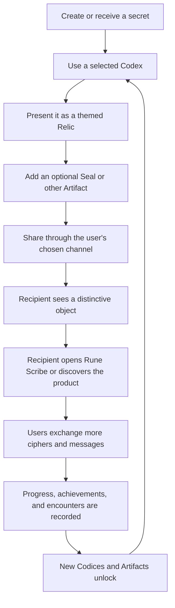

## 4.4 Core customer jobs

| Customer job | Rune Scribe response |
|---|---|
| “I want to send something private and memorable.” | Encrypt it and present it through a selected Codex and Relic. |
| “I want a fun secret-message experience with another person.” | Provide a shared cipher, visual exchange, reply flow, and progression for genuine correspondence. |
| “I want to create a puzzle, clue, or story object.” | Provide themed share artifacts, QR-compatible presentation, and reusable ciphers. |
| “I want to collect and display things that show what I accomplished.” | Provide a Vault, achievements, rarity, provenance, and Encounter history. |
| “I want to customize the app without learning a complicated system.” | Keep one stable UI scaffold and offer selectable Codices through Settings and the Share Builder. |
| “I want it to work even when Apple services or the internet are unavailable.” | Keep encoding, decoding, ordinary progression, and owned content local-first. |

## 4.5 Product principles

### Utility before ceremony

A user can encode, decode, and share without opening the Vault, signing into Game Center, reading achievement requirements, or customizing every share.

### Cosmetic progression, not capability withholding

Core security and communication capabilities are available from the base product. Unlocks change appearance, presentation, prestige, and collection breadth. They do not make encryption stronger or messages more readable.

### Curiosity rather than solicitation

The share object should make a recipient curious. The product must not instruct users to pressure friends into purchasing, reviewing, or downloading the app in exchange for rewards.

### Earned history rather than artificial scarcity

Rare items represent accomplishment, discovery, event participation, or verifiable limited issuance. The system does not call an item “limited” unless the limit is technically enforced.

### Theme diversity through one interaction grammar

Every Codex may feel distinct, but the user should not need to relearn where Encode, Decode, Share, Library, Settings, security warnings, or accessibility controls live.

## 4.6 Non-goals for the initial system

The first Codex System release is not:

- A new messaging network or account-based chat service.
- A replacement for iMessage, Mail, AirDrop, or the system Share sheet.
- A cryptocurrency, NFT, or tradable-item marketplace.
- A loot-box or randomized-purchase system.
- A competitive message-volume game.
- A framework/module selector visible to users.
- A method for remotely downloading executable app features.
- A system that verifies that five shares caused five App Store purchases.
- A requirement to use Game Center or iCloud before using Rune Scribe.

## 4.7 Product success indicators

The initial release should measure product health through privacy-preserving aggregate product telemetry only if Raven Forge later elects to add telemetry. The local app itself should expose useful personal statistics regardless of telemetry.

Recommended product-level indicators are:

- Percentage of active users who use more than one Codex.
- Percentage of eligible shares using a customized Relic or Seal.
- Inbound open/decode success rate for themed packages.
- Percentage of users who complete at least one bidirectional exchange.
- Theme-unlock conversion by requirement.
- Vault revisit rate.
- Game Center opt-in rate, without treating opt-out as failure.
- Crash-free and decode-success rates across current and older payload versions.

No product goal should be defined as “maximum messages sent,” because that would reward spam rather than durable engagement.

---

# 5. Formal Product Vocabulary

The vocabulary below is the canonical language for product requirements, UI copy, architecture documents, and future theme briefs.

## 5.1 Primary terms

| Term | User-facing? | Definition |
|---|---:|---|
| **Theme** | Sometimes | Plain-language category for a visual appearance. Used in explanatory copy when “Codex” would be unclear. |
| **Codex** | Yes | A complete selectable visual world or theme pack. A Codex contains a Script and a catalog of compatible visual Artifacts. |
| **Theme Module** | No | The internal Forsetti module that supplies one Codex's conforming descriptor, resources, Script, Relics, Seals, and optional effects. It is never presented as a module to the user. |
| **Script** | Yes | The 32-symbol visual alphabet and rendering resources used to represent Rune Scribe's encrypted base-32 values within a Codex. A Script is presentation, not cryptography or translation. |
| **Artifact** | Yes | The umbrella term for collectible presentation items. Artifact classes include Relics, Seals, Frames, Effects, and approved Script Variants. |
| **Relic** | Yes | The primary visual object or canvas that carries a shared cipher presentation, such as a stone, tablet, device, medallion, document, or other theme-appropriate object. |
| **Seal** | Yes | A smaller optional emblem, sigil, badge, sticker, crest, or mark placed in an approved anchor area on a Relic. A Seal is not a Unicode/system emoji. |
| **Frame** | Yes | An optional border, mount, aperture, or surrounding treatment used in Vault cards or shared presentations. |
| **Effect** | Yes | An optional motion, light, sound, haptic, reveal, or material treatment. Every Effect must have a static and Reduce Motion fallback. |
| **Title** | Yes | A selectable honorific earned through an Achievement or event, such as Courier or Archivist. It does not confer power. |
| **Vault** | Yes | The user's owned Codices, Artifacts, Titles, and provenance records. |
| **Archive** | Yes | The discovery collection containing items the user has Encountered but does not own, plus silhouettes for unknown discoverable items when appropriate. |
| **Encounter** | Yes | A recorded observation of another user's Codex or Artifact through a valid incoming Rune Scribe package. Encounter does not grant ownership or creation rights. |
| **Achievement** | Yes | A named accomplishment with defined criteria, progress, completion state, and optional rewards. Selected evergreen Achievements may be mirrored to Game Center. |
| **Milestone** | Usually no | A rule-engine threshold or condition used to grant progress or content. A Milestone may exist without a public Achievement. |
| **Statistic** | Yes | A privacy-minimized count or set derived from eligible Rune Scribe domain events. |
| **Unlock** | Yes | The irrevocable grant of the right to create with, select, or display an owned Codex or Artifact. |
| **Entitlement** | No | The runtime authorization Forsetti uses to decide whether a gated module may activate. It is the technical expression of an Unlock or purchase. |
| **Selected Codex** | Yes | The Codex the UI currently applies by default. This is not the same as an “active module” in Forsetti terminology. |
| **Rarity** | Yes | A prestige classification that reflects difficulty, distinction, or exceptional status. Rarity does not by itself state when or how an item is available. |
| **Availability** | Yes | The acquisition window or supply rule: permanent, seasonal, event, limited edition, or singular. |
| **Edition** | Yes | A fixed, numbered issuance series, such as 17 of 50. An Edition requires authoritative issuance. |
| **Provenance** | Yes | The trusted record of an item's origin, acquisition method, date or season, edition number, authenticity state, and reissue policy. |
| **Collection** | Yes | A named group of related Artifacts, often within one Codex, season, event, or achievement path. |
| **Season** | Yes | A time-bounded official Rune Scribe narrative or challenge campaign. |
| **Challenge** | Yes | An official task or puzzle with defined completion evidence and an optional Achievement or reward. |
| **Forge Ledger** | Yes, sparingly | The future authoritative issuance and authenticity service required for globally limited and singular collectibles. |

## 5.2 Existing terms retained without redefinition

| Term | Definition retained from Rune Scribe |
|---|---|
| **Cipher** | A shared cryptographic key, public identifier, decorative 32-value mapping, and related presentation reference used to encrypt and decode messages. |
| **Message** | Plaintext sealed into an authenticated encrypted envelope and presented as glyphs or a themed share. |
| **Encode / Rune Scribe** | Encrypt and transform plaintext into the selected visual presentation. |
| **Decode** | Reverse the presentation encoding and authenticate/decrypt the message with an available cipher. |
| **Cipher Library** | The user's local collection of cryptographic ciphers. It remains distinct from the Vault. |

## 5.3 Terms that must not be conflated

| Do not conflate | Required distinction |
|---|---|
| Cipher and Codex | Cipher protects the message; Codex presents it. |
| Artifact and Relic | Artifact is the umbrella category; Relic is the primary share canvas. |
| Rarity and availability | A hard-to-earn permanent item may be Rare; a seasonal item may be common within its season. |
| Installed and unlocked | A Theme Module may ship in the app but remain entitlement-locked. |
| Unlocked and selected | An unlocked Codex is available; only one is selected as the default UI appearance. |
| Activated module and selected Codex | Several unlocked service modules may run; the UI renders one selected Codex. |
| Achievement and reward | An Achievement records accomplishment; one Achievement may grant multiple rewards or none. |
| Encounter and ownership | Seeing an item adds it to the Archive; it does not add it to the Vault. |
| Seal and emoji | A Seal is Rune Scribe artwork; it is not added to Apple's Unicode emoji keyboard. |
| Script and language | A Script is a visual substitution alphabet. It is not represented as a linguistic translation unless a future feature explicitly performs translation. |
| Spark and points | “Spark” is reserved for story, event, or Founding Fifty terminology. It is not the initial universal experience currency. |

## 5.4 Vocabulary hierarchy

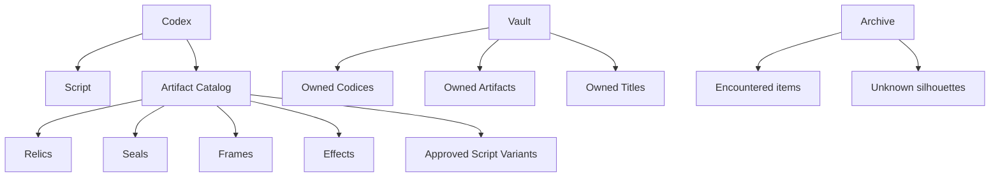

---

# 6. Existing Rune Scribe Baseline

The Codex System is an extension of the current application, not a replacement product.

## 6.1 Existing behaviors that remain authoritative

The current application already provides:

- AES-256-GCM message sealing.
- A 32-symbol base-32 presentation system with a per-cipher decorative permutation.
- Multiple locally stored ciphers.
- Contacts linked to individual ciphers.
- First-delivery key exchange through a `.runescribe` package.
- Later runes-only messages after the cipher is delivered.
- QR, custom link, file import, iMessage, and Share-sheet routes.
- Hash-validated bundled or imported font references.
- Optional PIN app lock.
- SwiftUI and Metal presentation.
- A shared design system in `RuneTheme.swift`.
- Tested, versioned `CipherSharePayload` and `MessageSharePayload` formats.
- Fully local encryption and decoding.

The new system must not weaken or silently alter these properties.

## 6.2 Existing architecture-to-module migration map

| Current Rune Scribe area | Target ownership | Migration intent |
|---|---|---|
| `RuneScribApp`, scene root, app delegates | Thin host/bootstrap plus UI Module entry | Host composes Forsetti; application interface comes from one UI Module. |
| `RootView`, `ContentView`, settings, library, contacts, import and received-message sheets | `RuneScribeUIModule` | Preserve behavior first, then add scaffold slots and new screens. |
| `RuneTheme.swift`, button styles, SwiftUI components, Metal background | `RuneScribeUIModule` | Becomes the seed of the reusable UI scaffold and semantic rendering system. |
| Cipher, message, contact, import, routing, font, QR, app-lock, Keychain, and cryptographic services | `RuneScribeCoreModule` | Move behind framework-resolved application services and domain events. |
| `CipherSharePayload` and `MessageSharePayload` | Core Module with contracts shared through neutral schemas | Extend by version; preserve older decode paths. |
| NotificationCenter-based cross-view signals | UI-local state or Forsetti-mediated events/messages | Do not preserve NotificationCenter as a cross-module communication mechanism. |
| Current singleton environment objects | Module-owned implementations exposed through Forsetti services | Remove cross-module singleton access. A module may use internal singletons only when they never cross its boundary. |
| Current font reference and font store | Core for imported cipher fonts; Theme Coordinator/resources for official Codex Scripts | Keep user-imported cipher font compatibility separate from official theme resources. |
| No current progression system | `RuneScribeProgressionModule` | New local-first, iCloud-backed canonical store and rule engine. |
| No current theme registry | Theme Coordinator plus individual Theme Modules | New capability. |
| No current Game Center integration | `RuneScribeGameCenterModule` | New optional adapter. |

## 6.3 Migration principle

The first modular migration must preserve the current UI and wire behavior before adding new product behavior. A single release should not simultaneously:

- Rewrite the module architecture.
- Replace the entire interface.
- Change cryptographic wire formats.
- Add cloud synchronization.
- Add Game Center.
- Add multiple production themes.

Those changes are separated into staged releases later in this document.

---

# 7. Target Forsetti Pattern B Architecture

## 7.1 Runtime topology

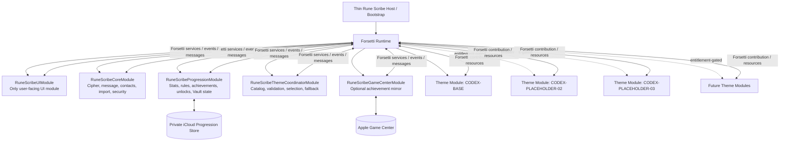

The arrows do not represent direct module-to-module references. Forsetti remains the mediator.

## 7.2 Target composition

| Component | Forsetti role | User-visible | Primary responsibility |
|---|---|---:|---|
| Rune Scribe Host/Bootstrap | Host infrastructure | No | Configure Forsetti, register factories/manifests, supply platform adapters, and present the UI Module root. |
| `RuneScribeContracts` | Neutral library target; not a runtime module | No | Shared IDs, immutable DTOs, event schemas, service protocols, validation enums, and version definitions. |
| `RuneScribeUIModule` | `ForsettiUIModule` | **Yes** | Entire layout, navigation, controls, rendering, accessibility, animation policy, share preview, Vault, Achievements, and Settings interface. |
| `RuneScribeCoreModule` | `ForsettiModule` | No | Existing cipher, message, contacts, imports, app lock, payload, QR, cryptographic, and secure-storage behavior. |
| `RuneScribeProgressionModule` | `ForsettiModule` | No | Statistics, event qualification, rules, achievements, unlocks, ownership, encounters, provenance records, iCloud sync state, and theme entitlement grants. |
| `RuneScribeThemeCoordinatorModule` | `ForsettiModule` | No | Theme-provider registry, conformance validation, selected Codex, fallback resolution, catalog snapshots, and resource mediation. |
| `RuneScribeGameCenterModule` | `ForsettiModule` | No | Optional Game Center authentication, progress reporting, retry queue, and status mapping. |
| One Theme Module per Codex | `ForsettiModule` | No as a module | Supply one immutable Codex descriptor and its resources through the approved contribution contract. |
| Future Forge Ledger Adapter | `ForsettiModule` or platform service | No | Verify and synchronize signed limited-edition grants when the ledger exists. |

## 7.3 Pattern B interpretation for themes

Pattern B permits exactly one UI Module. Therefore:

- A Theme Module is **not** a second UI Module.
- A Theme Module does not own a screen, window, settings panel, route, or navigation stack.
- A Theme Module does not inject arbitrary SwiftUI views into the application.
- A Theme Module is an installed feature/content provider whose data is interpreted by the UI Module's stable scaffold.
- Multiple unlocked Theme Modules may be Forsetti-active at the same time.
- Exactly one Codex is selected as the default presentation at a time.

This distinction is essential. Forsetti's module activation state is not the user's current appearance selection.

## 7.4 Installed, unlocked, activated, and selected states

| State | Meaning | Authority |
|---|---|---|
| **Installed** | The signed module and resources are present in the app bundle. | App release / manifest discovery |
| **Locked** | The user has not earned or otherwise obtained the required entitlement. | Progression entitlement state |
| **Unlocked** | The user owns the creation/select entitlement for the Codex. | Progression Module |
| **Activated** | Forsetti has validated and started the module for the current runtime. | Forsetti runtime |
| **Available** | The module is activated, its descriptor validated, and its resources resolvable. | Theme Coordinator |
| **Selected** | The user chose the Codex as the current default appearance. | Theme Coordinator preference, applied by UI Module |
| **Encountered** | The user has seen the Codex or an Artifact in an incoming package but does not necessarily own it. | Progression Module Archive |

### Required state rules

1. A Codex cannot be selected unless it is Available.
2. A Codex may be Installed but Locked.
3. A Codex may be Unlocked but temporarily unavailable because its module failed validation; the UI must explain that the content is unavailable and use the Base Codex.
4. Unlocking causes the entitlement bridge to ask Forsetti to reconcile module activation.
5. Selecting a Codex never changes the cipher key.
6. Receiving a message never requires the sender's Theme Module to be unlocked locally.

---

# 8. Forsetti Framework Requirements and Extension Points

The current Forsetti architecture already provides the correct foundation: bundled manifests, compatibility validation, capability policy, entitlement-aware activation, one UI Module under Pattern B, service lookup, events, messages, and entitlement reconciliation.

The Codex System requires several reusable public extension points. These should be added to the Forsetti framework product itself as general capabilities, not patched into Rune Scribe through private framework access.

## 8.1 Required Forsetti enhancement: generalized earned entitlements

The current manifest entitlement concept is purchase-oriented. Rune Scribe needs earned activation entitlements that originate in the Progression Module.

### Required behavior

- A manifest may specify an optional generic activation-entitlement identifier.
- The entitlement identifier is not semantically restricted to an App Store product ID.
- A composite provider can evaluate always-available, purchase, progression, signed grant, or future entitlement sources.
- Entitlement changes produce a refresh stream that triggers Forsetti activation reconciliation.
- The provider is available during boot so prior unlocks can activate modules immediately.

### Rune Scribe use

A locked Codex Theme Module will declare an entitlement such as:

`runescribe.codex.placeholder02.create`

The Progression Module grants that entitlement after the corresponding rule completes. A host-supplied entitlement bridge observes the canonical entitlement snapshot through an injected Forsetti persistence/entitlement service contract and notifies Forsetti. It does **not** read the Progression Module's private files or call the module directly. Forsetti then validates and starts the installed Theme Module.

The Progression Module remains the sole domain authority allowed to create earned grants. The injected repository/bridge is infrastructure that persists and exposes the resulting entitlement snapshot to the runtime during boot and reconciliation.

### Constraint

Do not overload a field named `iapProductID` with an achievement ID. The framework contract should accurately represent earned and purchased entitlements.

## 8.2 Required Forsetti enhancement: keyed content-contribution registry

Rune Scribe needs several Theme Modules to contribute immutable descriptors and resource namespaces without directly importing one another.

### Required behavior

- Modules register named, typed contributions through the Forsetti context.
- Multiple providers may contribute the same general contribution type under unique identifiers.
- The framework tracks contribution ownership and removes contributions when a module stops.
- Consumers receive read-only snapshots through framework-mediated lookup.
- Registration is capability-gated.
- Contribution identifiers are stable and globally unique within the host application.

This should be a generic Forsetti feature rather than a hard-coded “Rune Scribe theme” feature.

## 8.3 Required Forsetti enhancement: opaque module-resource resolution

The UI Module must render images, fonts, vectors, Metal parameters, sounds, and other resources owned by a Theme Module without importing that Theme Module's bundle or target.

### Required behavior

- A Theme Module registers an opaque resource namespace and resource handles.
- A capability-scoped resolver returns validated data, URLs, or platform-neutral resource descriptors.
- The UI Module never assumes the Theme Module's bundle path.
- Resource checksums and declared media types can be validated.
- A stopped or failed module automatically makes its resources unavailable.

## 8.4 Required Forsetti enhancement: app-defined capability-scoped services

Rune Scribe needs application-specific service protocols such as progression queries and theme catalog snapshots. These services must still be provided through Forsetti's service container and governed by capabilities.

The framework should permit the host to map custom service identifiers or protocol keys to custom capability identifiers without adding Rune Scribe-specific types to Forsetti Core.

## 8.5 No special Forsetti UI for Rune Scribe

Forsetti discovery, activation, diagnostics, and module-switching controls remain hidden in this production Pattern B application. Rune Scribe users see only the Rune Scribe UI Module.

A module failure may be translated into a Rune Scribe-native fallback or status message. It must not expose an internal framework dashboard.

## 8.6 Capability plan

The exact manifest syntax is an implementation decision, but the capability intent is locked.

| Module | Minimum capabilities |
|---|---|
| UI Module | View presentation, theme catalog read, progression read, core command/query access, route presentation, share presentation, local preference access |
| Core Module | Secure storage, local files, contacts where authorized, cryptography, import routing, message export, font storage, domain-event publication |
| Progression Module | Private local persistence, private iCloud sync, secure integrity key, domain-event subscription, entitlement publication |
| Theme Coordinator | Theme contribution discovery, theme resource resolution, selected-Codex preference, progression entitlement read, catalog event publication |
| Game Center Adapter | Game Center, local retry storage, achievement-completion subscription |
| Theme Module | Theme contribution registration and read-only access to its own bundled resources only |
| Forge Ledger Adapter | Network/API access, signed-grant storage, provenance verification; no message or cipher capability |

## 8.7 Communication rule

Every cross-module interaction must use one of these mechanisms:

| Interaction type | Mechanism |
|---|---|
| Request/response or read model | Capability-scoped Forsetti service resolved through module context |
| Broadcast state change | Forsetti event |
| Targeted fire-and-forget command | Forsetti directed message |
| Immutable theme/content registration | Forsetti keyed contribution registry |
| Bundled resource access | Forsetti opaque resource resolver |
| Persistent cross-launch state | Owning module's store; never an ad hoc file read by another module |

Forbidden cross-module mechanisms include:

- Importing another runtime module target.
- Calling another module's singleton.
- Reading another module's files directly.
- Using NotificationCenter as a hidden cross-module event bus.
- Discovering another module's bundle by name or path.
- Holding another module's concrete class.
- Sharing mutable global state.

---

# 9. Module Specifications

## 9.1 Thin Rune Scribe Host / Bootstrap

### Owns

- Forsetti runtime composition.
- Module registry and manifest-bundle configuration.
- Platform service adapters.
- Progression-backed entitlement bridge.
- Production hiding of Forsetti controls.
- Presentation of the single UI Module root.
- App lifecycle forwarding required by public Forsetti APIs.

### Does not own

- Rune Scribe navigation.
- Theme selection.
- Cipher or message business logic.
- Achievement rules.
- Game Center achievement mapping.
- Theme descriptors or resources.

The host must remain intentionally boring. It is infrastructure, not an alternate application layer.

## 9.2 `RuneScribeContracts`

This is a neutral library target, not a runtime module. It contains no concrete module implementation and no app UI.

### Owns

- Stable identifier conventions.
- Immutable request, response, snapshot, and event envelope schemas.
- Service protocols used through Forsetti.
- Theme descriptor schema.
- Progression rule schema.
- Rarity, availability, ownership, and validation enums.
- Shared version numbers and compatibility rules.

### Must not contain

- SwiftUI views.
- Module concrete classes.
- Keychain implementations.
- CloudKit implementations.
- GameKit implementations.
- Cryptographic key material.
- Theme artwork.

## 9.3 `RuneScribeUIModule`

The UI Module is the only user-facing Forsetti module.

### Owns

- Root shell, splash, app-lock presentation, and inbound-route presentation.
- Main Scribe workspace.
- Cipher Library and Contacts interfaces.
- Encode and Decode interaction controls.
- Share Builder and static themed preview rendering.
- Vault and Archive screens.
- Achievement and statistic screens.
- Settings and selected-Codex controls.
- All user-facing error, loading, empty, locked, offline, and fallback states.
- Semantic design tokens interpreted from the selected Codex.
- Dynamic Type, VoiceOver, contrast, keyboard, pointer, Reduce Motion, and platform adaptation.
- Rendering of background, panels, controls, Script glyphs, Relics, Seals, Frames, and Effects inside approved slots.
- Existing SwiftUI and Metal presentation behavior after migration.

### Consumes through Forsetti

- Core application services and snapshots.
- Progression snapshots and achievement detail.
- Theme catalog, selected Codex, and resolved resources.
- Game Center connection status.

### Publishes or sends through Forsetti

- User intents such as selecting a Codex, initiating encode/decode, opening a route, choosing a Relic, and starting a share.
- UI-consumed completion acknowledgments where required.

### Does not own

- Cryptographic operations.
- Unlock evaluation.
- Achievement completion truth.
- Theme entitlement truth.
- Theme-specific navigation.
- iCloud merge logic.
- Game Center reporting.

## 9.4 `RuneScribeCoreModule`

This module encapsulates the current application's domain and security behavior.

### Owns

- Cipher Library and cipher lifecycle.
- Contact organization and contact-linked cipher relationships.
- AES-GCM message sealing and opening.
- Base-32 encode/decode and decorative mapping.
- `.runescribe` cipher and message wire formats.
- Import validation and routing.
- First-delivery key inclusion rules.
- QR payload generation and parsing.
- App-lock and secure storage behavior.
- User-imported font validation and storage needed for compatibility.
- Share-package construction and backward-compatible decode.
- Normalized domain events used by Progression.

### Emits eligible domain events

Examples include:

- Cipher created.
- Cipher imported.
- Message encoded.
- Eligible share completed.
- First cipher delivery completed.
- Incoming message imported.
- Message successfully decoded.
- Bidirectional exchange established.
- Presentation metadata encountered.

### Does not emit

- Plaintext.
- Cipher key material.
- Phone number or email address.
- Raw Apple contact identifier.
- Full `.runescribe` package contents.

### Does not own

- Achievement criteria.
- Theme unlock requirements.
- Collectible ownership.
- Game Center state.
- Theme rendering.

## 9.5 `RuneScribeProgressionModule`

The Progression Module is the canonical source of game mechanics and earned state.

### Owns

- Eligible-event deduplication.
- Privacy-minimized statistics.
- Milestone and rule evaluation.
- Public and hidden Achievements.
- Achievement progress and completion timestamps.
- All Codex-unlock requirements.
- All Artifact-unlock requirements.
- Owned Codices, Artifacts, and Titles.
- Encountered items and Archive state.
- Provenance records for non-ledger items.
- Entitlement grants supplied to Forsetti.
- iCloud synchronization and merge state for progression.
- Game Center mapping metadata for selected evergreen Achievements.
- Migration version of the progression catalog.
- Retry-safe publication of completion and unlock events.

### Required catalog responsibility

This module contains the canonical list of:

- Every unlockable Codex identifier.
- Whether the Codex is included, earned, seasonal, event, limited, or future purchase.
- The requirement or signed-grant condition.
- The teaser metadata shown while locked.
- The rewards granted when unlocked.
- The visibility of requirements.

Theme Modules declare what they contain. The Progression Module declares how the user earns the right to create with that content.

### Does not own

- Theme artwork or fonts.
- UI layout.
- Cipher, message, or contact data.
- Game Center as an ownership source.
- Globally limited issuance without the Forge Ledger.

## 9.6 `RuneScribeThemeCoordinatorModule`

The Theme Coordinator is the adapter between activated Theme Modules, progression entitlements, and the UI scaffold.

### Owns

- Registry of activated Theme Module contributions.
- Theme descriptor schema validation.
- Resource presence and checksum validation.
- Compatibility checks against the UI scaffold contract.
- Stable catalog snapshots for the UI.
- User's selected Codex preference.
- Selected-Codex fallback behavior.
- Resolution of Relic, Seal, Frame, Effect, Script, and thumbnail resource handles.
- Detection of duplicate IDs or conflicting resources.
- Publication of catalog and selection changes.

### Selection rule

The user may select only a Codex that is:

1. Unlocked by Progression.
2. Forsetti-activated.
3. Successfully validated by the Theme Coordinator.
4. Compatible with the current UI contract.

### Does not own

- Unlock requirements.
- Achievement progress.
- Cipher keys.
- Message contents.
- Arbitrary views.

## 9.7 `RuneScribeGameCenterModule`

### Owns

- Optional Game Center authentication.
- Mapping Rune Scribe Achievement IDs to permanent Game Center identifiers.
- Reporting integer percentage progress.
- Reporting completed evergreen Achievements.
- Local retry queue for transient failures.
- Reconciliation that only moves Game Center progress forward.
- Game Center status exposed to the UI.

### Rules

- Local Progression completion is authoritative.
- Game Center failure never removes an Unlock.
- Game Center data never grants an Unlock by itself.
- Reporting is idempotent and monotonic.
- Authentication is not forced during first launch.
- The user may disable Rune Scribe's Game Center integration without resetting local progress.

## 9.8 Theme Modules

Each Theme Module supplies exactly one Codex.

### Owns

- One stable Codex identifier.
- One theme descriptor conforming to the current schema.
- One Script and its required resources.
- A minimum conforming Artifact catalog.
- Semantic visual tokens.
- Theme-specific background parameters and decorative resources.
- Share-layout parameters within UI-defined bounds.
- Localization and accessibility metadata for its content.
- Resource integrity metadata.

### Does not own

- Unlock rules.
- User ownership.
- User statistics.
- Screens, navigation, buttons, settings, or system dialogs.
- Message or cipher logic.
- Network access.
- Game Center logic.
- Direct access to another module.

## 9.9 Future Forge Ledger Adapter

This module is deferred until true global scarcity is implemented.

It will be responsible only for:

- Claiming or receiving an authoritative issuance grant.
- Verifying signed collectible provenance.
- Refreshing authenticity and revocation state where policy permits.
- Synchronizing owned limited items across devices.
- Exposing verification status to Progression.

It must not receive plaintext messages, cipher keys, contact records, or private correspondence metadata.

---

# 10. Cross-Module Contract and Event Model

## 10.1 Identifier conventions

All identifiers are immutable after release and use lowercase reverse-domain notation.

| Identifier class | Pattern | Example placeholder |
|---|---|---|
| Runtime module | `com.ravenforge.runescribe.module.<role>` | `com.ravenforge.runescribe.module.progression` |
| Theme Module | `com.ravenforge.runescribe.module.theme.<codex-slug>` | `com.ravenforge.runescribe.module.theme.codex-02` |
| Codex | `codex.<stable-slug>` | `codex.placeholder-02` |
| Artifact | `artifact.<codex-slug>.<class>.<slug>` | `artifact.placeholder-02.relic.default` |
| Achievement | `achievement.<stable-slug>` | `achievement.five-circles` |
| Milestone/rule | `rule.<stable-slug>` | `rule.unlock-codex-02` |
| Entitlement | `runescribe.<content-class>.<stable-slug>.<right>` | `runescribe.codex.placeholder-02.create` |
| Event | `runescribe.<domain>.<past-tense-action>` | `runescribe.unlock.granted` |

Versions belong in descriptor fields and payload schema fields, not in stable ownership IDs, unless a materially distinct collectible is intentionally created. Renaming display copy does not rename the identifier.

## 10.2 Event envelope

Every cross-module domain event must have a versioned envelope containing:

| Field | Purpose |
|---|---|
| Event ID | Globally unique idempotency identifier. |
| Event type | Stable reverse-domain event name. |
| Schema version | Allows additive evolution and safe rejection of unsupported changes. |
| Occurred-at timestamp | Device-recorded time of the domain action. |
| Source module ID | Identifies the publisher without exposing a concrete class. |
| Correlation ID | Connects related encode, share, import, and decode operations. |
| Payload | Minimal, privacy-safe fields required by subscribers. |
| Eligibility flags | States whether the Core Module considers the event eligible for progression and why. |

Forsetti's event payload should carry small versioned values. Large read models, binary assets, and full catalogs must be retrieved through services or contribution snapshots, not embedded in event payloads.

## 10.3 Core domain events

| Event | Emitted when | Minimum safe fields |
|---|---|---|
| `runescribe.cipher.created` | A new cipher is durably stored. | Event ID, randomized cipher token, origin |
| `runescribe.cipher.imported` | A valid incoming cipher is confirmed and stored. | Event ID, randomized cipher token, import route class |
| `runescribe.message.encoded` | Encryption and presentation conversion succeed for a new operation. | Event ID, randomized message token, cipher relationship token, Codex/Artifact IDs used |
| `runescribe.share.completed` | The operating-system share route reports completion under the route's defined semantics. | Event ID, message token, route class, Codex/Artifact IDs, key-included flag, linked-relationship flag |
| `runescribe.cipher.firstDeliveryCompleted` | The existing first-delivery rule is successfully consumed for a linked cipher. | Event ID, relationship token, cipher token |
| `runescribe.message.imported` | A valid message package enters the app. | Event ID, package token, presentation IDs encountered, embedded-cipher flag |
| `runescribe.message.decoded` | Authenticated decryption succeeds. | Event ID, package/message token, relationship token if known, presentation IDs encountered |
| `runescribe.exchange.bidirectionalEstablished` | The same local cipher relationship has qualifying outbound and inbound activity. | Event ID, relationship token |
| `runescribe.presentation.encountered` | A valid package declares a known presentation item the user does not own. | Event ID, Codex ID, Artifact IDs, signed-provenance status |

## 10.4 Progression events

| Event | Meaning |
|---|---|
| `runescribe.progression.snapshotChanged` | Statistics, ownership, progress, or sync status changed. |
| `runescribe.milestone.reached` | A rule-engine condition completed. |
| `runescribe.achievement.progressed` | Public percentage or count changed materially. |
| `runescribe.achievement.completed` | Achievement completed for the first time. |
| `runescribe.unlock.granted` | Codex, Artifact, Title, or capability entitlement was durably granted. |
| `runescribe.encounter.recorded` | Archive state changed. |
| `runescribe.entitlements.changed` | Forsetti should reconcile activation against the canonical entitlement store. |
| `runescribe.progression.syncStatusChanged` | iCloud state changed. |

## 10.5 Theme events

| Event | Meaning |
|---|---|
| `runescribe.theme.providerAvailable` | An activated Theme Module registered a contribution. |
| `runescribe.theme.providerUnavailable` | A provider stopped, failed, or was removed. |
| `runescribe.theme.catalogChanged` | Validated available Codices or Artifacts changed. |
| `runescribe.theme.selectionChanged` | The selected Codex changed or fell back. |
| `runescribe.theme.validationFailed` | A Theme Module did not satisfy its descriptor/resource contract. |

## 10.6 Game Center events

| Event | Meaning |
|---|---|
| `runescribe.gamecenter.statusChanged` | Authentication or availability changed. |
| `runescribe.gamecenter.reportSucceeded` | A progress report was accepted. |
| `runescribe.gamecenter.reportDeferred` | A report remains queued after a transient failure. |

## 10.7 Data that must never appear in progression or theme events

- Plaintext message content.
- Encrypted payload bytes.
- Cipher key material.
- Full decorative mapping.
- Phone number.
- Email address.
- Contact name.
- Raw Contacts framework identifier.
- Game Center player identifier in shared content.
- Share-sheet recipient identity.
- Clipboard contents.

## 10.8 Idempotency and durable delivery

A share or decode operation may cause repeated callbacks, app relaunches, or sync replays. Therefore:

- The Core Module assigns one stable event ID per logical operation.
- The Progression Module maintains a bounded deduplication ledger.
- Achievement completion and Unlock grants use unique stable IDs and upsert semantics.
- The Core Module uses a durable event outbox for progression-relevant events or provides an equivalent replay-safe mechanism.
- A UI animation or toast is never evidence that a grant was durably stored.

---

# 11. UI Information Architecture and Scaffolding

## 11.1 Primary information architecture

The current Scribe workspace remains primary.

```text
Rune Scribe
├── Scribe Workspace (default)
│   ├── Encode
│   ├── Decode
│   ├── Cipher / Contact selection
│   ├── Quick Share
│   └── Customize Share → Share Builder
├── Cipher Library
├── Contacts
├── Vault
│   ├── Codices
│   ├── Artifacts
│   ├── Titles
│   ├── Achievements
│   ├── Statistics
│   └── Archive
└── Settings
    ├── Appearance / Selected Codex
    ├── Game Center
    ├── iCloud Progression
    ├── App Lock
    ├── Contacts
    ├── Accessibility and Motion
    ├── About
    └── License
```

## 11.2 Main-header access

The main header should expose three stable destinations without crowding the encode/decode workflow:

1. Cipher Library.
2. Vault.
3. Settings.

Contacts may remain accessible through Cipher Library and Settings rather than adding a fourth permanent header control.

## 11.3 UI scaffold ownership

The UI Module owns the following fixed interaction grammar:

- Root application shell.
- Header geometry and action placement.
- Screen and sheet hierarchy.
- Encode/Decode mode control.
- Cipher and contact selectors.
- Primary and secondary button placement.
- Text-entry and result surfaces.
- Security and key-delivery indicators.
- Share Builder step order.
- Vault navigation and collection-card layout.
- Locked, encountered, unavailable, and owned states.
- Achievement progress presentation.
- Provenance sheet layout.
- Settings categories.
- Error, retry, offline, and fallback affordances.
- Accessibility semantics.

## 11.4 Themeable presentation slots

A Codex may style only approved semantic slots:

| Slot | Theme may supply |
|---|---|
| Application background | Color, gradient, image/vector layers, material parameters, approved Metal parameters |
| Header | Wordmark treatment, decorative header layer, semantic colors, Script rendering |
| Panels and cards | Semantic surface colors, borders, textures, corner treatment within geometry bounds |
| Typography | Script font/glyph resources and approved display-face references; system text remains accessible |
| Buttons | Semantic colors, border and material tokens; labels and placement remain fixed |
| Transformation | Glyph reveal parameters, particles, light, timing ranges, static fallback |
| Share canvas | Relics, Seal anchors, Frames, safe areas, background treatment |
| Vault cards | Codex art, locked silhouette, owned/encountered states, rarity accents |
| Sounds and haptics | Optional named cues within global volume/accessibility policy |

## 11.5 Non-themeable behavior

A Theme Module cannot change:

- Navigation destinations or order.
- Encode/Decode semantics.
- Cryptographic warnings.
- Key-included indicators.
- App-lock behavior.
- Import confirmation requirements.
- Share recipient semantics.
- Accessibility labels.
- Minimum contrast or Dynamic Type policy.
- System permission prompts.
- Game Center authentication UI.
- iCloud account UI.
- Contact permissions.
- Error meanings.
- The fact that a received message must remain readable.

## 11.6 Main workspace interaction

### Default state

- Current selected Codex applied.
- Active cipher/contact visible.
- Encode selected unless the incoming route requires Decode or Received Message.
- Text area empty or populated by explicit incoming content.
- Primary Rune Scribe action available.
- Vault progress is not shown as a persistent intrusive HUD.

### Encoded-result state

- The result remains visible in the text frame.
- Copy remains available.
- Quick Share uses the selected Codex, its default Relic, and the user's last valid Seal preference or no Seal.
- Customize Share opens the Share Builder.
- The existing “Key included” versus “Uses your shared key” indicator remains visible and is not obscured by theme art.

## 11.7 Share Builder

The Share Builder uses a stable sequence:

```text
1. Codex
2. Relic
3. Seal (optional)
4. Frame / Effect (optional when supported)
5. Preview and security summary
6. Share
```

### Rules

- The current selected Codex is preselected.
- Only owned and available creation items can be selected.
- Locked items may appear with clear requirements but cannot be applied.
- Encountered items appear in the Archive, not as selectable owned items.
- The preview must distinguish visual presentation from key-delivery status.
- Quick Share bypasses the Builder using validated defaults.
- The Builder remembers the most recent valid selection per Codex.
- If a previously selected item becomes unavailable because of a validation failure, the coordinator substitutes the Codex default and explains the fallback once.

## 11.8 Vault

The Vault is the user's owned collection and personal history, not a storefront.

### Codices view

Each card shows:

- Codex name and placeholder art.
- Owned, locked, unavailable, or selected state.
- Requirement progress when visible.
- Included Artifact count and owned count.
- Select button when available.
- Details sheet with Script, Relics, Seals, and provenance.

### Artifacts view

Filter by:

- All.
- Relics.
- Seals.
- Frames.
- Effects.
- Codex.
- Rarity.
- Availability/origin.

### Achievements view

Shows:

- Evergreen, hidden/discovered, seasonal, and completed sections.
- Current count and progress.
- Reward preview when not secret.
- Game Center mirror status where applicable.
- Completion date.

### Statistics view

Shows only understandable personal statistics. It should not expose implementation tokens or unverifiable claims about distinct real people.

### Archive view

Shows:

- Encountered Codices and Artifacts.
- Silhouettes for discoverable unknown items when product design elects to tease them.
- Encounter count and first-seen date.
- Ownership state.
- Provenance information supplied by the incoming package.
- A clear statement that Encounter does not grant ownership.

## 11.9 Settings

### Appearance

- Selected Codex.
- Preview of available Codices.
- Default Relic per Codex.
- Default Seal or “None.”
- Motion/effects preference.

### Game Center

- Connection state.
- Connect or open Game Center action.
- Mirrored Achievement count.
- Last sync/report status.
- Explanation that Rune Scribe progression works without Game Center.

### iCloud Progression

- Local-first status.
- iCloud availability.
- Last successful synchronization, without promising immediate timing.
- Conflict/fallback status when relevant.
- Explanation of what is synchronized and what is not.

### Existing settings retained

- App Lock.
- Contacts.
- About.
- License.

## 11.10 Conceptual screen schematics

These are structural wireframes, not final visual designs. Every production Codex must render within them.

### Main Scribe workspace

```text
┌──────────────────────────────────────────────────────────────┐
│ [Codex-branded header]       Library   Vault   Settings      │
├──────────────────────────────────────────────────────────────┤
│ Active relationship / cipher selector                       │
│ [ Contact or Cipher ▼ ]                                     │
│                                                              │
│                  [ Encode | Decode ]                         │
│                                                              │
│ ┌──────────────────────────────────────────────────────────┐ │
│ │ Plaintext entry or encoded/decoded result               │ │
│ │ Theme supplies surface treatment; UI owns behavior      │ │
│ └──────────────────────────────────────────────────────────┘ │
│                                                              │
│ [ Rune Scribe / Decode ]                                    │
│                                                              │
│ Result state:  Key included / Uses your shared key          │
│ [ Copy ]       [ Customize Share ]       [ Quick Share ]     │
└──────────────────────────────────────────────────────────────┘
```

### Share Builder

```text
┌──────────────────────────────────────────────────────────────┐
│ Customize Share                                      Close  │
├──────────────────────────────────────────────────────────────┤
│ Step 1  Codex       [ owned cards / locked requirement ]     │
│ Step 2  Relic       [ compatible owned Relics ]              │
│ Step 3  Seal        [ None / compatible owned Seals ]        │
│ Step 4  Extras      [ Frame / Effect when supported ]        │
│                                                              │
│ ┌──────────────────── Live Preview ────────────────────────┐ │
│ │ Sender-rendered Relic with Script and optional Seal     │ │
│ └──────────────────────────────────────────────────────────┘ │
│                                                              │
│ Security: Key included / Uses your shared key                │
│ [ Save as default ]                             [ Share ]     │
└──────────────────────────────────────────────────────────────┘
```

### Vault

```text
┌──────────────────────────────────────────────────────────────┐
│ Vault                                                 Close │
├──────────────────────────────────────────────────────────────┤
│ Codices | Artifacts | Titles | Achievements | Stats | Archive│
│                                                              │
│ [Card: selected/owned]  [Card: owned]  [Card: locked 60%]    │
│ [Card: encountered]     [Card: unknown silhouette]           │
│                                                              │
│ Selected card detail                                         │
│ Rarity · Origin · Requirement · Provenance · Select/Preview  │
└──────────────────────────────────────────────────────────────┘
```

### Achievement detail

```text
┌──────────────────────────────────────────────────────────────┐
│ Achievement name                                     60%    │
│ [Achievement image]                                          │
│ Description and exact or hinted requirement                  │
│ ████████████────────                                         │
│ Current: 3 of 5                                              │
│ Reward: [Codex / Artifact / Title preview]                   │
│ Game Center: Mirrored / Local only / Report pending          │
└──────────────────────────────────────────────────────────────┘
```

### Appearance settings

```text
Appearance
├── Selected Codex              [ CODEX-BASE ▼ ]
├── Default Relic               [ RELIC-DEFAULT ▼ ]
├── Default Seal                [ None ▼ ]
├── Effects                     [ Full / Reduced / Off ]
└── Preview selected Codex      [ Preview ]
```

## 11.11 Unlock reveal interaction

When an Unlock is granted:

1. Progression commits the grant.
2. Forsetti reconciliation activates the module when required.
3. Theme Coordinator validates availability.
4. UI presents a non-blocking reveal at the next safe presentation point.
5. The user may select the new Codex immediately or keep the current one.
6. The reveal is also stored in the Vault so dismissing it does not lose information.

Unlock reveals must not interrupt:

- App-lock entry.
- An import-confirmation decision.
- A received-message decode.
- An active system share sheet.
- A security warning.

---

# 12. Reusable Theme Module Specification

This section is the template every future Theme Module must satisfy.

## 12.1 Placeholder naming for planning

Until actual themes are designed, use:

- `[CODEX-BASE]`
- `[CODEX-02]`
- `[CODEX-03]`
- `[CODEX-04-SEASONAL]`
- `[CODEX-FUTURE-N]`

No cultural, historical, fantasy, or science-fiction identity is locked by this document.

## 12.2 Minimum Codex content

Each production Codex must contain at minimum:

| Content | Minimum |
|---|---:|
| Primary Script | 1 |
| Default Relic | 1 |
| Additional Relics | 2 |
| Total Relics | **3** |
| Default Seals included at Codex unlock | 2 |
| Additional unlockable Seals | 4 |
| Total Seals | **6** |
| Codex card artwork | 1 |
| Locked/undiscovered silhouette treatment | 1 |
| Background treatment | 1 |
| Static share fallback | 1 per Relic composition |
| Accessibility/Reduce Motion fallback | Required |

Frames, Effects, sounds, alternate Scripts, and animated share treatments are optional additions after the base contract is proven.

## 12.3 Theme descriptor sections

### A. Identity and compatibility

- Stable Codex ID.
- Stable Theme Module ID.
- Display name.
- Short and long descriptions.
- Codex content version.
- Theme-contract schema version.
- Minimum compatible Rune Scribe UI-contract version.
- Supported platforms.
- Default resource identifiers.
- Localization list.
- Attribution and rights metadata.

### B. Semantic palette

The Codex supplies semantic values rather than view-specific colors:

- Background primary and secondary.
- Surface primary and elevated.
- Text primary, secondary, and inverse.
- Accent primary and secondary.
- Success, warning, danger, and informational accents where overridden.
- Locked, encountered, and unavailable state treatments.
- Rarity accent mappings.
- Focus, selection, and keyboard-focus treatments.

The UI Module may adjust or reject values that fail contrast requirements.

### C. Typography and Script

- Primary 32-symbol Script definition.
- Glyph resource type.
- Font/resource handle and integrity hash when applicable.
- 32 unique presentation glyph identifiers.
- Canonical base-32 value mapping.
- Required fallback glyphs.
- Display-size recommendations.
- Character coverage validation.
- Plain-text portability classification.
- License/rights metadata.

### D. Background and material treatment

- Static layers.
- Optional approved Metal or particle parameter set.
- Parallax allowance.
- Motion intensity class.
- Reduce Motion alternative.
- High-contrast alternative.
- Performance class and fallback.

Theme Modules provide data and assets. The UI Module owns the renderer and decides whether a requested effect is supported on the current platform or device.

### E. Relic catalog

Every Relic descriptor includes:

- Stable Artifact ID.
- Display name and description.
- Codex ID.
- Rarity.
- Availability classification.
- Default/optional status.
- Resource handles.
- Content safe area.
- Script/glyph safe area.
- Seal anchor list.
- Frame compatibility.
- QR safe zone when supported.
- Thumbnail crop guidance.
- Static fallback resource.
- Accessibility description.
- Provenance-origin identifier.

### F. Seal catalog

Every Seal descriptor includes:

- Stable Artifact ID.
- Display name and description.
- Codex ID.
- Rarity and availability.
- Resource handle.
- Allowed scale range.
- Allowed anchor categories.
- Light/dark variants if required.
- Static fallback.
- Accessibility description.

### G. Optional Frame and Effect catalog

Each optional item declares:

- Compatible Relic classes.
- Performance and motion class.
- Static fallback.
- Audio/haptic policy.
- Accessibility behavior.
- Whether it may be included in a static share preview.

### H. Share-layout contract

A Codex does not define arbitrary share-card geometry. It supplies parameters inside a fixed renderer contract:

- Supported aspect ratios.
- Relic bounds.
- Glyph safe region.
- Maximum glyph lines and scaling behavior.
- Seal anchors.
- Provenance-mark area.
- Serial-number area for eligible items.
- Rune Scribe attribution area.
- Optional QR safe area.
- Static image background.
- Thumbnail crop.
- Legibility thresholds.

### I. Vault presentation

- Codex card artwork.
- Locked silhouette.
- Encountered treatment.
- Selected treatment.
- Rarity accents.
- Collection grouping metadata.

### J. Localization and accessibility

- Localized names and descriptions.
- VoiceOver descriptions for decorative content.
- High-contrast tokens.
- Reduce Motion behavior.
- No-color-only state distinctions.
- Dynamic Type-safe text regions.
- Keyboard and pointer behavior inherited from UI scaffold.

### K. Resource integrity and fallback

- Resource identifiers and media types.
- Content hashes.
- Required versus optional resources.
- Default fallback identifiers.
- Unsupported-device fallback.
- Validation error severity.

## 12.4 Script contract

The existing encrypted envelope is rendered through 5-bit values. Therefore every Script must provide a complete 32-value presentation system.

### Required Script properties

- Exactly 32 unique display symbols or glyph IDs.
- Deterministic mapping from each value 0 through 31.
- Compatibility with the cipher's existing 32-value decorative permutation.
- A renderer-safe representation for the UI and static share image.
- A fallback representation that allows the message package to remain usable when the Script resource is unavailable.

### Script portability classes

| Class | Meaning |
|---|---|
| Unicode portable | All 32 symbols are Unicode characters expected to survive ordinary text transport. |
| Font-dependent | Canonical characters require the Codex font for intended appearance. The package and static preview remain authoritative. |
| Vector-rendered | Glyphs are rendered from vector resources. Raw text is not the primary external presentation. |

A Script is not permitted to modify AES-GCM, the message envelope, key exchange, or the cipher's cryptographic identity.

## 12.5 Theme conformance rules

A Theme Module fails validation when any required condition is absent, including:

- Duplicate module, Codex, or Artifact identifier.
- Unsupported schema version.
- Missing required resource.
- Hash mismatch.
- Script not containing exactly 32 unique symbols.
- Missing default Relic.
- Missing static fallback.
- Missing accessibility description.
- Invalid safe-area geometry.
- Attempt to provide navigation or arbitrary UI.
- Attempt to request an undeclared capability.
- Attempt to access message, cipher, contact, Game Center, or network data.

A validation failure cannot crash the app. The Base Codex remains available and the invalid Codex is marked unavailable.

## 12.6 Theme-authoring pipeline

```mermaid
flowchart LR
    A[Clone Theme Module template] --> B[Assign stable placeholder or production IDs]
    B --> C[Create descriptor and resources]
    C --> D[Run schema and resource validation]
    D --> E[Run Script 32-symbol validation]
    E --> F[Run UI scaffold snapshot tests]
    F --> G[Run share-layout and payload tests]
    G --> H[Run accessibility and Reduce Motion tests]
    H --> I[Register manifest and factory]
    I --> J[Test locked, unlocked, activated, selected, and fallback states]
    J --> K[Ship in signed app release]
```

## 12.7 Theme design brief template

Each future theme design phase must complete:

1. Codex working name.
2. Creative premise.
3. Audience and emotional tone.
4. Script source or original-design plan.
5. Rights and cultural review.
6. Semantic palette.
7. Background/material language.
8. Three Relic concepts.
9. Six Seal concepts.
10. Unlock progression.
11. Rare/seasonal opportunities.
12. Static-share composition.
13. Motion and sound concepts.
14. Accessibility alternatives.
15. Marketing preview and App Store screenshot use.
16. Module resource budget and performance plan.

---

# 13. Progression System Design

## 13.1 Progression philosophy

Rune Scribe progression recognizes meaningful use and discovery. It does not turn ordinary communication into repetitive grinding.

The system uses three broad participation paths:

| Path | Meaning | Example qualifying actions |
|---|---|---|
| **Scribe** | Creating and presenting encrypted messages | Encode unique messages, use Codices, compose Relics |
| **Courier** | Sharing and establishing cipher relationships | Complete eligible shares, complete first deliveries to distinct linked relationships |
| **Archivist** | Receiving, decoding, collecting, and discovering | Import ciphers, decode incoming messages, Encounter items, maintain a collection |

A user may progress through a mix of these paths. Not every valuable unlock should require outbound sharing.

## 13.2 Canonical progression state

The Progression Module stores:

- Catalog version.
- Processed-event deduplication records.
- Per-device statistic shards.
- Derived global statistic snapshots.
- Achievement progress.
- Achievement completion records.
- Milestone completion records.
- Unlock grants.
- Owned-item records.
- Encounter records.
- Provenance records.
- Selected Titles.
- Pending Game Center reports.
- iCloud synchronization metadata.
- Entitlement snapshot consumed by the Forsetti bridge.

## 13.3 Statistic definitions

| Statistic | Definition | Eligibility notes |
|---|---|---|
| Unique messages encoded | Number of distinct successful encode operations | Repeated rendering of the same operation does not increment. |
| Eligible shares completed | Share operations reported complete under the route's supported semantics | A completion callback is not proof of receipt, installation, or purchase. |
| First cipher deliveries | Existing linked-cipher first-delivery state transitions from not delivered to delivered | Counts once per cipher relationship. |
| Distinct linked relationships reached | Distinct privacy-preserving relationship tokens with a completed first delivery | Used for the “five different people” intent without storing identity. |
| Incoming messages imported | Valid message packages admitted through the import pipeline | Invalid or cancelled imports do not count. |
| Messages decoded | Authenticated decrypt operations that produce plaintext | Wrong-key and tampered-message failures do not count. |
| Bidirectional exchanges | Local relationships with qualifying outbound and inbound activity | Counts one established relationship, not every reply. |
| Ciphers created | New locally generated ciphers durably stored | Deleted ciphers do not reduce lifetime achievement progress. |
| Ciphers imported | Valid imported ciphers confirmed and durably stored | Duplicate-update policy is defined by Core. |
| Codices used in eligible shares | Distinct available Codex IDs used in completed shares | Quick Share and customized Share both qualify. |
| Relics used | Distinct owned Relic IDs used in completed shares | Locked preview interactions do not count. |
| Seals used | Distinct owned Seal IDs used in completed shares | No Seal is not an item. |
| Artifacts owned | Count of durable owned Artifact IDs | Set union across devices. |
| Artifacts encountered | Count of durable encountered Artifact IDs | Does not imply ownership. |
| Official challenges completed | Valid signed or locally verifiable challenge completions | Ordinary user-created ciphers do not impersonate official challenges. |

## 13.4 Distinct-relationship privacy

Rune Scribe cannot reliably obtain or verify the recipient identity from every system Share route. The “share with five different people” product intent is therefore implemented as:

> Complete the first cipher delivery for five distinct locally linked cipher relationships.

The Progression Module receives only a pseudonymous relationship token. The token is derived locally using a secret-held keyed transform and is not reversible to a name, phone number, email address, or Contacts identifier.

This proves five distinct local relationships according to Rune Scribe's own data. It does not claim five purchases or five successful installations.

## 13.5 Eligible-event rules

Progress is not awarded for:

- Opening and cancelling a share sheet.
- Repeatedly tapping Share for the same logical operation.
- Re-rendering a preview.
- Selecting a locked item.
- Failed decode attempts.
- Invalid imports.
- Duplicate replayed events.
- Sending to a recipient identity the app cannot establish when the Achievement explicitly requires a distinct linked relationship.
- Developer/test events in production state.

## 13.6 Rule-engine primitives

The initial rule engine must support:

| Rule type | Example |
|---|---|
| Count at least | Decode at least 10 incoming messages. |
| Distinct count at least | Use at least 3 distinct Relics. |
| All conditions | Complete 3 bidirectional exchanges and decode 10 incoming messages. |
| Any condition | Earn through either an official Challenge or a seasonal path. |
| Achievement dependency | Complete Courier I and Archivist I. |
| Ownership dependency | Own a specified Codex or Artifact. |
| Encounter dependency | Encounter a specified rarity or Codex. |
| Ordered sequence | Complete a hidden series of official clues in order. |
| Date/season window | Complete an action while a Season is open. |
| Signed grant | Verify an event, limited-edition, or manual award token. |
| Manual support grant | Raven Forge support issues a signed corrective grant without altering message data. |

## 13.7 Rule visibility

A rule may be:

- **Visible:** full criteria and progress shown.
- **Partially hidden:** title and general hint shown; exact threshold hidden.
- **Hidden:** absent until first progress or completion.
- **Secret:** not listed until completed or officially revealed.

Hidden rules must not gate essential app functionality.

## 13.8 Unlock semantics

- Grants are committed atomically with the completing milestone where feasible.
- A granted Unlock is not removed because a related source record is later deleted.
- Catalog updates may add alternate paths but do not invalidate prior grants.
- Rule changes require versioning and migration policy.
- The UI shows progress from the canonical Progression snapshot, never recomputes rules independently.
- A Codex Unlock grants the creation/select entitlement; it does not guarantee module availability if the installed module fails validation.

## 13.9 No initial universal experience currency

The first release does not introduce XP, coins, gems, energy, or a spendable currency.

Reasons:

- Direct requirements are easier to understand.
- Currency encourages grinding and economy balancing.
- The product is a communication utility, not a resource-management game.
- “Forge Sparks” remains available for story and Founding Fifty language without becoming an accounting unit.

## 13.10 Existing-user migration

When the Progression store is first created:

- Base Codex ownership is granted.
- Base default Relic and included Seals are granted.
- Existing cipher counts may seed corresponding lifetime statistics when they can be derived safely.
- Existing imported/generated origin counts may seed only when current stored data clearly distinguishes them.
- Past shares, past decodes, and past distinct recipients are not invented from ambiguous state.
- Existing delivered flags may be used only if product and privacy review confirms they represent a durable first-delivery fact; they must not be double-counted on future events.
- Migration records its own schema version and is idempotent.

---

# 14. Initial Achievement and Unlock Catalog

The following is the initial evergreen Achievement set and tuning baseline. Names may receive final copyediting before Game Center IDs are submitted, but the underlying structure is approved.

Game Center identifiers are effectively permanent once released. Final IDs, point values, descriptions, and images must therefore be frozen before App Store Connect submission.

## 14.1 Initial evergreen Achievements

| # | Achievement ID | Display name | Requirement | Visibility | Game Center points | Rune Scribe reward |
|---:|---|---|---|---|---:|---|
| 1 | `achievement.first-inscription` | **First Inscription** | Complete 1 unique encode operation | Visible | 5 | `[SEAL-BASE-01]` |
| 2 | `achievement.first-dispatch` | **First Dispatch** | Complete 1 eligible share | Visible | 5 | `[RELIC-BASE-02]` |
| 3 | `achievement.echo-returns` | **An Echo Returns** | Successfully decode 1 incoming message package | Visible | 10 | `[TITLE-LISTENER]` |
| 4 | `achievement.correspondent` | **The Correspondent** | Establish 1 bidirectional cipher relationship | Visible | 10 | `[SEAL-BASE-02]` |
| 5 | `achievement.courier-1` | **Courier I** | Complete 5 eligible unique shares | Visible | 10 | `[SEAL-BASE-03]` |
| 6 | `achievement.courier-2` | **Courier II** | Complete 25 eligible unique shares | Visible | 20 | `[RELIC-BASE-03]` |
| 7 | `achievement.five-circles` | **Known in Five Circles** | Complete first delivery to 5 distinct locally linked relationships | Visible, progressive | 25 | Unlock `[CODEX-02]` creation/select entitlement |
| 8 | `achievement.archivist-1` | **Archivist I** | Create or import 5 ciphers | Visible | 10 | `[FRAME-BASE-01]` |
| 9 | `achievement.archivist-2` | **Archivist II** | Create or import 20 ciphers | Visible | 25 | `[TITLE-ARCHIVIST]` and `[RELIC-BASE-04]` if later added |
| 10 | `achievement.relic-bearer` | **Relic Bearer** | Use 3 distinct owned Relics in eligible shares | Visible | 10 | `[SEAL-CROSSCODEX-01]` |
| 11 | `achievement.seal-keeper` | **Seal Keeper** | Use 5 distinct owned Seals in eligible shares | Visible | 10 | `[FRAME-COLLECTOR-01]` |
| 12 | `achievement.many-worlds` | **Many Worlds** | Complete eligible shares using 2 distinct Codices | Visible | 20 | `[TITLE-WAYFARER]` |
| 13 | `achievement.explorer` | **Explorer** | Encounter a valid Codex the user does not yet own | Hidden until encountered | 10 | `[SEAL-ECHO-01]` |
| 14 | `achievement.collector` | **Collector** | Own 20 distinct Artifacts | Visible, progressive | 20 | `[RELIC-COLLECTOR-01]` |
| 15 | `achievement.master-scribe` | **Master Scribe** | Complete 10 evergreen Rune Scribe Achievements | Visible, progressive | 30 | `[TITLE-MASTER-SCRIBE]` and `[FRAME-MASTERY-01]` |

**Initial Game Center point allocation: 220 points.**

This leaves substantial room under Apple's achievement and point limits for later evergreen expansion. Seasonal, limited, and one-time historical rewards should generally remain Rune Scribe-native rather than consuming permanent Game Center completion slots.

## 14.2 Initial Codex unlock plan

| Codex placeholder | Initial state | Unlock requirement | Notes |
|---|---|---|---|
| `[CODEX-BASE]` | Included | App installation / migration | Current visual identity remains the initial content until redesigned through the template. |
| `[CODEX-02]` | Locked | Complete **Known in Five Circles** | Directly preserves the five-distinct-relationships growth concept. |
| `[CODEX-03]` | Locked | Establish 3 bidirectional exchanges **and** decode 10 incoming messages | Rewards real correspondence rather than outbound volume alone. |
| `[CODEX-04-SEASONAL]` | Locked | Complete an approved official Season milestone | Actual Season and content deferred. |
| `[CODEX-FUTURE-N]` | Deferred | Defined in future versioned catalog | Must follow the same Progression-owned rule contract. |

These thresholds are initial tuning values. The architecture and ownership of the rules are locked; exact counts may be tuned before release based on testing.

## 14.3 Reusable per-Codex Artifact ladder

Every new Codex should use a predictable content ladder unless its design brief documents a reason to differ.

| Trigger | Reward template |
|---|---|
| Codex unlock | Primary Script, default Relic, and 2 included Seals |
| 3 eligible shares using that Codex | Relic 2 |
| 5 incoming messages decoded after being presented with that Codex | Seal 3 |
| 10 eligible shares using that Codex | Relic 3 |
| Encounter the same Codex from another user | Echo/Encounter Seal |
| Complete the Codex mastery rule | Title, Frame, or Mythic variant |
| Official seasonal/challenge completion | Optional seasonal Artifact with provenance |

Theme-specific names and visual rewards remain placeholders until the theme design phase.

## 14.4 Achievement design constraints

- An Achievement must describe a meaningful accomplishment in user language.
- It must not imply verified recipient purchase or installation.
- It must not reward repeated spam behavior.
- It must not gate decoding, security, or access to received content.
- Its event sources and deduplication rule must be testable.
- Its reward must exist in the relevant module version before the Achievement can complete.
- Game Center percentages must be monotonic whole numbers.
- A permanently unavailable limited item must not be required for Master Scribe or other evergreen completion paths.

---

# 15. Collectibles, Rarity, Exclusivity, and Provenance

## 15.1 Collectible classes

| Class | Purpose |
|---|---|
| Codex | Complete selectable visual world |
| Relic | Primary share presentation object |
| Seal | Small optional mark placed on a Relic |
| Frame | Border or surrounding treatment |
| Effect | Motion/light/sound/haptic treatment |
| Script Variant | Approved alternate visual alphabet treatment within a Codex |
| Title | Selectable honorific |

## 15.2 Rarity tiers

Rarity describes distinction, not the acquisition window.

| Rarity | Meaning |
|---|---|
| **Forged** | Included or straightforward to earn; foundation content |
| **Inscribed** | Requires several meaningful actions or a defined progression step |
| **Rare** | Requires difficult accomplishment, unusual discovery, or substantial collection progress |
| **Mythic** | Exceptional prestige, major Season reward, verified limited edition, or significant historical item |
| **Singular** | Exactly one authoritative issuance exists |

“Relic” is not a rarity tier because Relic is an item class.

## 15.3 Availability classifications

| Availability | Meaning |
|---|---|
| **Permanent** | Requirement remains available indefinitely |
| **Seasonal** | Available during a recurring or defined Season window |
| **Event** | Available through a specific official event or location |
| **Limited Edition** | Fixed authoritative number of grants exist |
| **Singular** | Exactly one authoritative grant exists |
| **Legacy** | No longer obtainable under the original policy but retained by owners |

## 15.4 Ownership states

| State | Meaning |
|---|---|
| **Owned** | User may select/use the item subject to module availability |
| **Encountered** | User has seen a valid representation but cannot create with it |
| **Unknown** | User has neither owned nor encountered it; may appear as a silhouette only when discovery design permits |
| **Unavailable** | User owns it, but its module/resource currently failed validation or is incompatible |
| **Verification pending** | A signed limited item is locally present but authenticity has not yet been revalidated |

## 15.5 Provenance record

Each collectible record may include:

- Artifact ID.
- Codex ID.
- Rarity.
- Availability.
- Origin Achievement, Milestone, Season, Challenge, Event, or grant.
- Acquired date.
- First Encounter date.
- Edition number and size where authoritative.
- Issuer.
- Authenticity status.
- Signature or signed-grant identifier where applicable.
- Reissue policy.
- Transferability policy.
- Legacy status.

## 15.6 Rare-item presentation

Rare items should be immediately recognizable without compromising readability. Approved signals include:

- Distinct border or material.
- Provenance mark.
- Edition number.
- Controlled animation or sound.
- Rarity label.
- Unique Vault-card treatment.
- Tappable provenance panel.

Rarity must not be conveyed by color alone.

## 15.7 Encounter without copying

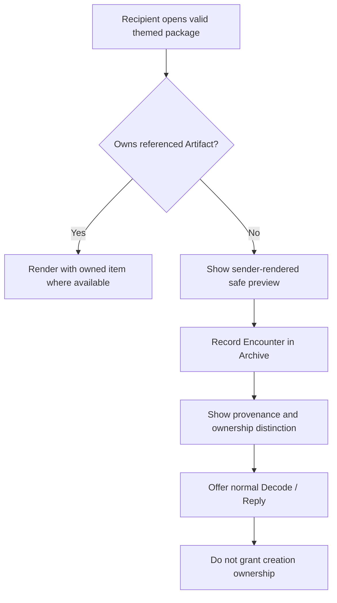

A recipient may earn a separate Echo or Encounter reward through a defined rule, but the original rare item remains with its owner.

## 15.8 Founding Fifty / First Sparks concept

The planned Founding Fifty collection remains strategically sound but is not released until an authoritative ledger exists.

Planned properties:

- Fixed edition size: 50.
- Serial numbers: 01/50 through 50/50.
- Non-transferable in the initial policy.
- Never reissued under the same identifier.
- Individually verifiable provenance.
- Optional visual variation per serial.
- Historical association with the opening Rune Scribe campaign.

### Game Center treatment

The numbered First Sparks must not be a required Game Center Achievement. A broadly attainable participation Achievement may be mirrored to Game Center, while the numbered collectible remains Rune Scribe-native.

## 15.9 No false scarcity

Without an authoritative Forge Ledger:

- A client-only item may be called Rare because of difficulty or discovery.
- A time-bounded local item may be called Seasonal only when the app can enforce and preserve the grant policy honestly.
- It may not be marketed as “one of 50 worldwide” or “1 of 1.”

## 15.10 No trading in the initial system

Owned collectibles are account/device-progression rights, not tradable property. The initial system excludes transfer because transfer would introduce:

- Account and ownership disputes.
- Fraud and theft support.
- Gray-market sales.
- Speculative behavior.
- More complex App Store and financial-policy considerations.
- Pressure to identify users and maintain a larger backend.

---

# 16. Sharing and Themed Presentation

## 16.1 Transport and presentation are separate

A themed message has two layers:

1. **Transport:** the versioned Rune Scribe payload that carries the encrypted envelope and, when required, the first-delivery cipher.
2. **Presentation:** the Codex, Script, Relic, Seal, Frame, Effect, and static preview metadata.

The cryptographic payload remains authoritative. A PNG or JPEG alone is not treated as the secure message transport or as a reliable tappable deep link.

## 16.2 Initial sharing architecture

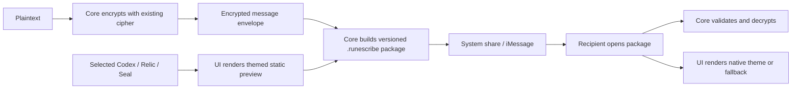

## 16.3 Presentation metadata

A future version of the message package should be able to carry non-secret presentation metadata such as:

- Codex ID and version.
- Script ID.
- Relic ID.
- Seal ID or None.
- Frame ID or None.
- Effect ID or None.
- Share-layout version.
- Safe static preview image or preview reference.
- Optional signed provenance token for a rare item.

This metadata must not contain plaintext, cipher keys, contact identity, or Game Center identity.

## 16.4 Backward compatibility

- Existing packages without presentation metadata render through `[CODEX-BASE]`.
- Unknown newer IDs use the embedded safe preview and Base Codex decode UI.
- Unknown optional fields are ignored according to version policy.
- Unsupported required transport versions produce the existing update-required error rather than a crash.
- Existing Cipher and Message payload tests remain and gain new version fixtures.

## 16.5 Quick Share flow

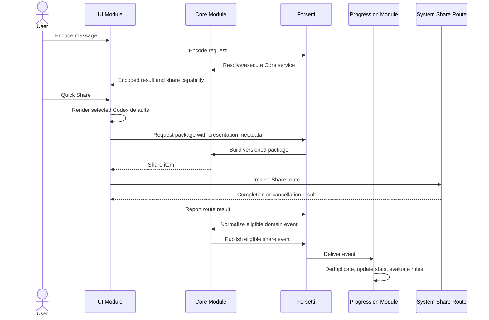

## 16.6 Customize Share flow

1. User selects Customize Share.
2. UI requests the owned/available Codex and Artifact snapshot.
3. UI opens the Share Builder with current defaults.
4. User selects an owned Codex.
5. User selects a compatible Relic.
6. User optionally selects a compatible Seal, Frame, or Effect.
7. UI renders a preview.
8. UI displays key-delivery state separately.
9. User shares.
10. Core emits one eligible event only after the route's completion semantics are met.

## 16.7 Receive flow with a locked or unavailable Codex

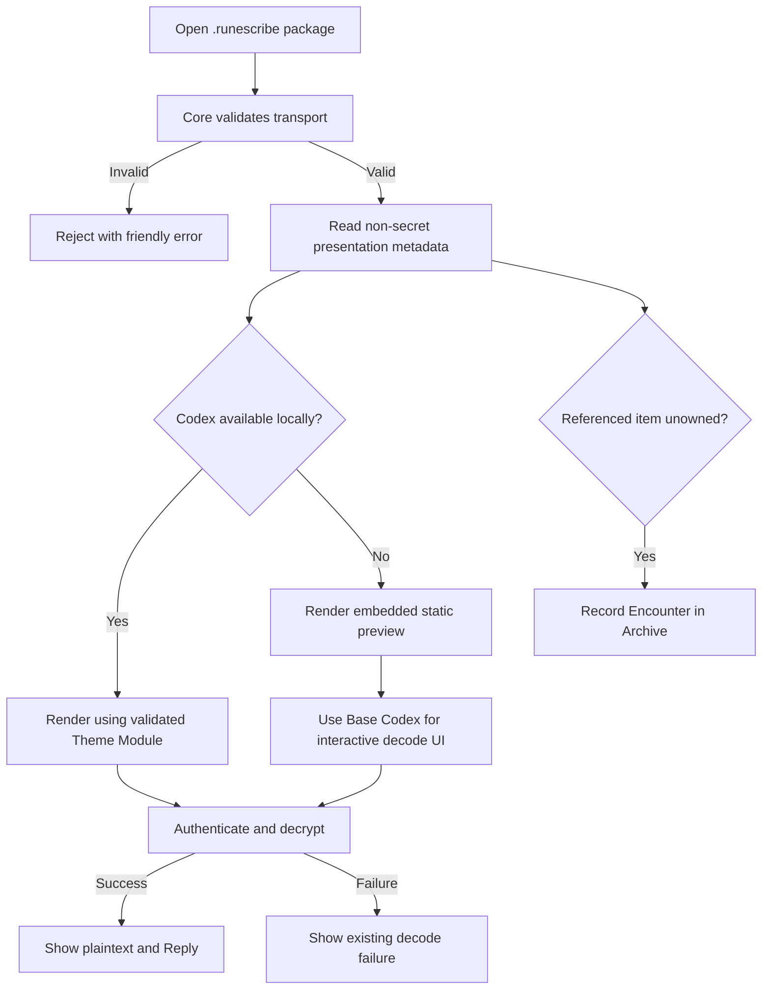

## 16.8 Acquisition fallback

A first-delivery share may continue to include a product-discovery route for recipients without Rune Scribe. Presentation should minimize the appearance of a raw technical URL when supported by the destination application, while retaining a reliable path to the product page.

The product may later add:

- Rich link presentation.
- Universal Link fallback.
- Quick Look thumbnail rendering for `.runescribe` files.
- A dedicated iMessage extension.

Those are separate implementation phases. They do not change the rule that an ordinary image alone is not the canonical tappable transport.

## 16.9 Security communication

The Share Builder must continue to disclose whether the cipher key is included. Themed art must not make the user forget that a first-delivery `.runescribe` package contains the shared secret.

Approved language remains conceptually equivalent to:

- **Key included** — first delivery to this linked relationship.
- **Uses your shared key** — recipient should already hold the cipher.

---

# 17. iCloud-Backed Progression and Security

## 17.1 Storage principle

Progression is local-first. The app records and grants progress without waiting for a network connection or iCloud response.

A private iCloud-backed store provides:

- Backup.
- Cross-device access for devices using the same iCloud account.
- Recovery after reinstall when Apple platform conditions permit.
- Merge of achievements, unlocks, ownership, encounters, and statistics.

## 17.2 Separation from cryptographic storage

The Progression store is separate from:

- Cipher Library storage.
- Cipher key material.
- Contact storage.
- Message plaintext.
- App-lock PIN derivation.

Enabling progression synchronization does not move ciphers or private message contents into the progression database.

## 17.3 Progression data model

| Record class | Merge behavior |
|---|---|
| Achievement completion | Set union; earliest valid completion time retained |
| Unlock grant | Set union; earliest valid grant time retained; signed provenance preserved |
| Owned item | Set union |
| Encounter | Set union; earliest first-seen and latest last-seen retained |
| Per-device counter shard | Maximum value per device shard; global count is sum of shard maxima |
| Distinct-token set | Set union of privacy-safe tokens, with retention limits where appropriate |
| Selected Codex | Last valid write wins by logical timestamp; fallback if no longer available |
| Selected Title | Last valid write wins if still owned |
| Pending Game Center report | Set/maximum union by Achievement ID |
| Catalog version | Highest supported migrated version |

Per-device counter shards avoid lost increments when two offline devices independently add progress.

## 17.4 iCloud flow

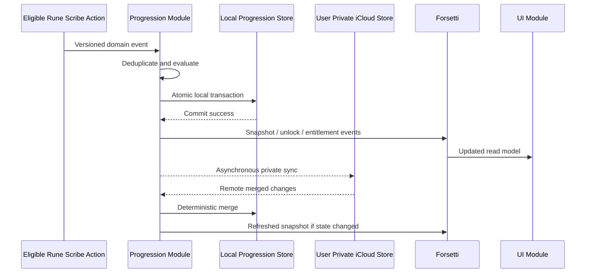

## 17.5 Security and privacy controls

The Progression Module should use:

- Platform data protection for local files.
- A private CloudKit database or an Apple-supported private-store mirroring mechanism.
- A Keychain-held local integrity key for tamper-evident records where appropriate.
- Pseudonymous local tokens instead of raw identities.
- Minimal event retention after aggregation.
- No analytics upload as a prerequisite for progression.
- Explicit schema migration and corruption recovery.

### Honest security boundary

Client-only anti-tamper controls cannot guarantee absolute protection on a compromised macOS or jailbroken iOS device. They protect ordinary local integrity and accidental corruption. Globally scarce items require server-signed authority.

## 17.6 iCloud unavailable behavior

- Rune Scribe progression continues locally.
- Unlocks earned locally remain usable on that device.
- UI reports that iCloud backup/sync is unavailable without blocking use.
- When iCloud returns, deterministic merge occurs.
- A failed sync never revokes locally earned ordinary content.

## 17.7 Reset behavior

A future Reset Progress action must be deliberately designed because cloud union semantics can restore deleted grants. The initial release should either omit global reset or implement a versioned reset generation/tombstone that is synchronized across devices.

A reset must never delete ciphers or contacts unless the user separately performs the existing data-deletion action.

---

# 18. Game Center Integration Plan

## 18.1 Role of Game Center

> **Game Center is the trophy case. Rune Scribe is the Vault.**

Game Center provides public achievement visibility and Apple-platform social context. Rune Scribe retains ownership, unlock, provenance, Archive, and detailed progression truth.

## 18.2 Authentication flow

- Do not force Game Center authentication before first use.
- Offer connection in Settings and at a contextually appropriate Achievements entry point.
- Use Apple's authentication UI when required.
- Explain that local Achievements continue without Game Center.
- Never expose a Game Center player identifier in a shared message or collectible.

## 18.3 Reporting flow

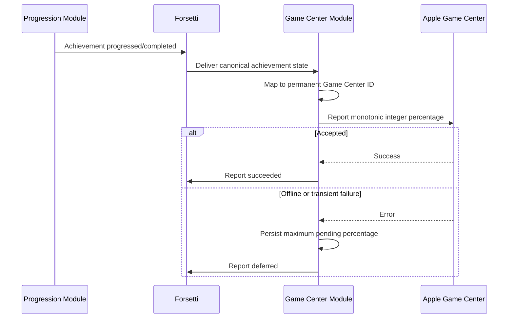

## 18.4 Reporting rules

- Report only the highest known percentage.
- Never report a lower percentage.
- Completion in Rune Scribe is not rolled back after a Game Center failure.
- Retry reports after authentication or connectivity returns.
- Reconcile local completion to Game Center after a user connects for the first time.
- Do not import Game Center completion as sufficient proof of an item grant unless a future migration policy explicitly validates the mapping. The initial direction is one-way: Rune Scribe to Game Center.

## 18.5 Initial Game Center scope

Apple currently permits up to 100 Achievements per app, with a maximum of 100 points for an individual Achievement and 1,000 points total for an app's Achievements. Hidden and repeatable status are available, and released identifiers/point values require careful planning. Rune Scribe will deliberately reserve most of that budget for future evergreen content.

- Up to the 15 evergreen Achievements listed in this document.
- 220 points total initially.
- Hidden status only where the product experience benefits.
- No leaderboards in the first Codex System release.
- No leaderboard based on messages sent, contacts reached, or shares completed.
- No permanently unattainable Founding Fifty Achievement.

## 18.6 macOS and iOS grouping

If the macOS and iOS editions use separate App Store records, they should be evaluated for a Game Center group so the same Achievement catalog and progress can be shared across both platform editions.

## 18.7 Future Game Center opportunities

After the core system is stable, suitable future uses include:

- Official weekly cipher challenges.
- Time-limited friend challenges.
- ARG chapter completion.
- Puzzle completion with limited hints.
- Season activity deep links.

Unsuitable uses include raw message-volume competition or public rankings based on how many people a user contacts.

---

# 19. Forsetti Entitlement and Theme Activation Flow

## 19.1 Boot and discovery

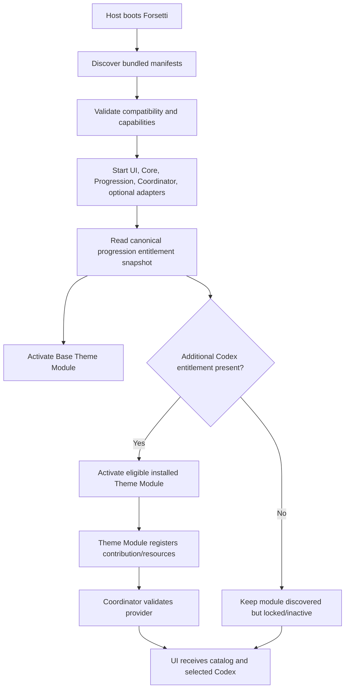

## 19.2 Unlock and activation

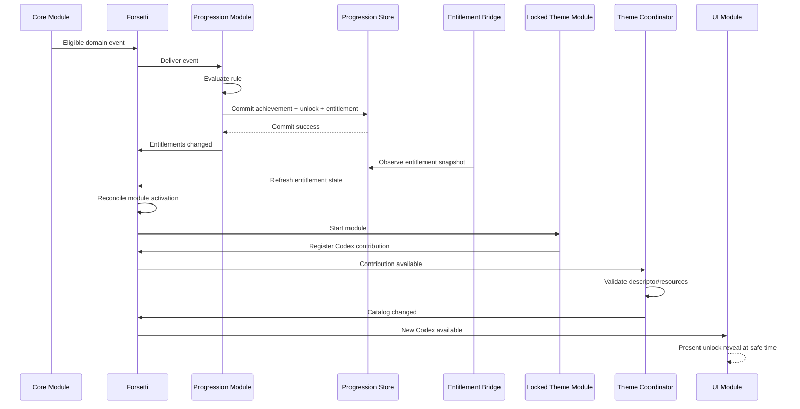

## 19.3 Theme selection

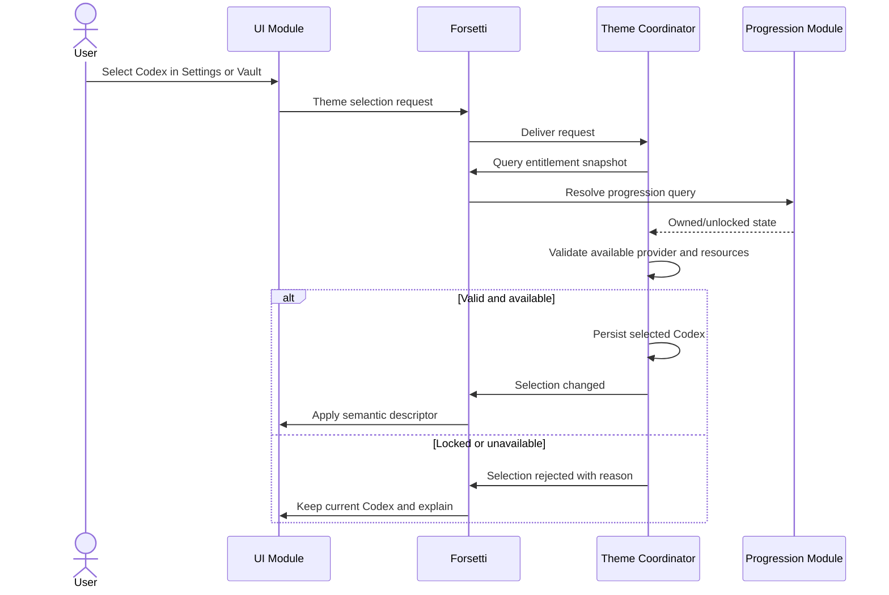

---

# 20. Product User Flows

## 20.1 Existing user after update

1. App starts through the new Forsetti host.
2. Existing cipher and contact data load through Core without wire migration unless required.
3. Progression store initializes once.
4. `[CODEX-BASE]` and included Artifacts are granted.
5. Current appearance is preserved as closely as practical.
6. A concise “Vault and Codices are now available” introduction appears after app lock and other critical inbound work.
7. Game Center and iCloud status are optional follow-up choices, not blocking onboarding.

## 20.2 New user first session

1. Existing splash and app-lock choices remain.
2. User reaches the Scribe workspace.
3. Base Codex is selected.
4. User creates/selects a cipher and encodes normally.
5. After first encode, First Inscription completes and the included reward reveal teaches the Vault concept.
6. Quick Share remains the simplest next action.
7. Customize Share is introduced contextually rather than through a long tutorial.

## 20.3 Unlocking the next Codex through social use

1. User links ciphers to local relationships.
2. Five distinct first-delivery transitions complete over time.
3. Progression completes **Known in Five Circles**.
4. `[CODEX-02]` entitlement is granted.
5. Forsetti activates the already-installed Theme Module.
6. Theme Coordinator validates it.
7. UI reveals the new Codex.
8. User may select it now or later.
9. The Achievement is queued/reported to Game Center when available.

## 20.4 Receiving a rare Relic

1. User opens a valid incoming `.runescribe` package.
2. Core validates and imports/decrypts normally.
3. UI displays the sender-rendered safe preview or native rendering.
4. Progression checks ownership.
5. If unowned, it records an Encounter.
6. UI presents “Encountered” and provenance, not “Unlocked.”
7. User can reply using their own owned presentation.
8. A separate Encounter Achievement may complete if its rule is satisfied.

## 20.5 Offline use

- Encode, decode, Quick Share preparation, local Achievement evaluation, ordinary Unlock grants, Vault access, and selected Codex use continue offline.
- Game Center reports queue.
- iCloud sync waits.
- Globally limited claims may require connectivity and cannot be promised until confirmed by the Forge Ledger.

## 20.6 Theme module failure

1. Forsetti or Theme Coordinator detects incompatibility or missing resources.
2. The module is marked unavailable.
3. If it was selected, selection falls back to `[CODEX-BASE]`.
4. Ownership is preserved.
5. The UI gives a concise availability message and logs diagnostic detail privately.
6. Incoming messages referencing the Codex still decode through static preview/Base fallback.

---

# 21. Forge Ledger Planning for True Scarcity

## 21.1 Why it is required

A local app and Game Center cannot atomically guarantee that exactly 50 or exactly 1 copies of an item exist globally. iCloud private databases are isolated per user and are not by themselves a global issuance authority.

## 21.2 Minimum ledger responsibilities

The future Forge Ledger must:

- Enforce global edition size.
- Atomically allocate serial numbers.
- Prevent duplicate claims under the chosen eligibility policy.
- Sign grants and provenance.
- Permit offline verification of previously issued items.
- Provide a privacy-light recovery/synchronization path.
- Support support-issued corrective grants with audit history.

## 21.3 Data minimization

The ledger should require only what is needed to enforce issuance, such as:

- Collectible/edition ID.
- Opaque claimant/account token under the selected account model.
- Serial number.
- Issuance time.
- Eligibility proof or campaign token.
- Signed grant and signature version.

It does not need messages, ciphers, keys, contacts, or correspondence history.

## 21.4 Deferred backend choice

The architecture requires an authoritative signed ledger but does not lock the implementation to CloudKit public data, a Raven Forge API, or another backend in this phase. That decision requires a separate threat model, account model, cost review, and operational plan.

---

# 22. Implementation and Release Roadmap

Actual production implementation begins only after this planning specification and any required Forsetti public extensions are accepted.

## Phase 0 — Framework and architecture prerequisites

### Scope

- Approve neutral contracts and ID conventions.
- Add generalized entitlement support to Forsetti.
- Add keyed contribution and opaque resource resolution support.
- Add app-defined capability-scoped service registration if absent.
- Define consumer-repo architecture guardrails.

### Exit criteria

- No Rune Scribe-specific private Forsetti patch.
- Pattern B boot test demonstrates one UI Module and multiple service modules.
- A test service module can earn an entitlement, trigger reconciliation, and register a contribution.
- A UI Module can resolve an opaque resource without importing the contributing module.

## Phase 1 — Modularize Rune Scribe without product redesign

### Scope

- Introduce thin Forsetti host/bootstrap.
- Move current SwiftUI/Metal UI into `RuneScribeUIModule`.
- Move current business/security behavior into `RuneScribeCoreModule`.
- Replace cross-module singleton/NotificationCenter behavior with framework-mediated contracts.
- Preserve current visual experience and payload compatibility.

### Exit criteria

- Existing unit tests pass or are replaced with equivalent module-boundary tests.
- Encode, decode, first delivery, import, app lock, contacts, QR, file open, iMessage, and Share behavior remain correct.
- No runtime module imports another runtime module.
- Framework controls remain invisible to users.

## Phase 2 — Build the Codex scaffold with placeholders

### Scope

- Create Theme Coordinator.
- Create reusable Theme Module template.
- Convert current presentation into `[CODEX-BASE]` placeholder module.
- Add `[CODEX-02]` and `[CODEX-03]` placeholder modules with test resources.
- Add selected-Codex Settings and fallback behavior.
- Validate Script, resource, share-layout, and accessibility contracts.

### Exit criteria

- Three placeholder providers conform to the same template.
- UI layout remains stable while switching semantic theme data.
- Locked modules cannot be selected.
- Unlocked modules activate through Forsetti.
- Missing and incompatible resources fall back safely.
- No actual future theme identity is required.

## Phase 3 — Progression, Vault, and unlocks

### Scope

- Build Progression Module and local store.
- Implement event outbox/deduplication.
- Implement statistic and rule engine.
- Implement initial Achievement catalog.
- Implement Codex and Artifact grants.
- Add Vault, Archive, Achievements, and Statistics UI.

### Exit criteria

- Progress is derived only from eligible domain events.
- Duplicate events do not double count.
- `[CODEX-02]` unlock flow activates its module.
- Unlocks survive relaunch.
- Existing users receive deterministic migration grants.

## Phase 4 — Themed Share Builder and incoming encounters

### Scope

- Add Share Builder.
- Add Relic/Seal selection and preview.
- Version presentation metadata in `.runescribe` packages.
- Add static preview fallback.
- Add Encounter recording and provenance UI.
- Preserve older package decoding.

### Exit criteria

- Quick Share remains one-action after encode.
- Customized shares render consistently on iOS and macOS.
- Locked/unavailable incoming themes remain readable.
- Rare item Encounter never copies ownership.
- Security/key-included indicator remains explicit.

## Phase 5 — iCloud and Game Center

### Scope

- Add private iCloud-backed Progression synchronization.
- Implement deterministic multi-device merge.
- Add optional Game Center adapter and initial evergreen catalog.
- Configure Game Center group if required by App Store record structure.

### Exit criteria

- Offline grants sync correctly later.
- Concurrent device counters do not lose progress.
- Game Center failure does not affect local ownership.
- Prior local completions report after opt-in.
- iCloud and Game Center opt-out paths preserve full core use.

## Phase 6 — Production theme design and release

### Scope

- Design actual Codices using the approved template.
- Complete cultural, IP, font-rights, accessibility, and performance review.
- Replace placeholder resources without changing scaffold contracts.
- Tune initial unlock thresholds through testing.

### Exit criteria

- Each production theme passes the same conformance suite.
- No theme-specific UI fork is introduced.
- All production copy and assets are localized as required.

## Phase 7 — Seasons and authoritative rarity

### Scope

- Design official Season framework.
- Threat-model and implement Forge Ledger.
- Issue signed provenance.
- Launch Founding Fifty or another true limited series only after audit.

### Exit criteria

- Global edition limits are technically enforced.
- Signed grants verify offline.
- Recovery, support, privacy, and operational runbooks exist.
- No limited-item claim can be duplicated by ordinary client replay.

---

# 23. Acceptance Criteria and Test Matrix

## 23.1 Architecture acceptance

The design fails architecture acceptance if any of the following is true:

- More than one user-facing UI Module is used under Pattern B.
- A Theme Module imports or calls the UI Module.
- The UI Module imports a concrete Theme Module.
- Progression rules live inside Theme Modules.
- Cross-module state relies on shared singletons or NotificationCenter.
- Theme assets are found by guessing bundle paths.
- Rune Scribe modifies Forsetti internals privately rather than using public extension points.
- Game Center becomes the ownership authority.

## 23.2 Functional acceptance

- Existing encode/decode behavior remains correct.
- Current and prior supported `.runescribe` payloads remain readable.
- Theme selection does not alter cipher keys.
- Quick Share is available without opening the Share Builder.
- Locked Codices cannot be selected for creation.
- Incoming messages using locked or missing Codices decode through fallback.
- Unlock grants survive relaunch.
- Duplicate events do not grant duplicate progress.
- Encounter never equals ownership.

## 23.3 Progression acceptance

- Each Statistic has one written eligibility definition.
- Every Achievement traces to one or more versioned domain events.
- Five-circles progress uses distinct local relationship tokens, not claimed App Store conversions.
- UI does not independently calculate Achievement truth.
- Unlock and Achievement transactions are recoverable after interruption.
- Existing-user migration is idempotent.

## 23.4 iCloud acceptance

Test at minimum:

- iPhone offline earn → later iCloud sync → Mac receives grant.
- Mac and iPhone increment the same counter offline → merge retains both increments.
- Same Achievement completes on two devices → one owned grant after merge.
- Selected Codex changes on two devices → deterministic winner and valid fallback.
- iCloud unavailable → local progression continues.
- Corrupt remote record → quarantine/fallback without deleting local Vault.

## 23.5 Game Center acceptance

- User declines authentication → local Achievements function.
- User connects after completing Achievements → maximum progress reports.
- Network failure → report queues.
- Repeated callback → no duplicate local reward.
- Game Center contains no limited-edition completion requirement.
- macOS/iOS progress behavior matches the selected App Store grouping strategy.

## 23.6 Theme conformance acceptance

Every Theme Module must pass:

- Manifest validation.
- Entitlement lock/unlock activation test.
- Unique ID test.
- Required-resource/hash test.
- 32-symbol Script test.
- Static fallback test.
- Light/dark/contrast test as applicable.
- Dynamic Type test.
- VoiceOver labeling test.
- Reduce Motion test.
- Share safe-area and crop test.
- iPhone and Mac snapshot test.
- Missing-resource failure test.
- Unknown-newer-version fallback test.

## 23.7 Platform interaction matrix

| Scenario | iOS | macOS |
|---|---|---|
| Main encode/decode | Required | Required |
| System Share | Required | Required |
| Dedicated MessageUI send | Required where supported | Not applicable; use system Share |
| Open `.runescribe` attachment | Required | Required |
| QR scan | Required where currently supported | Existing alternate import route |
| Theme selection | Required | Required |
| Vault/Achievements | Required | Required |
| Game Center | Required when enabled | Required when enabled |
| iCloud progression merge | Required | Required |
| Keyboard navigation | External keyboard coverage | Full required |
| Pointer/hover | iPad where relevant | Required |

## 23.8 App Review and distribution acceptance

- All executable Theme Modules are included in the signed app bundle.
- No downloaded executable code changes the app's features.
- Unlock copy rewards in-app behavior, not App Store reviews or required purchases by friends.
- Random paid rewards are absent.
- Privacy disclosures accurately describe iCloud and Game Center use.
- Theme content has documented rights and cultural review.

---

# 24. Risk Register

| Risk | Consequence | Mitigation |
|---|---|---|
| Treating Theme Modules as UI Modules | Violates Pattern B and creates competing roots | One UI Module; Theme Modules supply data/resources only |
| Purchase-only Forsetti entitlement model | Earned themes cannot activate cleanly | Add generalized public entitlement contract and composite provider |
| Multiple theme contributions conflict | Wrong theme appears or “last wins” behavior | Theme Coordinator owns explicit selected Codex; do not rely on unordered UI theme merging |
| Direct module-bundle access | Hidden coupling and brittle resources | Opaque Forsetti resource resolver |
| Share completion mistaken for confirmed recipient | Misleading Achievements and easy abuse | Distinguish eligible share from distinct linked first delivery; never claim purchase/install |
| Custom Script does not survive plain text | Recipient sees boxes or cannot copy glyphs | Canonical package plus static preview; portability class and fallback |
| Theme art obscures key-delivery warning | Security misunderstanding | Security summary is fixed UI and non-themeable |
| Theme module unavailable after Unlock | User appears to lose content | Preserve ownership; mark unavailable; Base fallback |
| Cloud merge loses counters | Incorrect progress | Per-device counter shards and deterministic merge |
| Client-only rare item is copied | False scarcity | Reserve globally limited claims for signed Forge Ledger grants |
| Achievement catalog consumes Game Center budget | No room for future releases | Start at 220 points and 15 evergreen items; keep seasonal history local |
| Gamification overwhelms utility | Existing users disengage | Main workspace remains default; no persistent XP HUD; Quick Share |
| Progression stores sensitive social data | Privacy erosion | Pseudonymous tokens and strict event payload exclusions |
| Future theme uses protected IP or insensitive historical framing | Legal/reputation risk | Original design, rights review, and cultural review in every theme brief |
| Remote Theme Module delivery violates App Review rules | Rejection | Ship executable modules only with app releases; remote data-only content requires separate review |

---

# 25. Deferred Decisions

The following are intentionally not locked by this specification:

- Final names and identities of production Codices.
- Final visual design of `[CODEX-BASE]`.
- Cultural or fictional inspiration of future Codices.
- Final Artifact names and artwork.
- Exact production animation and sound system.
- Final threshold tuning after usability tests.
- Whether deterministic paid Codices are introduced in a later release.
- Whether a rich Universal Link layer is added.
- Whether a dedicated iMessage extension is added.
- Whether public Game Center Challenges or leaderboards are added later.
- The Forge Ledger backend technology and account model.
- Dates and final mechanics of the first official Season.
- Final Founding Fifty item design.
- App Store category changes related to game features.

These decisions must conform to the architecture and terms established here.

---

# 26. Reusable Planning Templates

## 26.1 New Codex catalog entry

```text
Codex ID:
Theme Module ID:
Display name:
Status: Included / Earned / Seasonal / Event / Future Purchase
Teaser title:
Teaser description:
Requirement visibility: Visible / Partial / Hidden / Secret
Unlock rule ID:
Creation entitlement ID:
Minimum UI contract version:
Primary Script ID:
Default Relic ID:
Included Seal IDs:
Additional Artifact IDs:
Rarity opportunities:
Encounter behavior:
Fallback behavior:
Localization scope:
Accessibility notes:
Rights/cultural review owner:
```

## 26.2 New Achievement entry

```text
Achievement ID:
Display name:
Pre-earned description:
Earned description:
Visibility:
Rule expression:
Source event types:
Deduplication key:
Progress calculation:
Rune Scribe reward IDs:
Game Center mirrored: Yes / No
Game Center ID:
Game Center points:
Repeatable: No unless explicitly justified
Retroactive evaluation policy:
Test cases:
```

## 26.3 New Artifact entry

```text
Artifact ID:
Artifact class: Relic / Seal / Frame / Effect / Script Variant
Codex ID:
Display name:
Description:
Rarity:
Availability:
Unlock or grant rule ID:
Default/included status:
Compatible Relic or anchor classes:
Resource handles:
Static fallback:
Accessibility description:
Provenance origin:
Edition policy:
Reissue policy:
Encounter behavior:
Test cases:
```

## 26.4 New domain event entry

```text
Event type:
Schema version:
Owning publisher:
Exact domain occurrence:
Event ID generation rule:
Correlation ID rule:
Allowed payload fields:
Forbidden payload fields:
Progression eligibility rule:
Deduplication retention:
Replay behavior:
Test fixtures:
```

## 26.5 Forsetti module review checklist

```text
[ ] Correct Forsetti module type
[ ] Manifest and entry point aligned
[ ] No direct runtime-module imports
[ ] Capabilities are least-privilege
[ ] Services resolved through Forsetti context
[ ] Events/messages are versioned and privacy-safe
[ ] Start/stop behavior is idempotent
[ ] Resources use opaque resolver
[ ] Entitlement behavior tested
[ ] Locked, activated, unavailable, and fallback states tested
[ ] Framework controls remain hidden in production
```

---

# 27. Reference Evidence

## 27.1 Rune Scribe source evidence

The current source establishes the baseline used here:

- `README.md` documents the existing encrypted-message pipeline, offline sharing, current SwiftUI/Metal architecture, first-delivery package, and privacy boundaries.
- `RuneScrib/Models/Cipher.swift` separates key material, the 32-value decorative mapping, and `FontRef`.
- `CipherSharePayload.swift` and `MessageSharePayload.swift` provide tested versioned transport formats.
- `RuneScrib/Views/Components/RuneTheme.swift` already acts as a shared UI design system and is the natural seed of the Pattern B UI scaffold.
- `RuneScribApp.swift`, `RootView.swift`, `ContentView.swift`, and `SettingsView.swift` identify the current host, routing, primary workspace, and settings behavior that Phase 1 must preserve.

## 27.2 Planning evidence

The attached planning materials establish:

- Rune Scribe's positioning as a digital decoder ring that sells creative possibility rather than only technical security.
- ARG, community, secret-club, geocaching, and recurring-story opportunities.
- The product flywheel for Codices, Relics, Seals, sharing, discovery, and unlocks.
- Game Center as the trophy case and Rune Scribe as the Vault.
- Rare, seasonal, limited, singular, and Encounter concepts.

## 27.3 External platform evidence

The official Forsetti documentation establishes Pattern B's single-UI-module rule, public-contract boundaries, manifest/activation model, framework-mediated services/events/messages, and entitlement reconciliation.

Apple's official documentation establishes current Game Center Achievement limits and grouping support, private iCloud/Core Data synchronization capabilities, and the requirement that executable feature modules remain self-contained in the signed app rather than being downloaded as new executable functionality.

---

# 28. Final Locked Product Model

Rune Scribe's final planning model is:

```text
Cipher
└── Protects and authenticates the message

Codex
├── Supplies the visual world
├── Contains one Script
└── Contains collectible Artifacts
    ├── Relics
    ├── Seals
    ├── Frames
    └── Effects

Progression Module
├── Observes eligible domain events through Forsetti
├── Maintains statistics and achievements
├── Grants Codices, Artifacts, and Titles
├── Publishes earned entitlement changes
└── Synchronizes private progression through iCloud

Forsetti Runtime
├── Validates and activates entitled modules
├── Mediates all module communication
└── Keeps framework mechanics invisible to the user

UI Module
├── Owns the stable application scaffold
├── Renders the selected Codex
├── Presents Vault, Achievements, Share Builder, and Settings
└── Guarantees accessibility and fallback behavior

Theme Modules
├── One module per Codex
├── Supply conforming descriptors and resources
└── Never own application navigation or unlock rules

Game Center
└── Mirrors selected accomplishments; never owns Rune Scribe rewards
```

The resulting product remains recognizable as Rune Scribe while becoming extensible, collectible, socially discoverable, and capable of supporting future official stories and rare historical items.

The decisive product distinction is:

> **Achievements describe what the user accomplished. Collectibles prove where the user was. Codices determine how the secret appears. The cipher remains what protects it.**
